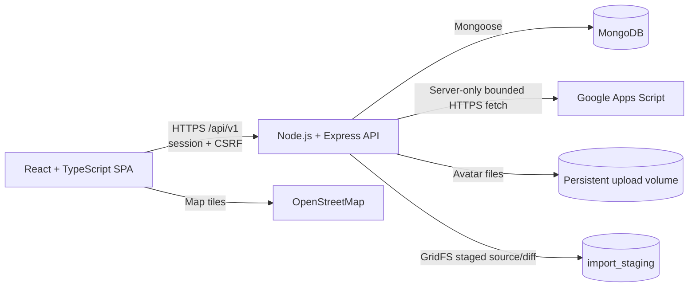

# SIGAP ULP Labuhan

SIGAP ULP Labuhan is a web application for transformer asset management, Leaflet/OpenStreetMap visualization, electrical load analysis, customer master data, guest records, controlled imports/exports, and backend-only Google guest synchronization.

> **Release status: NO-GO.** The repository implementation and evidence do not constitute production approval. Production-target migration rehearsal/approval and the seven unresolved HTML-name aliases remain mandatory blockers. The real Google Apps Script contract, production topology/configuration, backup/restore rehearsal, and production image scan/publication/deployment gates also remain open.

## Architecture



- **Frontend:** React 19, Vite 8, TypeScript 7, Tailwind CSS 4, Leaflet/OpenStreetMap
- **Backend:** Node.js `>=22.13.0`, CommonJS, Express 5, Mongoose 9, AJV
- **Database:** MongoDB with server-side opaque sessions, GeoJSON transformer locations, unique canonical keys, and TTL import/session records
- **Deployment:** Docker Compose topology with persistent MongoDB/upload volumes and an Nginx-served frontend

The Google endpoint, MongoDB URI, raw session token, and server secrets are not exposed to the browser.

## Source-of-truth rules

The supplied `.temp/sigap/` directory is protected, read-only ground truth:

- The transformer CSV is canonical for **1,238 transformer masters**.
- The customer CSV is canonical for **68,742 customers** and is CP1252-compatible; the XLSX is an equivalent row-for-row cross-check.
- The static HTML is the UI reference and contains **53 transformer names with 106 period objects**.
- **46 names reconcile to 92 eligible period records.** The other **7 names produce 14 unresolved period records** and require an explicit operator alias; they are never guessed.
- Missing values and measurement dates remain null; migrations never fabricate them.

See the [Phase 0 audit](docs/audit/phase-0-audit.md) for the historical baseline, the [implemented schema](docs/database/schema.md) for the canonical data contract, and the [migration guide](docs/database/migration.md) for reconciliation and rollback rules.

## Canonical API and identity rules

- Success bodies use `{data: ...}`; lists use top-level `meta`; transformer/anomaly lists also use top-level `counts`; errors use `{error: {code, message, details?}}`.
- Every response includes `X-Request-ID`.
- Sessions use an opaque 32-byte token stored as an HMAC-SHA-256 hash keyed by `SESSION_SECRET`; unsafe methods also require an independent session-bound CSRF token and an allowed `Origin`.
- Transformer display names are trim + Unicode NFC; `nameKey` is NFC + trim + lowercase and uniquely indexed.
- Transformer identity migration uses `npm run migrate:transformer-name-keys` (dry-run by default; `--apply` and `--report` supported).
- Startup fails closed with `TRANSFORMER_NAME_KEY_BACKFILL_REQUIRED` for missing/mismatched keys and `TRANSFORMER_IDENTITY_DUPLICATE_KEYS` for duplicate canonical keys.

The exact endpoint contract is in [docs/api/overview.md](docs/api/overview.md).

## Local prerequisites

- Node.js `22.13.0` or a compatible newer supported runtime
- npm 10+
- A MongoDB instance compatible with the repository's Mongoose version (the production support matrix remains a release decision)
- Optional Python 3 with Pillow only when regenerating image assets

```bash
npm ci
npm --prefix frontend ci
cp .env.example .env
```

Replace every placeholder secret in `.env`. Never commit `.env` or supplied source data.

## Commands

```bash
npm run dev                       # API and frontend development servers
npm run build                     # Production frontend build
npm run typecheck                 # Frontend TypeScript check
npm test                          # Backend unit/integration/script suites
npm --prefix frontend test        # Frontend unit/component suite
npm run lint                      # Backend/test/script ESLint
npm run lint:contracts            # API route/client inventory gate
npm run lint:security             # Security exception registry gate
npm run lint:licenses             # Installed dependency license gate
npm run verify:ground-truth       # Protected source inventory/hash gate
npm run test:e2e                  # Playwright end-to-end suite
npm run test:visual               # Playwright visual suite
```

Migration commands default to dry run and require explicit `--apply` for database writes:

```bash
npm run migrate:trafo
npm run migrate:customers
npm run migrate:measurements
npm run migrate:all
npm run migrate:transformer-name-keys
```

Initial administrator provisioning is CLI-only and requires explicit `INITIAL_ADMIN_ID` and `INITIAL_ADMIN_PASSWORD`; there is no usable default password.

## Containers

```bash
cp .env.example .env
# Set strong unique secrets, MONGO_ROOT_PASSWORD, and COMPOSE_MONGODB_URI
# with URL-encoded credentials before starting Compose.
docker compose up --build -d
docker compose ps
```

The intended Compose topology exposes the web application on `http://localhost:8080` and keeps MongoDB/API on the internal network. Persistent named volumes retain database and avatar data.

The disposable local Compose image build and runtime health check passed on the current tree. MongoDB, backend, and frontend containers all reported healthy; frontend `/healthz` returned `200 ok`, and backend `/api/ready` returned `200` with `status: "ok"` and `database: "connected"`. Trivy (pinned `0.58.1` digest) reported 0 HIGH and 0 CRITICAL findings for the filesystem and for both rebuilt application images. This is local repository evidence only, not production image publication, deployment, or external-operation evidence.

## 27 November 2026 evidence

- Aggregate root suite: **272/272 passed across 31 files** in the final stable sequential rerun (54 unit, 119 integration, 99 script tests).
- The isolated release-control script suite passed **99/99**; the earlier supplied checkpoint recorded 54/54.
- Frontend: **39/39 passed**; typecheck and production build passed.
- API contract: **37 documented / 37 implemented**; security/license/action-pin/ground-truth gates passed.
- Playwright E2E/visual: **4/4 passed** on desktop/mobile Chromium using isolated MongoMemoryServer database `sigap_ulp_labuhan_e2e`.
- Docker: the disposable backend/frontend **image build and Compose runtime health passed** on the current tree; all three containers reported healthy and the frontend/backend health endpoints returned `200`.
- Container/dependency scans: Trivy filesystem and both application images reported **0 HIGH / 0 CRITICAL**; Gitleaks reported no leaks in the commit history or the working tree.
- Workflow and script checks: actionlint, `bash -n` over all shell scripts, the action-pin gate, the Mermaid parse of all 68 diagram blocks, and the Markdown link/fence check passed.
- Aggregate migration dry run: 70,033 source records read, 0 invalid, 69,980 planned transformer/customer upserts, 106 period objects, 92 eligible/14 unresolved, 0 CSV/XLSX mismatches, 0 writes.
- Root ESLint: **passed** on the final tree. See the [testing strategy](docs/testing/strategy.md) for the exact evidence boundary.

## Documentation

- [Documentation index](docs/README.md)
- [Requirements](docs/requirements/overview.md)
- [Implemented architecture](docs/architecture/overview.md)
- [API contract](docs/api/overview.md)
- [Implemented database schema](docs/database/schema.md)
- [Migration strategy](docs/database/migration.md)
- [Testing strategy](docs/testing/strategy.md)
- [Architecture decisions](docs/decisions/README.md)
