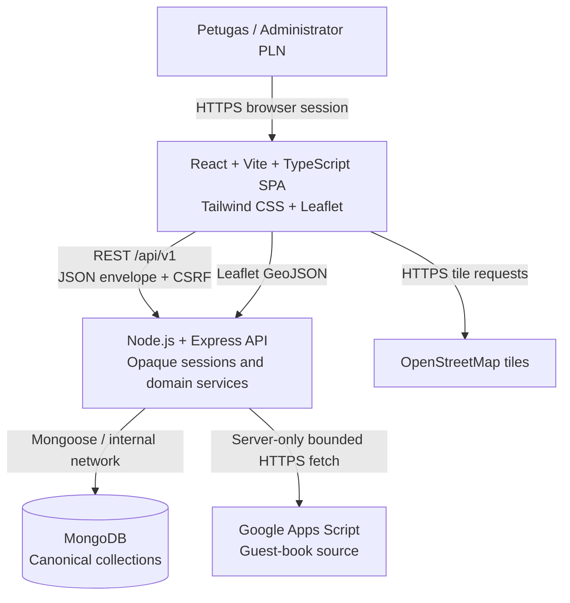

# SIGAP ULP Labuhan Documentation

Sistem Informasi Geografis & Analisis Pembebanan Trafo — PT PLN (Persero) ULP Labuhan.

This index describes the implemented repository contract as reconciled on 27 November 2026. It distinguishes repository implementation and isolated evidence from unresolved production gates.

> **Release status: NO-GO.** Production-target migration rehearsal/approval and the seven unresolved HTML-name aliases remain mandatory blockers. External Google synchronization, production topology/configuration, a production-approved backup/restore rehearsal, and production image scan/publication/deployment gates are also open.

## 1. Primary navigation

| Area | Document | Contract |
|---|---|---|
| Historical baseline | [Phase 0 audit](audit/phase-0-audit.md) | Source inventory/profile, pre-implementation findings, and original blockers |
| Implementation/release | [Implementation and release plan](implementation-plan.md) | Phase status, migration, test/evidence matrix, deployment/rollback, unresolved decisions, NO-GO gate |
| API | [REST API contract](api/overview.md) | Envelopes, request IDs, auth/CSRF, all endpoints, import/export, error codes |
| Database | [Implemented schema](database/schema.md) | Mongoose fields, nullability, indexes, identity, TTL, provenance |
| Migration | [Migration strategy](database/migration.md) | Encoding-aware dry run, exact source counts, identity/alias rules, rollback |

## 2. Requirements

| Document | Contents |
|---|---|
| [Requirements overview](requirements/overview.md) | Business problem, users, source authority, release boundary |
| [Functional requirements](requirements/functional-requirements.md) | Implemented FR-01 through FR-08 across auth, dashboard, transformer/measurement, customer/guest, import/export, migration, auditability |
| [Non-functional requirements](requirements/non-functional-requirements.md) | Performance targets, security/integrity controls, privacy, usability, maintainability |
| [Canonical data dictionary](requirements/data-dictionary.md) | Source-to-storage/API mapping, exact identity/provenance fields, null rules |

## 3. Architecture

| Document | Contents |
|---|---|
| [Architecture overview](architecture/overview.md) | Trust boundaries, system context, component/data flows, quality attributes, blockers |
| [Backend architecture](architecture/backend.md) | CommonJS layering, request lifecycle, opaque session/CSRF, validation, identity gate, import |
| [Frontend architecture](architecture/frontend.md) | API-driven components, CSRF client flow, period/anomaly behavior, GeoJSON, forms |
| [Database architecture](architecture/database.md) | MongoDB collections, consistency/read-write patterns, session/TTL, identity, migration boundary |
| [External integrations](architecture/integrations.md) | Server-only Google synchronization, strict validation, fingerprinting, OSM |
| [Deployment and CI](architecture/deployment.md) | Docker/VPS/CI artifacts and operational gates; disposable local image build/runtime health passed |

## 4. Development and testing

| Document | Contents |
|---|---|
| [Development setup](development/setup.md) | Local setup and configuration reference |
| [Testing strategy](testing/strategy.md) | Test layers, exact current counts, migration evidence, failures/skips, release evidence boundary |

## 5. Architecture Decision Records

| ADR | Decision |
|---|---|
| [ADR-0001](decisions/ADR-0001-react-vite-frontend.md) | React/Vite/TypeScript/Tailwind frontend |
| [ADR-0002](decisions/ADR-0002-modular-backend-express-mongoose.md) | Modular Express/Mongoose backend |
| [ADR-0003](decisions/ADR-0003-mongodb-data-modeling.md) | Data authority, canonicalization, MongoDB modeling |
| [ADR-0004](decisions/ADR-0004-leaflet-openstreetmap-migration.md) | Leaflet/OpenStreetMap with canonical GeoJSON |
| [ADR-0005](decisions/ADR-0005-secure-cookie-session-auth.md) | Revocable opaque sessions and session-bound CSRF |
| [ADR-0006](decisions/ADR-0006-import-preview-and-upsert.md) | Persisted import preview and validated upsert |
| [ADR-0007](decisions/ADR-0007-google-form-sync-integration.md) | Server-only Google guest sync with fingerprint idempotency |
| [ADR-0008](decisions/ADR-0008-docker-compose-vps-deployment.md) | Docker-host VPS deployment and CI/CD gates |

See the [ADR index](decisions/README.md) for lifecycle meaning.

## 6. System context

## 7. Ground truth and current status

- `.temp/sigap/` is read-only ground truth and is not changed by the application, migration, tests, or deployment.
- Transformer CSV: **1,238 canonical records**.
- Customer CSV: **68,742 canonical records** with CP1252 support; XLSX is the equivalent representation for row-for-row cross-check.
- HTML: **53 transformer names / 106 period objects**.
- Reconciliation: **46 names / 92 eligible period records** and **7 names / 14 unresolved period records** pending explicit aliases.
- Missing source values/dates remain null; no value, date, alias, or credential default may be fabricated.
- Transformer identity: display name trim + NFC; `nameKey` NFC + trim + Unicode full case folding; exact CLI `npm run migrate:transformer-name-keys`; errors `TRANSFORMER_NAME_KEY_BACKFILL_REQUIRED` and `TRANSFORMER_IDENTITY_DUPLICATE_KEYS`.
- The current evidence record and the local Docker runtime result are explicit in the [testing strategy](testing/strategy.md); the production decision remains **NO-GO**.
