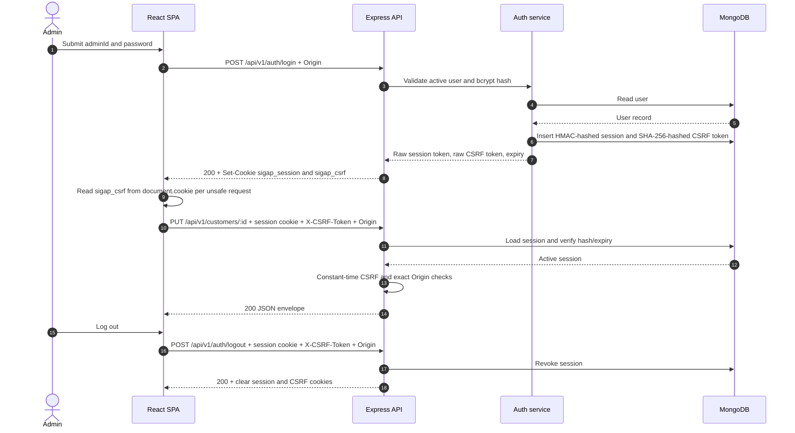
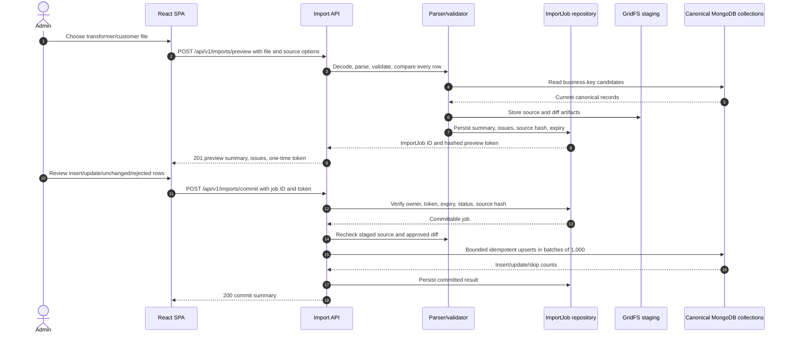

# REST API Contract — SIGAP ULP Labuhan

**Contract status:** Implemented API contract, reconciled with the backend routes and the frontend client on 27 November 2026. It describes repository behavior; it does not assert production approval or successful external operations.  
**Related records:** [implementation plan](../implementation-plan.md), [canonical schema](../database/schema.md), [Phase 0 audit](../audit/phase-0-audit.md), [ADR-0005](../decisions/ADR-0005-secure-cookie-session-auth.md), [ADR-0006](../decisions/ADR-0006-import-preview-and-upsert.md).

## 1. Transport and versioning

| Property | Contract |
|---|---|
| Base path | `/api/v1` |
| Request/response media type | `application/json; charset=utf-8`, except multipart upload, avatar download, and file export endpoints |
| Public API version | `1`; an incompatible change requires a new base path |
| Resource IDs | MongoDB ObjectId strings encoded as 24 lowercase hexadecimal characters |
| Dates and times | Server timestamps use ISO 8601 UTC. A source/operator measurement date is `YYYY-MM-DD`; a source/operator measurement time is `HH:mm`. A missing source date/time is JSON `null`. |
| Nullable fields | Explicitly `null`; absence is not used to imply a default |
| Request ID | Every response has `X-Request-ID`. A valid inbound ID matching `[A-Za-z0-9._:-]{1,128}` is reused; otherwise the server generates a UUID. |
| Character set | UTF-8 JSON. Customer CSV import also supports the canonical CP1252 source encoding. |

Unless an endpoint says otherwise, requests use the exact field names and enum values in this document. Unknown JSON request fields are rejected with `422 UNEXPECTED_FIELD` rather than silently ignored.

Operational liveness and readiness endpoints exist outside the versioned business API. They are not part of the `/api/v1` business contract.

## 2. Response envelopes

### 2.1 Single-resource success

```json
{
  "data": {
    "id": "66b000000000000000000001"
  }
}
```

`data` may be an object, array, primitive, or `null`. Every JSON success response uses HTTP `200` unless this contract explicitly names `201`.

### 2.2 Paginated success

```json
{
  "data": [],
  "meta": {
    "page": 1,
    "pageSize": 20,
    "total": 1238,
    "totalPages": 62
  }
}
```

`meta.total` is the count after active filters and before pagination. `meta.totalPages` is `ceil(total / pageSize)` and is `0` when `total` is `0`. A page beyond the last page returns an empty `data` array with the same metadata; it does not return `404`.

Transformer and anomaly lists additionally have a top-level `counts` object. It is not nested under `meta`.

### 2.3 Error

```json
{
  "error": {
    "code": "VALIDATION_ERROR",
    "message": "Permintaan tidak valid.",
    "details": [
      {
        "path": "incoming.r",
        "code": "REQUIRED",
        "message": "incoming.r wajib diisi."
      }
    ]
  }
}
```

`details` is omitted for errors without field-level information. Internal exception messages, stack traces, database errors, secrets, and upstream response bodies are not returned.

### 2.4 File-response exception

Successful CSV/XLSX export responses are files, not JSON envelopes. Avatar download is also a binary response. Their headers are described in Sections 4 and 15.

## 3. HTTP status codes

| Status | Meaning in this API |
|---:|---|
| `200` | Successful read, update, command, or completed import commit |
| `201` | Resource created; an import preview also creates an `ImportJob` and returns `201` |
| `400` | Malformed JSON, multipart structure, identifier, or source syntax that prevents parsing |
| `401` | Missing, invalid, expired, or revoked session; invalid login credentials use `INVALID_CREDENTIALS` |
| `403` | Authenticated but not authorized, CSRF/origin failure, or import job ownership failure |
| `404` | Resource does not exist or is not visible to the caller |
| `405` | Method is not supported for the route |
| `409` | Business-key conflict or import job state/hash/target conflict |
| `410` | Import preview/job has expired |
| `413` | Upload or request body exceeds the configured limit |
| `415` | Unsupported upload media type or export format |
| `422` | Well-formed request fails semantic validation |
| `429` | Login or guest-synchronization rate limit exceeded |
| `500` | Unexpected internal failure; no internal details are exposed |
| `502` | Upstream Google service returned an invalid or unsuccessful response |
| `503` | Required dependency/configuration is unavailable, including an unconfigured Google integration |
| `504` | Upstream Google service timed out |

## 4. Authentication, sessions, CSRF, and CORS

### 4.1 Session model

- Login creates a random 256-bit opaque session token. The raw token is sent only in the `sigap_session` cookie. MongoDB stores its HMAC-SHA-256 hash, keyed by `SESSION_SECRET`; the raw token is not stored.
- The session cookie is `HttpOnly`, `SameSite=Lax`, `Path=/`, and `Secure` in production. The default absolute lifetime is eight hours (`SESSION_TTL_HOURS`, bounded to 1–168 hours).
- `sigap_csrf` contains an independent random 256-bit token generated per session with a cryptographically secure random source. It is not derived from the session token, the user, or a deployment secret. MongoDB stores its SHA-256 hash in the same session record.
- The CSRF cookie is intentionally readable by the same-origin SPA so the client can copy it into a request header. It uses `SameSite=Lax`, `Path=/`, `Secure` in production, and the session lifetime.
- Neither raw token is returned in a JSON body, application log, or error message. Login and `/auth/me` return only the public user and session expiry.
- Logout, password change, account deactivation, or an expired/revoked session invalidates server-side access and clears the auth cookies as applicable. Expiry and revocation are enforced even if cookie deletion has not reached the browser.
- Authentication responses use `Cache-Control: no-store`. The application does not use a stateless JWT as its session authority.

### 4.2 Unsafe-request requirements

`POST`, `PUT`, `PATCH`, and `DELETE` requests other than the initial login request require all of the following:

1. A valid `sigap_session` cookie.
2. An exact allowed `Origin` header. `null`, missing, and unlisted origins are rejected.
3. A readable `sigap_csrf` cookie.
4. `X-CSRF-Token` containing the same value as the CSRF cookie, compared in constant time.
5. A server-side active session whose `csrfTokenHash` matches the SHA-256 hash of that token, compared in constant time.

A missing cookie/header, cookie/header mismatch, foreign-session token, or rejected origin fails closed with `403` and `{ "error": { "code": "CSRF_FAILED", "message": "..." } }`. The client does not automatically retry a rejected unsafe request.

Login requires an allowed `Origin`, but has no pre-session CSRF token. Requests without an `Origin` header are rejected in production; any development exception must be configured locally and cannot exist in production.

### 4.3 CORS

Credentialed CORS is enabled only for configured exact frontend origins (`CLIENT_URL` plus optional `CLIENT_URLS`). Wildcard origins are invalid when credentials are used, and the API does not reflect an arbitrary request origin.

### 4.4 Authentication sequence



### 4.5 Authentication and profile endpoints

| Method | Path | Authentication | Request | Success |
|---|---|---|---|---|
| `POST` | `/auth/login` | Public; allowed `Origin` required | JSON `{ "adminId": string, "password": string }` | `200` user/session data and cookies |
| `GET` | `/auth/me` | Session | None | `200` current user/session expiry |
| `POST` | `/auth/logout` | Session + CSRF + Origin | Empty body | `200` `{ "revoked": true }` and cookie clearing |
| `POST` | `/auth/register-admin` | Session + CSRF + Origin; `superadmin` only | JSON admin fields below | `201` created user without password/hash |
| `PUT` | `/auth/profile` | Session + CSRF + Origin | JSON containing `fullName` and/or `email` | `200` updated user |
| `PUT` | `/auth/profile/username` | Session + CSRF + Origin | JSON `{ "username": string }` | `200` updated user |
| `PUT` | `/auth/profile/password` | Session + CSRF + Origin | JSON `{ "currentPassword": string, "newPassword": string }` | `200` `{ "passwordChanged": true, "reauthenticationRequired": true }`; sessions are revoked and cookies cleared |
| `POST` | `/auth/profile/avatar` | Session + CSRF + Origin | Multipart field `avatar`; JPEG, PNG, or WebP; maximum 2 MiB | `200` updated user and avatar URL |
| `GET` | `/auth/avatar/:userId` | Session; own avatar or `superadmin` | None | `200` image bytes |

`PUT /auth/profile` does not accept `avatar`. Avatar upload has its own multipart endpoint and validates both the declared MIME type and file signature.

Login and `/auth/me` response data:

```json
{
  "user": {
    "id": "66b000000000000000000001",
    "adminId": "admin001",
    "username": "operator",
    "fullName": null,
    "email": null,
    "avatar": "",
    "role": "admin"
  },
  "session": {
    "expiresAt": "2026-11-27T12:00:00.000Z"
  }
}
```

The timestamp illustrates the format only; it is not a configured or asserted session time. The response contains no session or CSRF token.

Admin creation body:

```json
{
  "adminId": "admin002",
  "username": "operator2",
  "password": "operator-supplied-secret",
  "fullName": null,
  "email": null,
  "role": "admin"
}
```

The first administrator is provisioned through a controlled server-side bootstrap command with explicit input. No endpoint or shipped default provides a usable password.

## 5. Pagination, filtering, and ordering

### 5.1 Pagination

List endpoints use these parameters:

| Query parameter | Type | Default | Rules |
|---|---|---:|---|
| `page` | integer | `1` | Minimum `1` |
| `pageSize` | integer | `20` | Minimum `1`, maximum `100` |
| `limit` | integer | `20` | Compatibility alias for `pageSize` on supported list endpoints |
| `q` | string | absent | Trimmed, maximum 100 characters; endpoint-specific matching is documented below |

Invalid pagination values return `422 VALIDATION_ERROR`. Pagination and filtering occur in MongoDB; the API does not load the full population into application memory.

The implemented list endpoints do **not** accept a `sort` parameter. Their fixed ordering is documented with each endpoint. There is no `INVALID_SORT_FIELD` error code.

## 6. Dashboard

### 6.1 `GET /dashboard`

**Query:** `period=wbp|lwbp`; default `wbp`.

**Response `200`:**

```json
{
  "data": {
    "period": "wbp",
    "summary": {
      "transformerTotal": 1238,
      "unbalancedTotal": 0,
      "overloadedTotal": 0,
      "analyzableTotal": 0,
      "notAnalyzableTotal": 1238,
      "customerTotal": 68742,
      "guestTotal": 0
    },
    "anomalies": {
      "unbalanced": [],
      "overloaded": []
    },
    "mapPoints": [],
    "mapFeatureCollection": {
      "type": "FeatureCollection",
      "features": []
    },
    "transformerTotal": 1238,
    "customerTotal": 68742,
    "guestTotal": 0,
    "transformers": {
      "total": 1238,
      "periods": {
        "wbp": {
          "unbalance": 0,
          "overload": 0,
          "analyzable": 0,
          "notAnalyzable": 1238
        },
        "lwbp": {
          "unbalance": 0,
          "overload": 0,
          "analyzable": 0,
          "notAnalyzable": 1238
        }
      }
    },
    "customers": {
      "total": 68742
    },
    "guests": {
      "total": 0
    },
    "pincangList": [],
    "overloadList": []
  }
}
```

The numeric values are examples, not assertions about the current database state. The selected `period` drives `summary`, anomaly lists, and map statuses. `transformers.periods` contains both WBP and LWBP summaries.

- `unbalancedTotal` counts analyzable transformers whose unbalance is strictly above 10%.
- `overloadedTotal` counts analyzable transformers whose loading is strictly above 80%.
- `notAnalyzableTotal` counts records lacking valid eligibility for the selected period.
- Anomaly arrays contain at most five transformer summary objects. Complete filtered lists are available from the transformer endpoints.

## 7. Transformers and GIS

### 7.1 Transformer representation

A transformer serialization has this base shape:

```json
{
  "id": "66b000000000000000000010",
  "name": "ML.391",
  "feeder": null,
  "capacity": "100 kVA",
  "capacityKva": 100,
  "brand": null,
  "grounding": null,
  "location": {
    "type": "Point",
    "coordinates": [98.7, 3.7]
  },
  "rawCoordinates": "POINT (98.7 3.7)",
  "source": "operator",
  "sourceFile": null,
  "sourceRow": null,
  "sourceMetadata": null,
  "createdAt": "2026-11-27T12:00:00.000Z",
  "updatedAt": "2026-11-27T12:00:00.000Z"
}
```

`location.coordinates` is `[longitude, latitude]`. `nameKey` is a storage/upsert key and is not exposed in the transformer API response.

The canonical embedded measurement object is:

```json
{
  "id": "66b000000000000000000020",
  "transformerId": "66b000000000000000000010",
  "period": "wbp",
  "voltage": { "r": 220, "s": 220, "t": 220 },
  "incoming": { "r": 100, "s": 102, "t": 98, "n": 4 },
  "branches": [],
  "measurementDate": null,
  "measurementTime": null,
  "source": "manual",
  "sourceRecordKey": null,
  "createdAt": "2026-11-27T12:00:00.000Z",
  "updatedAt": "2026-11-27T12:00:00.000Z"
}
```

It contains no MongoDB `_id`; the public identifier is the string `id`.

### 7.2 Analysis rules

For a selected period, analysis is applicable only when incoming R/S/T are present, finite, nonnegative, within the operational current limit, have a positive average, and `capacityKva` is positive and within the operational capacity limit.

```text
averageCurrent = (incoming.r + incoming.s + incoming.t) / 3
unbalancePercent = max(|r - averageCurrent|, |s - averageCurrent|, |t - averageCurrent|) / averageCurrent * 100
nominalCurrent = capacityKva * 1000 / (sqrt(3) * 400)
loadingPercent = averageCurrent / nominalCurrent * 100
```

- If average current is zero or unavailable, unbalance is `null`, not a fabricated `0`.
- If numeric capacity is unavailable, non-positive, or above 1,000,000 kVA, nominal current and loading are `null`.
- Incoming and branch currents are limited to 100,000 A; voltage is limited to 500 V. Any non-finite derived result fails closed to `not_applicable` with nullable analysis metrics and `isPincang: false` / `isOverload: false`; extreme legacy data is never reported as `normal`.
- Pincang is strictly `>10%`; overload is strictly `>80%`.
- Operational `analysis.status` is one of `normal`, `warning`, `critical`, `overload`, or `not_applicable`.
- Recommendation status is `critical` above 15% unbalance or when neutral current is above 40 A, `warning` above 10% unbalance, and `normal` otherwise. Overload takes priority.
- Visual unbalance status is `warning` above 10%, `critical` above 20%, and `normal` otherwise.
- An unavailable map/visual/recommendation status is `unknown`. It is not represented as `not_applicable` in GeoJSON properties.
- All thresholds use strict `>` comparison.

### 7.3 Transformer endpoints

| Method | Path | Request | Success |
|---|---|---|---|
| `GET` | `/transformers` | Pagination plus optional `q`, `feeder`, `category=all|unbalanced|overloaded`, `period` | `200` transformer list with `data`, `meta`, and `counts` |
| `GET` | `/transformers/map-points` | Optional `period`; no pagination | `200` GeoJSON `FeatureCollection` under `data` |
| `GET` | `/transformers/anomalies` | Pagination plus required `category=unbalanced|overloaded`, `period`, `q`, and `feeder` | `200` anomaly list with `data`, `meta`, and `counts` |
| `GET` | `/transformers/:id` | None | `200` transformer detail |
| `POST` | `/transformers` | Transformer write body below | `201` created transformer |
| `PUT` | `/transformers/:id` | Full transformer write body | `200` updated transformer |
| `DELETE` | `/transformers/:id` | None; `superadmin` only | `200` `{ "id": "...", "deleted": true }`; measurements are deleted with the transformer |

`q` matches transformer name, feeder, or capacity using a bounded escaped server-side query. The fixed default order is `nameKey` ascending, then `_id` ascending. Unbalanced order is descending unbalance; overloaded order is descending loading.

The list `counts` object is:

```json
{
  "total": 1238,
  "analyzable": 0,
  "notAnalyzable": 1238,
  "pincang": 0,
  "overload": 0
}
```

`counts.total` is the count after `q`/`feeder` filters but before the category filter. `meta.total` is the filtered total used for pagination. `analyzable + notAnalyzable` equals `counts.total` for the selected period.

List items embed the selected period's canonical measurement as `measurement` and include `analysis`, `updatedAtDate`, and `updatedTimeStr`. Detail responses include `measurements.wbp`, `measurements.lwbp`, `beban`, and `analysis.wbp`/`analysis.lwbp`.

Transformer write body:

```json
{
  "name": "ML.391",
  "feeder": null,
  "capacity": "100 kVA",
  "capacityKva": 100,
  "brand": null,
  "grounding": null,
  "location": {
    "type": "Point",
    "coordinates": [98.7, 3.7]
  },
  "rawCoordinates": "POINT (98.7 3.7)"
}
```

Rules:

- `name` is required, trimmed, Unicode NFC-normalized, at most 200 characters, and unique through a Unicode full case-folded/NFC `nameKey`.
- `feeder`, `capacity`, `capacityKva`, `brand`, `grounding`, `location`, and `rawCoordinates` are optional and nullable.
- `capacityKva` is one positive numeric kVA value, at most 1,000,000 kVA, and is never defaulted. A compound/ambiguous capacity label remains in `capacity` with `capacityKva: null` and requires operator review. If both forms are supplied, they must agree.
- `location.type` must be `Point`; coordinates must contain exactly two finite numbers in longitude/latitude order.
- `rawCoordinates` may be supplied alone and is parsed into `location`. When supplied with a location, it must parse to the same coordinates.
- `POST` creates provenance `source: "operator"`. `PUT` is a full replacement for writable fields: omitted `feeder`, `capacity`, `capacityKva`, `brand`, `grounding`, `location`, and `rawCoordinates` clear. `PUT` preserves existing provenance fields.

`GET /transformers/map-points` response:

```json
{
  "data": {
    "type": "FeatureCollection",
    "features": [
      {
        "type": "Feature",
        "geometry": {
          "type": "Point",
          "coordinates": [98.7, 3.7]
        },
        "properties": {
          "id": "66b000000000000000000010",
          "name": "ML.391",
          "feeder": null,
          "capacity": "100 kVA",
          "capacityKva": 100,
          "brand": null,
          "grounding": null,
          "visualStatus": "unknown",
          "recommendationStatus": "unknown",
          "overloaded": null
        }
      }
    ]
  }
}
```

Only transformers with a valid location appear in `features`.

## 8. Measurements

### 8.1 `GET /measurements/:transformerId`

Returns the current WBP and LWBP documents for the transformer.

```json
{
  "data": {
    "transformerId": "66b000000000000000000010",
    "wbp": {
      "id": "66b000000000000000000020",
      "transformerId": "66b000000000000000000010",
      "period": "wbp",
      "voltage": { "r": null, "s": null, "t": null },
      "incoming": { "r": null, "s": null, "t": null, "n": null },
      "branches": [],
      "measurementDate": null,
      "measurementTime": null,
      "source": null,
      "sourceRecordKey": null,
      "createdAt": null,
      "updatedAt": null
    },
    "lwbp": null
  }
}
```

A missing period is `null`.

### 8.2 `PUT /measurements/:transformerId`

Replaces the current measurement document for the transformer and period in the request body.

```json
{
  "period": "wbp",
  "voltage": {
    "r": 220,
    "s": 220,
    "t": 220
  },
  "incoming": {
    "r": 100,
    "s": 102,
    "t": 98,
    "n": 4
  },
  "branches": [
    {
      "name": "Jurusan A",
      "r": null,
      "s": null,
      "t": null,
      "n": null,
      "fuse": null,
      "note": null
    }
  ],
  "measurementDate": null,
  "measurementTime": null
}
```

Rules:

- `period` is required and must be `wbp` or `lwbp`.
- For a manual API write, `voltage.r/s/t` and `incoming.r/s/t/n` are required finite nonnegative numbers. Voltage is limited to 500 V and current to 100,000 A. Migration paths may retain null source fields.
- `branches` defaults to an empty array; branch content is never invented.
- `measurementDate` and `measurementTime` are optional. Omission persists `null`; the server never supplies either value.
- The unique key `(transformerId, period)` guarantees one current measurement document per transformer and period.
- Success is `200` with the replaced measurement. Existing period data is not silently merged.
- The write sets `source: "manual"` and clears `sourceRecordKey`.

`POST /measurements/:transformerId` is not an API endpoint. It deliberately returns `405 METHOD_NOT_ALLOWED` with `Allow: GET, PUT`.

## 9. Customers

### 9.1 Customer representation

```json
{
  "id": "66b000000000000000000030",
  "customerId": "000000000001",
  "name": "Customer name",
  "tariff": null,
  "power": "1.300",
  "powerVa": 1300,
  "address": null,
  "feeder": null,
  "status": null,
  "source": "operator",
  "sourceFile": null,
  "sourceRow": null,
  "sourceMetadata": null,
  "createdAt": "2026-11-27T12:00:00.000Z",
  "updatedAt": "2026-11-27T12:00:00.000Z"
}
```

`power` is the canonical raw text. `powerVa` is the derived nonnegative integer. Nullable source fields remain `null`.

### 9.2 Customer endpoints

| Method | Path | Request | Success |
|---|---|---|---|
| `GET` | `/customers` | Pagination plus optional `q` | `200` paginated customer list |
| `GET` | `/customers/:id` | None | `200` customer detail |
| `POST` | `/customers` | Customer write body | `201` created customer |
| `PUT` | `/customers/:id` | Full customer write body | `200` updated customer |
| `DELETE` | `/customers/:id` | None; `superadmin` only | `200` `{ "id": "...", "deleted": true }` |

`q` matches an anchored customer-ID prefix or customer name/address using a bounded server-side query. The fixed order is `customerId` ascending, then `_id` ascending. Customer names are not unique.

Customer write body:

```json
{
  "customerId": "000000000001",
  "name": "Customer name",
  "tariff": null,
  "power": "1.300",
  "powerVa": 1300,
  "address": null
}
```

Rules:

- `customerId` is required and must contain exactly 12 ASCII digits; it is stored and returned as a string.
- `name` is required, non-empty after trimming, and at most 300 characters.
- `tariff`, raw `power`, and `address` are optional and nullable, with maximum lengths of 100, 100, and 1,000 characters respectively; no tariff default is applied. `powerVa` is a nonnegative safe integer.
- Supply `power`, `powerVa`, or both. If only `power` is supplied, the server derives `powerVa` using the explicit Indonesian thousands rule. If only `powerVa` is supplied, the server uses its canonical integer text for `power`. If both are supplied and disagree, return `422 POWER_VALUE_MISMATCH`.
- A malformed or ambiguous power value returns `422 INVALID_POWER_VALUE`; it is not replaced with zero.
- `PUT` is full replacement for the writable optional fields. Omitted `tariff`, `power`/`powerVa`, and `address` clear. Existing provenance is preserved.

## 10. Guests and Google synchronization

### 10.1 Guest representation

```json
{
  "id": "66b000000000000000000040",
  "guestName": "Guest name",
  "phone": "08123456789",
  "customerId": null,
  "purpose": "Visit purpose",
  "timestamp": null,
  "timestampRaw": "value supplied by source",
  "source": "google_form",
  "syncedAt": "2026-11-27T12:00:00.000Z",
  "syncFingerprint": "hexadecimal-sha-256",
  "sourceRecordId": null,
  "createdAt": "2026-11-27T12:00:00.000Z",
  "updatedAt": "2026-11-27T12:00:00.000Z"
}
```

`timestamp` is the parsed source visit date or `null`; it is never replaced by `syncedAt`. `timestampRaw` preserves source text when present. `sourceRecordId` preserves a stable upstream identifier when supplied.

### 10.2 Guest endpoints

| Method | Path | Request | Success |
|---|---|---|---|
| `GET` | `/guests` | Pagination plus optional `q` | `200` paginated guest list |
| `POST` | `/guests/sync` | Empty JSON object | `200` synchronization summary |

Both endpoints require `admin` or `superadmin`. `q` matches guest name, phone, purpose, or an exact customer ID. The fixed order is `timestamp` descending, then `_id` descending.

Synchronization response:

```json
{
  "data": {
    "totalFetched": 0,
    "fetchedCount": 0,
    "insertedCount": 0,
    "duplicateCount": 0,
    "duplicateSkipped": 0,
    "duplicatesInFile": 0,
    "existingDuplicateCount": 0,
    "invalidCount": 0,
    "rejectedCount": 0,
    "invalidRows": [],
    "invalidRowsTruncated": false,
    "lastSyncTime": "2026-11-27T12:00:00.000Z"
  }
}
```

The zero values and timestamp illustrate the response shape only. `lastSyncTime` records when the synchronization attempt completed; it is not a source visit date.

Synchronization behavior:

1. The browser asks the backend to synchronize; it never receives the Apps Script URL or credentials. The frontend sends only `{}`.
2. The backend calls the configured server-only Apps Script URL with a bounded timeout, response-size limit, and redirect/host allowlist.
3. Each valid source record receives a versioned SHA-256 fingerprint derived from canonical timestamp, guest name, and phone fields.
4. Valid new records are inserted; an existing fingerprint is skipped; invalid records are rejected and counted.
5. The backend inserts no static fallback guest.
6. Missing integration configuration returns `503 DEPENDENCY_UNAVAILABLE`; an invalid upstream payload returns `502 UPSTREAM_INVALID_RESPONSE`; a timeout returns `504 UPSTREAM_TIMEOUT`.
7. The endpoint has a dedicated request-rate ceiling (`429 RATE_LIMITED`) scoped to the authenticated user and the trusted client address. The default budget is 10 requests per 60 seconds per bucket and is configurable with `GUEST_SYNC_RATE_LIMIT_MAX` and `GUEST_SYNC_RATE_LIMIT_WINDOW_MS`. Every authenticated attempt counts, successful attempts included, and a rejected request never reaches the upstream integration.
8. Concurrent requests are coalesced into one active upstream fetch and database upsert. The first caller and every waiting caller receive the same `200` summary, so a burst of requests cannot multiply upstream traffic or duplicate writes. The coordination is process-local; a multi-instance deployment needs a shared lock to extend it across instances.
9. A failed synchronization releases the active operation; the next request starts a fresh attempt instead of replaying the cached failure.

## 11. Imports

### 11.1 Preview: `POST /imports/preview`

**Content type:** `multipart/form-data`.

| Part | Type | Required | Rules |
|---|---|---|---|
| `file` | file | Yes | Maximum 25 MiB; CSV or XLSX; content and extension must agree |
| `kind` | string | Yes | `transformer` or `customer` |
| `format` | string | Yes | `csv` or `xlsx` and must agree with `file` |
| `encoding` | string | CSV only | `utf-8-sig`, `cp1252`, or deterministic `auto`; defaults are `utf-8-sig` for transformer CSV and `cp1252` for customer CSV |
| `sheet` | string | XLSX only | Worksheet name; required only when the workbook contains more than one candidate data worksheet |
| `mapping` | JSON string | No | Explicit source-to-canonical field mapping; no implicit field values |

The v1 canonical delimiter is semicolon (`;`). A different delimiter returns `422 UNSUPPORTED_DELIMITER` rather than guessing. The preview parser reads and compares every source row, with a maximum of 100,000 data rows.

Success `201`:

```json
{
  "data": {
    "importJobId": "6d21f936-b8c6-4d16-b8dc-cf6412c4217f",
    "previewToken": "opaque-token-returned-to-the-client",
    "kind": "customer",
    "format": "csv",
    "sourceEncoding": "cp1252",
    "sourceWorksheetName": null,
    "sourceFilename": "customers.csv",
    "sourceSha256": "hexadecimal-sha-256",
    "expiresAt": "2026-11-28T12:00:00.000Z",
    "summary": {
      "totalRows": 68742,
      "validRows": 68742,
      "insertCount": 68742,
      "updateCount": 0,
      "unchangedCount": 0,
      "rejectedCount": 0
    },
    "issueCount": 0,
    "issues": [],
    "issuesTruncated": false
  }
}
```

The counts and timestamp are examples, not current-state claims. `totalRows` must equal `validRows + rejectedCount`, and `validRows` must equal `insertCount + updateCount + unchangedCount`.

- The raw `previewToken` is returned once and only its SHA-256 hash is stored.
- The reviewed source and diff report are stored in the MongoDB GridFS bucket `import_staging` and referenced by a persisted `ImportJob`.
- The job and preview expire after 24 hours.
- The first 100 issues are returned inline. Full issues are available through the paginated issues endpoint.
- Missing source values remain null. If an optional source column is omitted, the existing canonical value is preserved; if the column is present but the cell is empty, the imported value is explicitly null.
- Each prepared row is checked against the same canonical field constraints as direct transformer/customer writes. A violation is recorded as a per-row rejection issue and that row is never committed.
- Runtime imports validate the uploaded file only. They do not compare it with the protected canonical source population.

### 11.2 Commit: `POST /imports/commit`

**Content type:** `application/json`.

```json
{
  "importJobId": "6d21f936-b8c6-4d16-b8dc-cf6412c4217f",
  "previewToken": "token-returned-by-preview"
}
```

The server verifies the token hash, authenticated owner, job state, expiry, staged-source hash, and approved preview summary. It then upserts only valid `insert` and `update` rows. Unchanged rows are rechecked for stale targets and skipped without a write. Rejected rows are not written. The operation never deletes a record.

A committing job uses a renewable 15-minute lease and a database batch size of 1,000. After an expired lease, a retry resumes idempotently without duplicating rows already applied by the same job. A target changed after preview returns `409 IMPORT_TARGET_CONFLICT` and requires a new preview.

Success `200`:

```json
{
  "data": {
    "importJobId": "6d21f936-b8c6-4d16-b8dc-cf6412c4217f",
    "status": "committed",
    "committedAt": "2026-11-27T12:00:00.000Z",
    "result": {
      "insertedCount": 0,
      "updatedCount": 0,
      "unchangedCount": 0,
      "rejectedCount": 0,
      "failedCount": 0
    }
  }
}
```

The zero values and timestamp illustrate the shape only. Repeating a successful commit with the same job/token returns the stored result and does not apply the rows twice.

Committed transformer/customer records receive provenance `source: "operator_import"`, `sourceFile`, `sourceRow`, and `sourceMetadata.importJobId`.

### 11.3 Import job and issue endpoints

| Method | Path | Request | Success |
|---|---|---|---|
| `GET` | `/imports/:importJobId` | None; owner or `superadmin` | `200` job metadata and status |
| `GET` | `/imports/:importJobId/rows` | Pagination | `200` paginated reviewed rows and row issues |
| `GET` | `/imports/:importJobId/issues` | Pagination and optional `code` | `200` paginated issues |

Import job status is one of `previewed`, `committing`, `committed`, `failed`, or `expired`. Commit remains bound to the original owner even when a `superadmin` reads the job.

Issue data:

```json
{
  "rowNumber": 12,
  "field": "power",
  "code": "INVALID_POWER_VALUE",
  "message": "Nilai daya harus berupa bilangan VA bulat yang tidak ambigu.",
  "rawValue": "source text",
  "action": "reject"
}
```

`rowNumber` is one-based and uses the source file's physical record location. The contract reports the source location without silently rewriting it.

## 12. Transformer alias registry

Aliases are operator-approved mappings for source names that do not match a canonical transformer.

| Method | Path | Request | Success |
|---|---|---|---|
| `GET` | `/transformer-aliases` | Pagination plus optional `q` | `200` paginated alias list |
| `POST` | `/transformer-aliases` | JSON `{ "aliasName": string, "transformerId": ObjectId, "reason": string, "sourceVersion"?: string }`; `superadmin` only | `201` created alias |
| `DELETE` | `/transformer-aliases/:id` | None; `superadmin` only | `200` `{ "id": "...", "deleted": true }` |

The system does not generate these mappings. Alias records store `aliasName`, `aliasKey`, `transformerId`, `reason`, `approvedBy`, `approvedAt`, `source`, and `sourceVersion`. The current unresolved HTML names are listed in the [implementation plan](../implementation-plan.md#45-measurement-and-alias-rules).

Alias writes are validated strictly: only `aliasName` (maximum 200 characters), `transformerId`, `reason` (maximum 1,000 characters), and the optional `sourceVersion` (maximum 100 characters) are accepted, unknown fields are rejected with the canonical `422` envelope (`UNEXPECTED_FIELD`), and wrong types are rejected with `422` (`VALIDATION_ERROR`). `aliasKey` is server-owned and always derived from `aliasName` through the shared Unicode full case-folding path. Alias listing uses the canonical bounded pagination (`page` from 1, `pageSize` from 1 to 100) and the canonical 100-character search bound; malformed pagination or search values are rejected with `422` instead of being clamped.

## 13. Validation rules by resource

| Resource | Required | Nullable | Additional rules |
|---|---|---|---|
| Login | `adminId`, `password` | None | Non-empty, bounded strings; rate limited |
| Profile | At least one of `fullName`, `email` | Profile values may be null | Unknown fields rejected; email syntax validated when non-null |
| Transformer | `name` | All other canonical source fields | Unique name key; valid GeoJSON; positive `capacityKva` when supplied; full-replacement update |
| Measurement | `period`, manual voltage and incoming values | Date/time and branch values | Non-negative finite values; period enum; unique transformer/period; full-replacement write |
| Customer | `customerId`, `name` | `tariff`, `power`, `powerVa`, `address` | 12-digit customer ID; power agreement; no tariff/power default; full-replacement update |
| Guest sync | Upstream guest name, phone, and purpose | Customer ID and source date may be null | Strict upstream validation; no placeholder insertion |
| Import | `file`, `kind`, `format` | `encoding`, `sheet`, `mapping` | Size/content/type checks; complete-row validation; source hash |
| Alias | `aliasName`, `transformerId`, `reason` | None | Alias key unique; target transformer must exist |

No validation path may coerce a missing value to zero, an empty string, today's date, a default tariff, a default capacity, or a fallback external record.

## 14. Error codes

| HTTP | Code | Meaning |
|---:|---|---|
| `400` | `MALFORMED_JSON` | JSON body cannot be parsed |
| `400` | `MALFORMED_MULTIPART` | Required multipart part is missing or structurally invalid |
| `400` | `INVALID_IDENTIFIER` | MongoDB identifier is malformed |
| `400` | `DATABASE_VALIDATION_ERROR` | Mongoose validation rejected a persisted value |
| `400` | `SOURCE_PARSE_ERROR` | CSV/XLSX source cannot be parsed as the declared format |
| `401` | `UNAUTHENTICATED` | Session missing, invalid, expired, or revoked |
| `401` | `INVALID_CREDENTIALS` | Login failed; unknown user and wrong password are indistinguishable |
| `403` | `FORBIDDEN` | Authenticated caller lacks permission |
| `403` | `CSRF_FAILED` | CSRF cookie/header/session binding or `Origin` validation failed |
| `403` | `IMPORT_JOB_OWNER_MISMATCH` | Caller does not own the import job |
| `404` | `RESOURCE_NOT_FOUND` | Resource does not exist |
| `404` | `IMPORT_PREVIEW_NOT_FOUND` | Import job or preview token does not exist |
| `405` | `METHOD_NOT_ALLOWED` | Route method is unsupported |
| `409` | `DUPLICATE_RESOURCE` | Business key already exists |
| `409` | `IMPORT_JOB_STATE_CONFLICT` | Job is not in a committable state or is leased by another commit |
| `409` | `IMPORT_HASH_MISMATCH` | Reviewed source hash no longer matches staged source |
| `409` | `IMPORT_TARGET_CONFLICT` | A target changed or was created after preview; a new preview is required |
| `409` | `IMPORT_SOURCE_NOT_FOUND` | Reviewed staged source is unavailable |
| `410` | `IMPORT_PREVIEW_EXPIRED` | Import job/preview expired |
| `413` | `PAYLOAD_TOO_LARGE` | Request, upload, cell, or archive exceeds limit |
| `415` | `UNSUPPORTED_MEDIA_TYPE` | File media type, extension, or export format is unsupported |
| `422` | `VALIDATION_ERROR` | One or more request fields or an export population fail validation |
| `422` | `EXPORT_TOO_LARGE` | Generated export file exceeds the configured output-byte ceiling |
| `422` | `UNEXPECTED_FIELD` | Request contains a field not defined by the endpoint |
| `422` | `INVALID_POWER_VALUE` | Power text/number is ambiguous or malformed |
| `422` | `POWER_VALUE_MISMATCH` | Raw power and numeric VA disagree |
| `422` | `INVALID_CAPACITY` | Capacity label cannot be represented by one numeric kVA value |
| `422` | `CAPACITY_VALUE_MISMATCH` | `capacity` and `capacityKva` disagree |
| `422` | `INVALID_LOCATION` | GeoJSON location is invalid |
| `422` | `LOCATION_VALUE_MISMATCH` | `rawCoordinates` and `location` disagree |
| `422` | `UNSUPPORTED_DELIMITER` | Import delimiter is not the canonical semicolon delimiter |
| `429` | `RATE_LIMITED` | Login or guest-synchronization request rate exceeds the configured limit, or too many exports are running concurrently |
| `500` | `INTERNAL_ERROR` | Unexpected server failure |
| `500` | `IMPORT_COMMIT_INTERRUPTED` | A transient commit failure occurred; already-applied rows are safe and the same job/token may be retried |
| `502` | `UPSTREAM_INVALID_RESPONSE` | Google upstream response is invalid or unsuccessful |
| `503` | `DEPENDENCY_UNAVAILABLE` | Required runtime dependency or integration configuration is absent |
| `504` | `UPSTREAM_TIMEOUT` | Google upstream did not respond before the deadline |

## 15. Exports

### 15.1 Common export contract

| Method | Path | Query | Success |
|---|---|---|---|
| `GET` | `/exports/transformers` | `format`, `view`, `period` | File response |
| `GET` | `/exports/customers` | `format` | File response |
| `GET` | `/exports/guests` | `format` | File response |

All export endpoints require `admin` or `superadmin`.

- `format` is `csv` or `xlsx`; default is `csv`.
- CSV responses use `Content-Type: text/csv; charset=utf-8`, begin with a UTF-8 BOM, use semicolon delimiters, and use RFC 4180-compatible quoting.
- XLSX responses use `Content-Type: application/vnd.openxmlformats-officedocument.spreadsheetml.sheet`.
- `Content-Disposition` uses a generated timestamped filename.
- The maximum population is 100,000 rows. Exceeding it fails with `422 VALIDATION_ERROR`; no partial file is returned.
- The generated file size is capped at 64 MiB (`67108864` bytes, `EXPORT_MAX_BYTES`). The row ceiling alone does not bound the produced bytes, so the byte ceiling is enforced while the file is written; exceeding it fails with `422 EXPORT_TOO_LARGE` and no partial file is returned.
- At most `EXPORT_MAX_CONCURRENT` exports (default 2) may be generated at the same time. A request above that limit fails fast with `429 RATE_LIMITED`; it is not queued.
- Exports are generated into a bounded temporary file and streamed to the client, so the complete payload is never buffered in memory and the CSV body is never copied into a second full-size buffer. The temporary file is removed when the transfer ends.
- A failure detected after the response headers were sent aborts the transfer; the client never receives a truncated file as a successful export.
- Exports are not silently truncated. The canonical 68,742-customer population is below the maximum and is exported in full.
- Text cells that could be interpreted as spreadsheet formulas are neutralized according to the export policy. Canonical business IDs and numeric values are not replaced with invented values.
- Export headers and audit logs do not include session tokens, CSRF tokens, or unredacted secrets.

### 15.2 Transformer export

`view` accepts `all`/`semua`, `unbalanced`/`pincang`, and `overloaded`/`overload`; `period` accepts `wbp` and `lwbp`. The filter uses the same calculation rules as the transformer API.

### 15.3 Customer export

The customer export includes `customerId`, `name`, `tariff`, raw `power`, integer `powerVa`, `address`, `feeder`, and `status`.

### 15.4 Guest export

The guest export includes guest name, phone, customer ID, purpose, source timestamp when present, raw source timestamp, source, and synchronization time. A missing source date is not replaced with the synchronization time.

## 16. Import sequence



## 17. Compatibility and change control

1. Additive optional response fields do not require a path version change; clients must ignore unknown response fields.
2. Removing/renaming a field, changing an enum meaning, changing a status code for an existing condition, or changing pagination semantics requires API version `v2` or an approved migration window.
3. The canonical schema and this contract change in the same review whenever a stored representation or validation rule changes.
4. Contract tests cover success envelopes, pagination, validation details, and documented error behavior.
