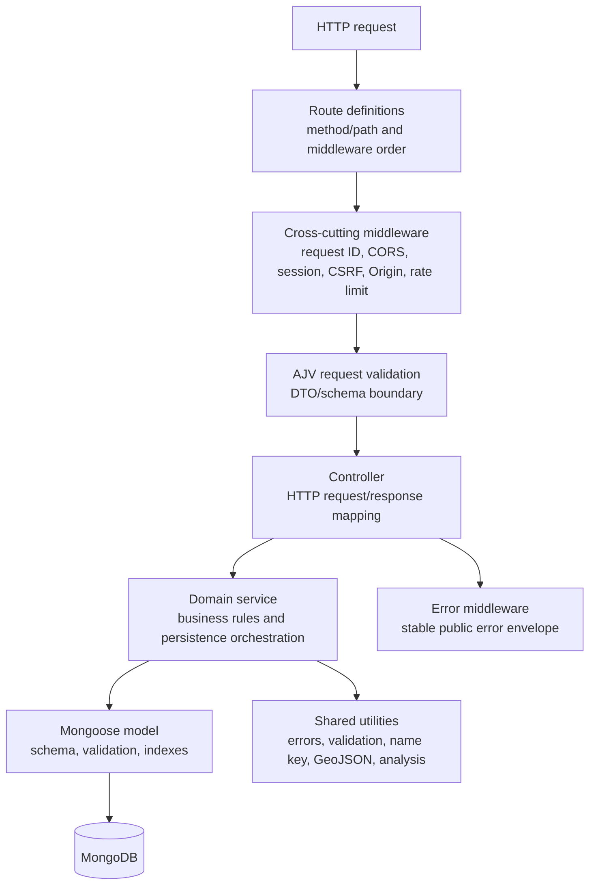
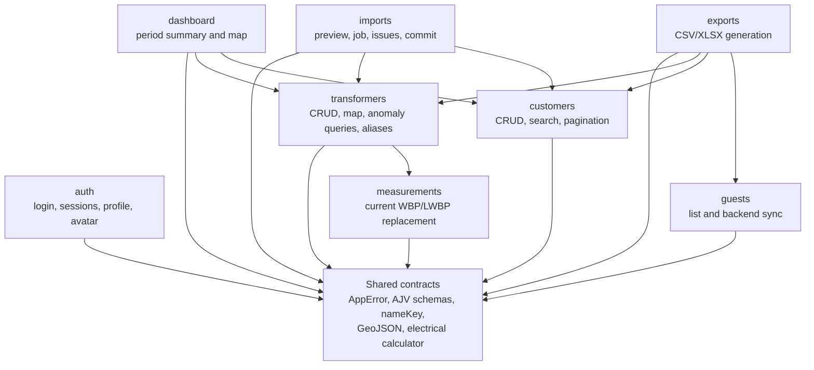
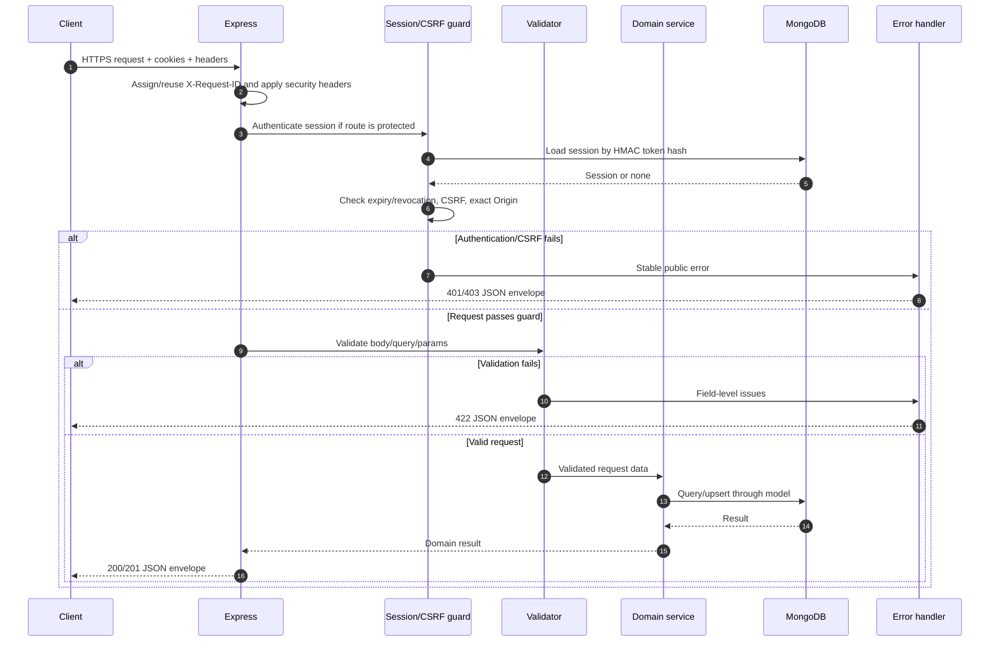
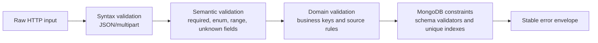
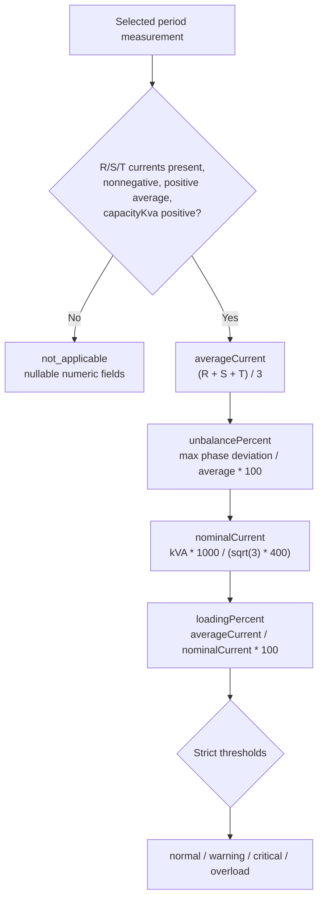
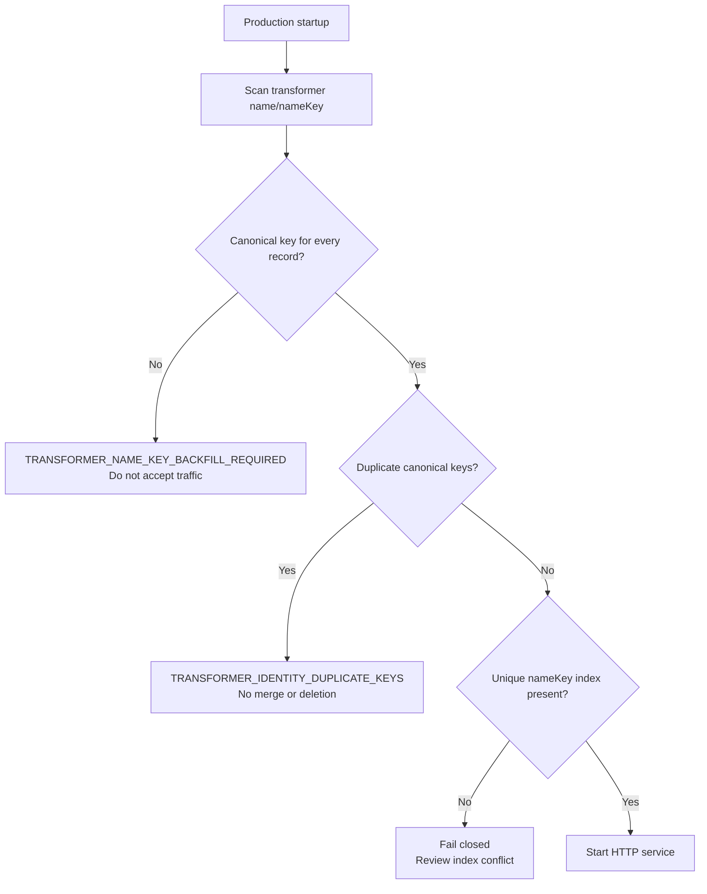
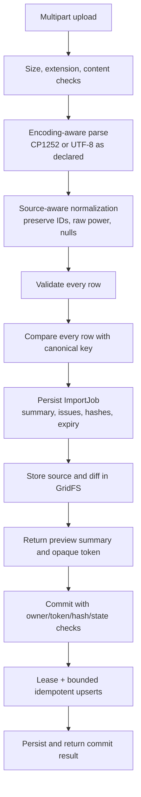

# Implemented Backend Architecture — SIGAP ULP Labuhan

**Status:** Repository backend implementation as reconciled on 27 November 2026. It describes the current CommonJS/Express/Mongoose behavior and does not assert that production configuration, migration approval, or external operations have succeeded.  
**Contracts:** [API contract](../api/overview.md), [implemented schema](../database/schema.md), [ADR-0002](../decisions/ADR-0002-modular-backend-express-mongoose.md), [ADR-0005](../decisions/ADR-0005-secure-cookie-session-auth.md), [ADR-0006](../decisions/ADR-0006-import-preview-and-upsert.md).

## 1. Runtime baseline

| Item | Implemented state |
|---|---|
| Module system | CommonJS |
| HTTP framework | Express 5 |
| ODM | Mongoose 9 dependency; models use strict schemas and explicit indexes |
| Runtime | Repository declares Node.js `>=22.13.0` |
| Authentication | Revocable opaque server-side session, not stateless JWT |
| Session token storage | HMAC-SHA-256 keyed by `SESSION_SECRET` |
| CSRF token storage | SHA-256 hash bound to the authenticated session |
| Validation | AJV request schemas plus service/domain and Mongoose validation |
| Error contract | Central `{ "error": { "code", "message", "details"? } }` middleware |
| Correlation | Every request receives `X-Request-ID` |
| Operational endpoints | `/api/health` and `/api/ready`, outside the versioned business API |

The supported production MongoDB/Mongoose/base-image matrix remains an operational release decision. The repository runtime floor is not a production support claim.

## 2. Layering and dependency direction

Dependencies point toward domain services. HTTP parsing does not enter electrical, import, migration, or synchronization rules. A separate repository layer is not part of the current implementation; services query Mongoose models directly where appropriate.

## 3. Implemented domain modules

| Module | Implemented responsibility | Boundary |
|---|---|---|
| `auth` | Credential verification, opaque sessions, CSRF issuance/binding, profile/account/avatar operations | Never returns raw tokens; no public registration; no usable default administrator password |
| `transformers` | Canonical transformer CRUD, map points, filtered anomaly queries, alias registry | Never invents feeder/capacity/coordinates; preserves canonical identity |
| `measurements` | Current WBP/LWBP document per transformer/period | Never fabricates source date/time; manual write replaces rather than silently merges |
| `customers` | Canonical customer CRUD, bounded search, pagination | Keeps 12-digit IDs as strings; does not default tariff/power |
| `dashboard` | Selected-period summary, anomaly preview, GeoJSON map data | Selected-period availability drives anomaly and map status; both period summaries remain available |
| `guests` | Guest list and server-only Google synchronization | Never inserts fallback rows or accepts a client-supplied URL |
| `imports` | Parse, compare every row, persist preview job/issues, commit validated upserts | Never holds authoritative preview only in memory; never deletes canonical rows |
| `exports` | Complete/bounded CSV/XLSX generation streamed from a bounded temporary file | Fails explicitly above 100,000 rows or above the output-byte ceiling; never silently truncates; concurrent exports are capped |

## 4. Request lifecycle

Every response includes `X-Request-ID`. A valid inbound value matching `[A-Za-z0-9._:-]{1,128}` is reused after trimming; all other values are replaced by a UUID. Internal exception messages, stack traces, database errors, secrets, and upstream bodies are not returned.

## 5. Authentication and request security

### 5.1 Opaque server-side session

- Login generates a random 32-byte opaque token and an independent random 32-byte CSRF token.
- The raw session token is sent only in `sigap_session`. It is stored as an HMAC-SHA-256 hash keyed by `SESSION_SECRET`; the raw token is never stored.
- The session cookie is `HttpOnly`, `SameSite=Lax`, `Path=/`, and `Secure` in production.
- The default absolute lifetime is eight hours (`SESSION_TTL_HOURS`, bounded to 1–168 hours).
- `lastUsedAt` is metadata and does not extend the absolute expiry.
- Logout, password change, account deactivation, and explicit revocation invalidate server-side access even if browser cookie deletion has not completed.
- Authentication responses use `Cache-Control: no-store`.
- The session model does not store raw IP addresses, user-agent text, IP hashes, or user-agent hashes.

### 5.2 Session-bound CSRF and origin

- The CSRF token is stored only as a SHA-256 hash in the session record.
- The `sigap_csrf` cookie is deliberately readable by the SPA and uses `SameSite=Lax`, `Path=/`, production `Secure`, and the session lifetime.
- Unsafe methods require all of the following:
  1. a valid `sigap_session` cookie;
  2. an exact allowed `Origin` (`null`, missing, and unlisted origins are rejected);
  3. a readable `sigap_csrf` cookie;
  4. an `X-CSRF-Token` equal to the cookie, compared in constant time; and
  5. a session whose CSRF hash matches the token hash.
- Login requires an allowed `Origin` but has no pre-session CSRF token.
- Neither raw token is returned in JSON.
- `SameSite=Lax` is defense in depth, not the complete CSRF control.

### 5.3 CORS, limits, and provisioning

- Credentialed CORS allows only configured exact origins (`CLIENT_URL` plus optional `CLIENT_URLS`). Arbitrary origins are not reflected.
- JSON, URL-encoded, multipart, avatar, and import inputs have explicit size/type boundaries.
- Login has a dedicated rate limiter.
- The guest-synchronization endpoint has its own rate limiter, scoped to the authenticated user and trusted client address, plus single-flight coordination that keeps only one upstream fetch and database upsert active at a time.
- The first administrator is provisioned through a controlled server-side CLI with explicit input. The public API can create another administrator only for an authenticated `superadmin`.
- Production startup rejects missing/short placeholder secrets and requires `CLIENT_URL` and `MONGODB_URI`.

## 6. Validation and error contract

Representative errors are:

| Failure layer | Example code | HTTP |
|---|---|---:|
| JSON/multipart syntax | `MALFORMED_JSON`, `MALFORMED_MULTIPART` | 400 |
| Request field | `VALIDATION_ERROR`, `UNEXPECTED_FIELD` | 422 |
| Authentication | `UNAUTHENTICATED`, `INVALID_CREDENTIALS` | 401 |
| CSRF/origin/authorization | `CSRF_FAILED`, `FORBIDDEN` | 403 |
| Duplicate key | `DUPLICATE_RESOURCE` | 409 |
| Missing resource | `RESOURCE_NOT_FOUND` | 404 |
| Upload limit/type | `PAYLOAD_TOO_LARGE`, `UNSUPPORTED_MEDIA_TYPE` | 413/415 |
| Rate limit | `RATE_LIMITED` | 429 |
| Upstream | `UPSTREAM_INVALID_RESPONSE`, `UPSTREAM_TIMEOUT` | 502/504 |
| Dependency/configuration | `DEPENDENCY_UNAVAILABLE` | 503 |

The exact endpoint-specific list is normative in the [API contract](../api/overview.md#14-error-codes).

## 7. Null-aware electrical analysis

Rules:

- Pincang is strictly `>10%`; overload is strictly `>80%`.
- Recommendation critical is unbalance `>15%` or neutral current `>40 A`; warning is unbalance `>10%` when critical is not met.
- Visual unbalance is warning `>10%` and critical `>20%`.
- Overload has priority over the recommendation label.
- Operational analysis status is `normal`, `warning`, `critical`, `overload`, or `not_applicable`; an unavailable visual/map/recommendation status is `unknown`.
- A missing required input produces `null` metrics. The service does not substitute zero, today's date, or a default capacity.

## 8. Transformer identity startup gate

The exact backfill CLI is `npm run migrate:transformer-name-keys`. Its default dry-run reports the plan; `--apply` performs the reviewed backfill/index reconciliation. Duplicate canonical keys abort the command without merging or deleting records.

## 9. Import processing

Rules:

1. The canonical delimiter is semicolon. Ambiguous delimiter/content is rejected rather than guessed.
2. Preview compares every row and reports insert, update, unchanged, and rejected counts.
3. Preview state is persisted in `import_jobs`; the raw preview token is not stored.
4. The reviewed source and diff are stored in GridFS and bound by SHA-256.
5. Commit is bound to the job owner, expiry, job state, and staged-source hash. A renewable 15-minute lease and 1,000-row batches support idempotent retry.
6. A target changed after preview returns `409 IMPORT_TARGET_CONFLICT` and requires a new preview.
7. Rejected rows are never written. The importer never deletes records.
8. Import defaults do not invent tariff, power, capacity, alias, date, or time values.
9. Committed transformer/customer provenance is `source: "operator_import"`, source file/row, and `sourceMetadata.importJobId`.

## 10. Concurrency and idempotency

| Operation | Implemented concurrency/idempotency rule |
|---|---|
| Transformer upsert | Canonical `nameKey` plus unique `transformer_name_key_unique` |
| Customer upsert | Unique 12-digit string `customerId` |
| Measurement write | Unique `(transformerId, period)`; manual write replaces the period document |
| Guest sync | Unique versioned fingerprint; duplicate source rows skip |
| Import commit | Renewable lease and status transition; a repeated successful commit returns the stored result |
| Alias creation | Unique `aliasKey`; conflicting aliases return a conflict |
| Session creation | Random opaque token; no reusable identifier |

MongoDB transactions are not assumed for multi-document operations. The deployment topology and transactional requirement remain separate decisions.

## 11. Upstream integration isolation

The guest client is a server-side adapter with:

- a server-only URL from runtime configuration;
- HTTPS-only URL/path/host validation and a bounded redirect policy;
- a 10-second timeout and a 5 MiB response limit;
- strict array/record validation;
- no static fallback records;
- a summary separating fetched, inserted, duplicate, and rejected counts; and
- redacted errors that do not echo upstream bodies or credentials.

## 12. Observability and health

| Signal | Implemented behavior |
|---|---|
| Request ID | Returned in `X-Request-ID`; available to request/error handling |
| Error envelope | Stable code/message and optional safe field details |
| Health | `/api/health` reports process liveness without a credential |
| Readiness | `/api/ready` reports MongoDB connection state without exposing the URI |
| Import cleanup | Scheduled cleanup removes expired staged artifacts/issues and prevents late commit |
| Production startup | Fails closed on unsafe configuration or non-canonical transformer identity |

The repository does not contain a complete production metrics/trace pipeline. That remains an operational concern rather than an implemented architecture claim.

## 13. Backend verification boundary

Backend evidence consists of the unit/integration suite, static API-contract gate, ground-truth verifier, lint/type/build gates, release-control checks, and a disposable local Compose runtime check recorded in the [testing strategy](../testing/strategy.md). A green repository suite does not prove production configuration, a production migration, a successful external sync, production image publication, or a production deployment.
