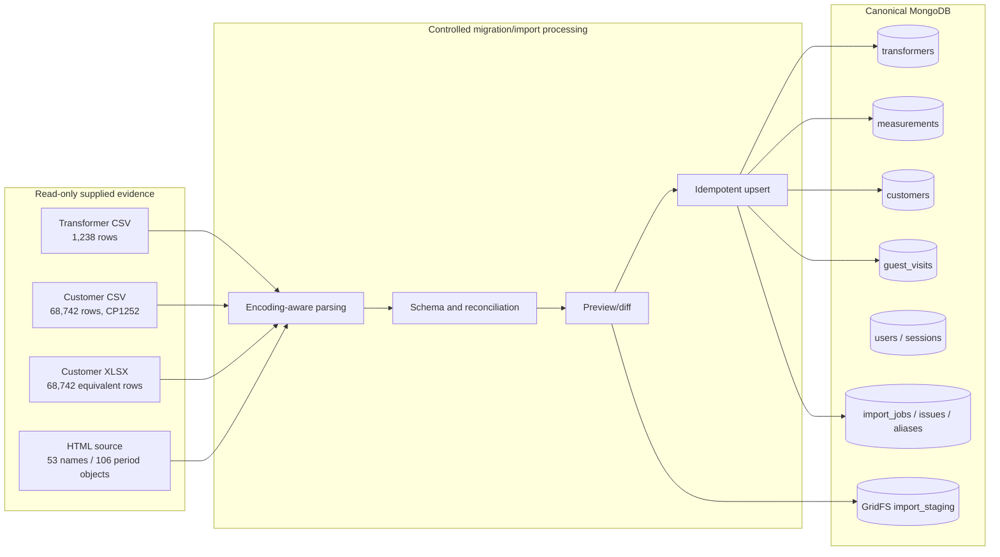
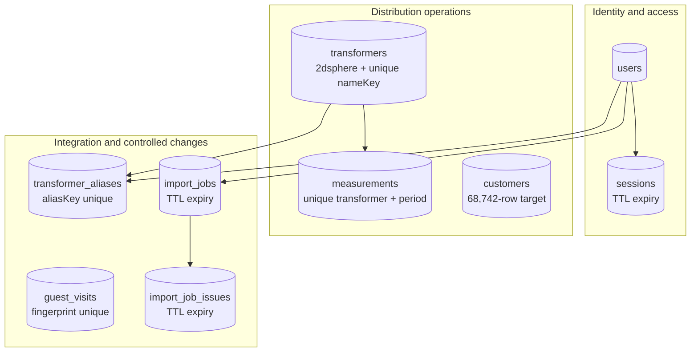
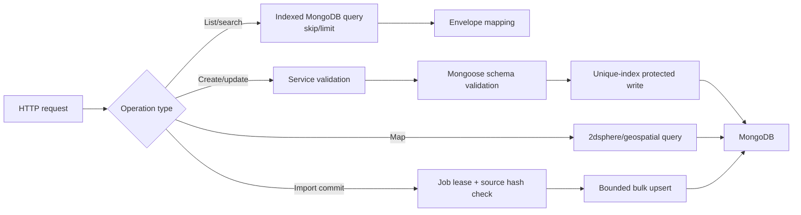
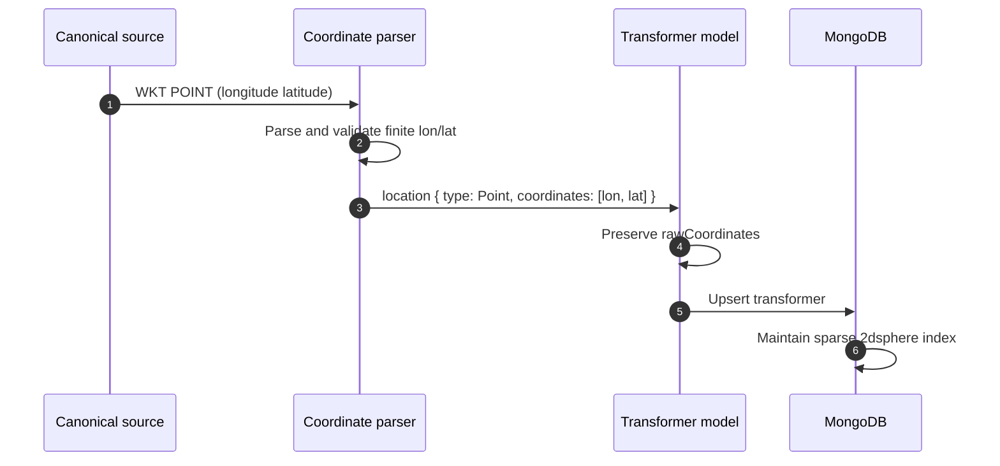
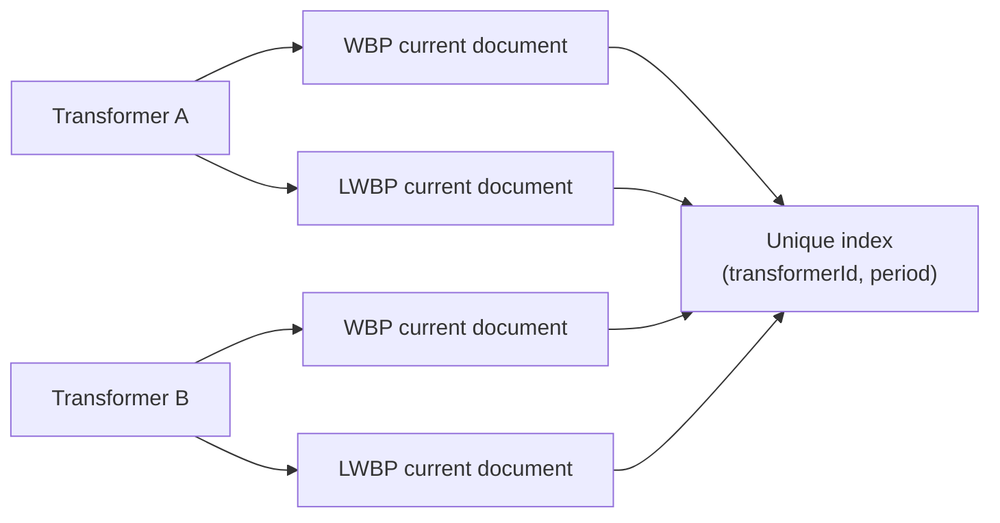
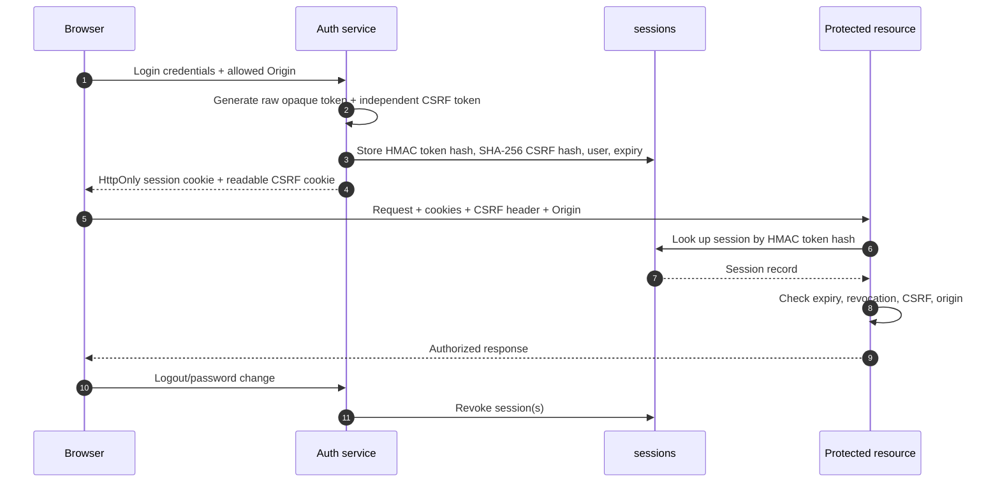
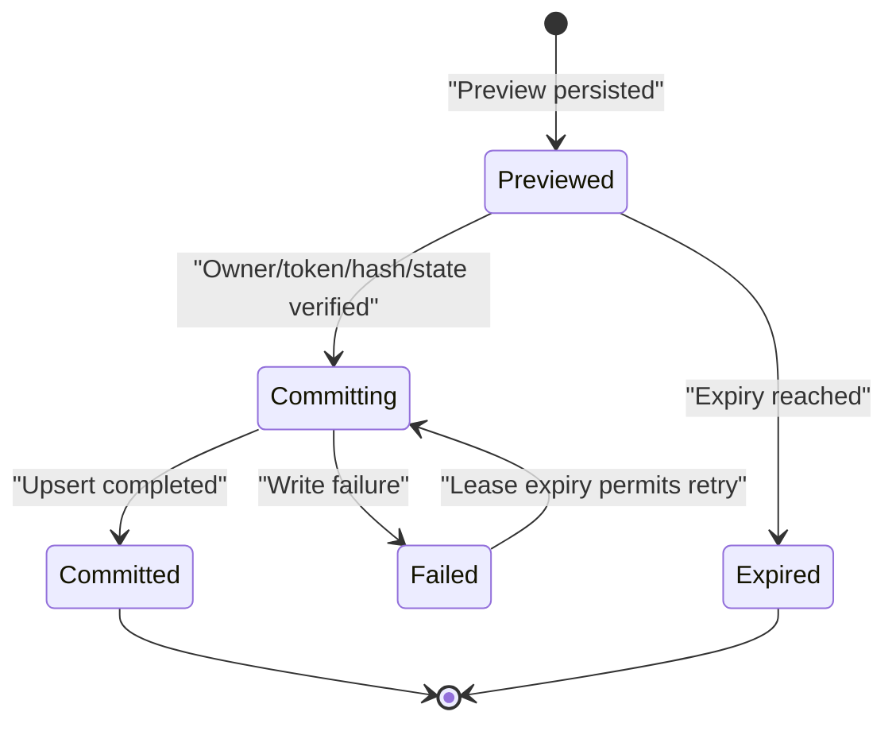
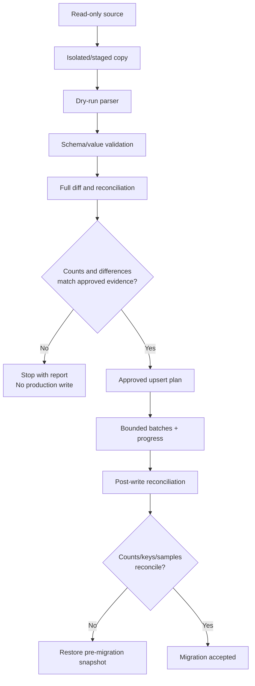

# Implemented Database Architecture — SIGAP ULP Labuhan

**Status:** Repository MongoDB/Mongoose implementation as reconciled on 27 November 2026. The field and index contract is normative in the [implemented schema](../database/schema.md). This document does not assert that a production database has been migrated, backed up, approved, or released.  
**Evidence:** [Phase 0 audit](../audit/phase-0-audit.md), [ADR-0003](../decisions/ADR-0003-mongodb-data-modeling.md), [migration guide](../database/migration.md).

## 1. Storage responsibility

MongoDB is the runtime authority for transformed, validated application data. The supplied `.temp/sigap/` files are read-only evidence and are not a live database.

## 2. Canonical collection architecture

The full field type/nullability and index contract is in the [implemented schema](../database/schema.md). The architecture diagram intentionally shows relationships rather than duplicating every field.

## 3. Consistency boundaries

| Boundary | Enforcement |
|---|---|
| Transformer identity | Canonical NFC/trim/Unicode full case-folded `nameKey`; unique `transformer_name_key_unique`; production startup gate |
| Transformer location | GeoJSON Point `[longitude, latitude]`; sparse `2dsphere` index |
| Capacity semantics | Raw text and nullable numeric kVA; no default numeric capacity |
| Current measurement | Unique `(transformerId, period)`; no ambiguous multiple current rows |
| Customer identity | Unique 12-digit string `customerId` |
| Customer power | Nullable raw text in `powerRaw` plus nullable correctly scaled integer VA |
| Guest idempotency | Unique version-2 source fingerprint |
| Import authority | Persisted job, owner, status, source hash, expiry, stored result |
| Alias authority | Unique `aliasKey` and explicit `approvedBy`/`approvedAt` reference |
| Session authority | Unique HMAC-hashed opaque credential with expiry and revocation state |

## 4. Read and write patterns

- List/search operations use indexed server-side predicates and bounded pagination.
- Customer search can combine an anchored customer-ID prefix predicate with indexed text predicates for name/address.
- Transformer map points omit records without a valid location.
- Writes rely on database unique indexes as the final conflict defense.
- Import commit uses bounded batches and persisted progress; it does not load the full 68,742-row population into one transaction.
- Transaction use is not assumed because the production topology remains unresolved.

## 5. GeoJSON storage

The canonical order is fixed as longitude first. The HTML source uses a different latitude-first representation, so only the HTML-specific adapter converts it; the canonical CSV adapter does not.

## 6. Measurement storage model

The current contract stores one document for each transformer/period pair. Updating WBP does not affect LWBP. Retaining historical measurements requires a future approved model and retention policy; it must not be introduced by weakening the current unique index.

A manual `PUT /measurements/:transformerId` replaces the selected period document, requires complete voltage R/S/T and incoming R/S/T/N, clears omitted date/time/branches as defined by the API contract, sets `source: "manual"`, and clears `sourceRecordKey`.

## 7. Session storage model

Only hashes are persisted. Expiry and revocation are checked at authorization time; TTL cleanup is asynchronous. The model stores no raw IP address, user-agent text, IP hash, or user-agent hash.

## 8. Transformer identity reconciliation

```mermaid
stateDiagram-v2
    [*] --> NeedsBackfill: "Missing or mismatched nameKey"
    [*] --> DuplicateConflict: "Duplicate canonical key"
    [*] --> IndexConflict: "Conflicting nameKey index"
    [*] --> Canonical: "Canonical records + unique index"
    NeedsBackfill --> Canonical: "Approved backfill"
    DuplicateConflict --> [*]: "Abort; no merge/delete"
    IndexConflict --> [*]: "Manual index review"
```

- The exact command is `npm run migrate:transformer-name-keys` (dry-run by default; `--apply` and `--report` supported).
- Missing/mismatched keys are reported as `TRANSFORMER_NAME_KEY_BACKFILL_REQUIRED`.
- Duplicate canonical keys are reported as `TRANSFORMER_IDENTITY_DUPLICATE_KEYS`; no record is merged or deleted.
- The migration manages only the canonical/known legacy `nameKey` indexes and preserves unrelated indexes.
- Production startup fails closed until the data and unique index satisfy the identity contract.

## 9. Import staging and TTL

- `import_jobs.expiresAt` has a MongoDB TTL index with `expireAfterSeconds: 0`.
- `import_job_issues.expiresAt` uses the same expiry horizon and has its own TTL index.
- TTL monitor deletion is asynchronous; the service rejects an expired job before MongoDB physically removes it.
- The cleanup scheduler removes staged source/diff artifacts and associated issues and prevents late commit.
- A successful job retains its summary/result until the approved retention policy permits removal.
- The source/diff artifacts live in GridFS bucket `import_staging`; the raw preview token is never stored.

## 10. Migration architecture

Detailed rules and the 27 November 2026 isolated dry-run evidence are in the [migration guide](../database/migration.md).

## 11. Backup, restore, and retention boundary

| Concern | Implemented/repository state | Release requirement |
|---|---|---|
| Backup | Backup/restore scripts and runbooks exist in the working tree | Approved schedule, target, encryption, and successful isolated restore rehearsal |
| Restore | Repository tooling supports restore | Production operator sign-off and evidence |
| Migration rollback | Migration is idempotent and dry-run capable | Verified pre-migration snapshot; no assumed destructive down-migration |
| Source evidence | `.temp/sigap/` remains unchanged and is not the production backup | Preserve read-only boundary |
| Import staging | Short-lived GridFS artifacts removed by cleanup/TTL | Approved retention/PII handling |
| Sessions | Expired sessions removed by TTL; active sessions require explicit revocation | Approved session lifetime/revocation operation |
| Import jobs/issues | 24-hour job horizon | Approved retention policy |
| Guest/source data | Model separates source visit time from synchronization time | Approved customer/guest PII privacy policy |

The production topology, backup schedule, retention, restore target, and PII policy remain release blockers. The repository's presence of scripts is not evidence that a production restore or deployment has occurred.

## 12. Database verification boundary

Database evidence consists of Mongoose/integration tests, migration dry runs in isolated databases, ground-truth hash verification, and schema/index assertions. It does not prove that the production volume contains the canonical population, that its backup can be restored, or that production topology/retention decisions have been approved.
