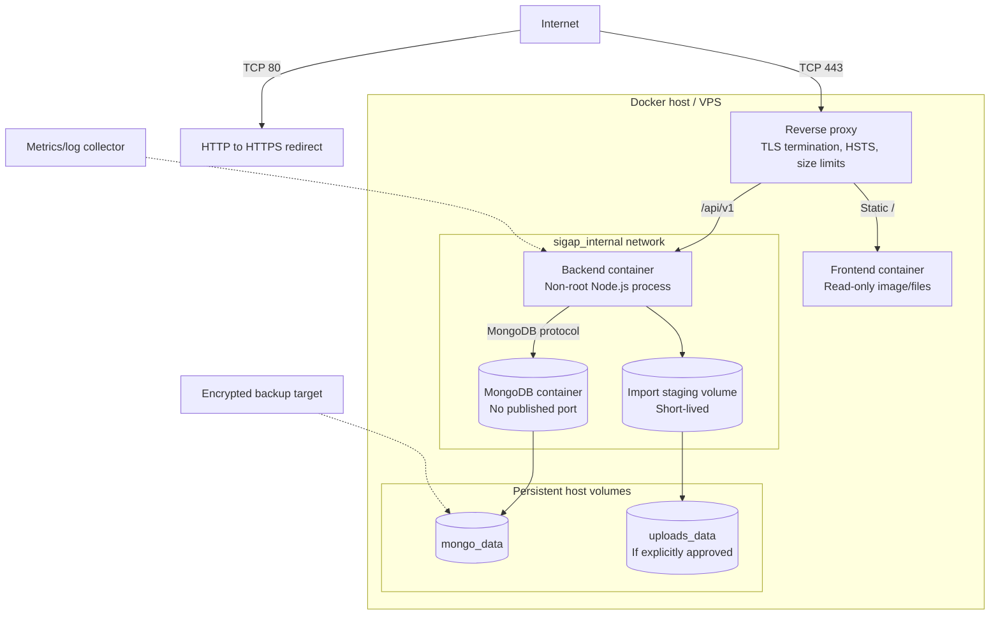
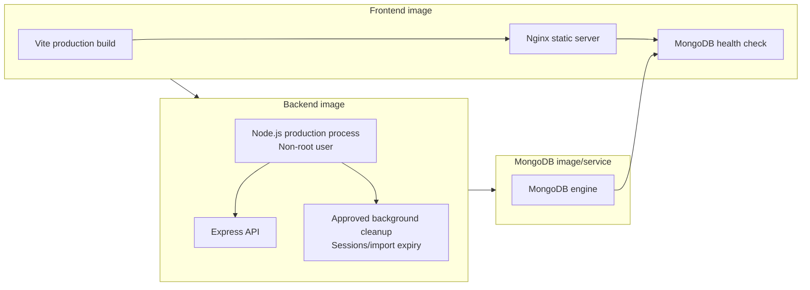
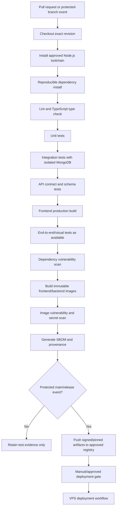
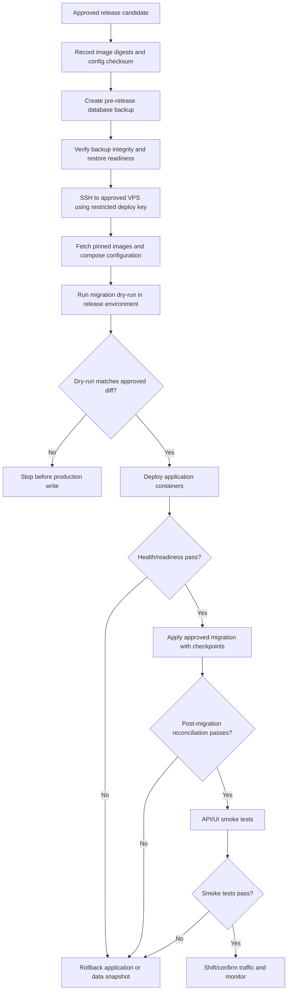
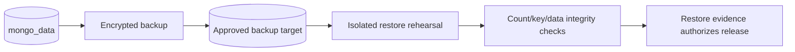
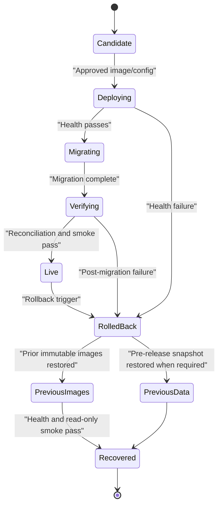

# Target Deployment and CI Architecture — SIGAP ULP Labuhan

**Reconciliation note (27 November 2026):** The current working tree contains Dockerfiles, Compose/Caddy deployment artifacts, CI/release-control workflows, and backup/restore tooling. The disposable local backend/frontend image build and Compose runtime health check passed on the current tree; no production deployment is claimed. The Phase 0 target/status wording below is retained as historical baseline, so rows marked “To implement” describe that baseline rather than the current artifact inventory. Current status and gates are normative in [ADR-0008](../decisions/ADR-0008-docker-compose-vps-deployment.md) and the [implementation plan](../implementation-plan.md).

**Status:** Required deployment target. The Phase 0 baseline reported Docker and Docker Compose CLIs but an inactive Docker daemon, and no Dockerfile, Compose file, or GitHub Actions workflow was found in the repository at that point. This document therefore specifies work to implement, not automation that already exists.  
**Decision:** [ADR-0008](../decisions/ADR-0008-docker-compose-vps-deployment.md)  
**Release gates:** [implementation plan](../implementation-plan.md#6-deployment-and-rollback-gates).

## 1. Deployment assumptions and unresolved inputs

| Item | Target | Status |
|---|---|---|
| Runtime host | Linux VPS with Docker Engine and Compose plugin | UD-03 |
| Public entry | DNS plus reverse proxy with managed TLS | UD-03 |
| Application runtime | Pinned Node.js image satisfying the repository engine floor | Exact production version is UD-06 |
| Database | Isolated MongoDB service/container with no public port | Topology/version are UD-04 and UD-06 |
| Frontend | Immutable static image served by Nginx or equivalent | To implement |
| Backend | Immutable Node.js API image with non-root runtime user | To implement |
| CI | Controlled pipeline that builds, tests, scans, and publishes immutable artifacts | To implement |
| Secrets | Runtime injection from an approved secret store | Secret manager/process remains UD-03/UD-04 |

Production release is blocked until the applicable external dependencies are approved and supplied.

## 2. Target VPS topology

### 2.1 Network rules

- Only the reverse proxy exposes an application port publicly.
- MongoDB has no published host port and is reachable only on the internal network.
- The backend exposes a health port only on the internal network unless the proxy needs it.
- The frontend container serves static assets and proxies only the approved `/api/v1` path when a split-container topology is used.
- Outbound access is limited to required package, map, and Google integration endpoints.

### 2.2 Persistence rules

| Volume | Contents | Lifecycle |
|---|---|---|
| `mongo_data` | Canonical MongoDB data | Persistent; included in backup/restore policy |
| Import staging | Short-lived staged import source/diff artifacts | Expiry sweep; TTL metadata fallback; not a source archive |
| Optional uploads | Approved avatar/upload objects only | Separate retention/backup decision |
| Export scratch | Short-lived generated export files in the container temp directory | Removed when the transfer ends; peak usage is bounded by `EXPORT_MAX_BYTES` × `EXPORT_MAX_CONCURRENT` |
| TLS/certificates | Managed proxy certificates | Renewed by approved certificate process; never in an image |

`.temp/sigap/` is not mounted into application containers as writable storage.

## 3. Target container responsibilities

Image requirements:

- Pin base-image digests and supported runtime versions.
- Install production dependencies reproducibly; do not copy development tooling into the runtime image.
- Run as a non-root user with a read-only root filesystem where practical.
- Do not bake secrets, source credentials, customer data, or `.temp/sigap/` into an image.
- Include provenance/SBOM metadata and scan results.
- Define health checks that test the process without exposing sensitive configuration.

## 4. Target CI pipeline

### 4.1 CI quality rules

1. A pull request cannot publish a production image unless the protected workflow explicitly allows it.
2. Tests must not depend on the production Google endpoint or production customer data.
3. Integration tests use an isolated MongoDB instance/database and deterministic fixtures derived from the audited profiles.
4. The frontend build must use the TypeScript 7-compatible configuration.
5. Dependency, secret, container, and license scans are required evidence.
6. Critical/high findings block release unless a security owner records a time-bounded, approved exception.
7. The deployed artifact is identified by immutable digest, not only a mutable tag.

## 5. Target CD/release workflow

The deployment mechanism may be GitHub Actions, another CI provider, or an operator-controlled workflow. The architecture requires the gates and immutable artifacts, not a specific vendor before UD-03/UD-06 is resolved.

## 6. Configuration and secret handling

| Class | Examples | Rule |
|---|---|---|
| Public build/runtime configuration | OpenStreetMap tile URL, application version label | May be embedded only when genuinely public |
| Backend-only configuration | Public API origin, session lifetime, rate limits, upload limits | Runtime environment/config; validated at startup |
| Secrets | MongoDB URI/password, Google endpoint/credential, session/CSRF key material if used, deploy keys | Approved secret store or protected runtime file; never in Git/image/log |
| Data | Transformers, customers, measurements, guests | Runtime database/staging policy; never in CI artifacts |

Configuration validation fails closed in production:

- Missing required values stop startup.
- Development examples are not accepted as production values.
- There is no default session secret, JWT secret, administrator password, Google credential, or database credential.
- Secret values are redacted from startup errors and health responses.

## 7. Health, readiness, and monitoring

| Signal | Expected behavior |
|---|---|
| Liveness | Process/event loop is responsive; no dependency mutation |
| Readiness | MongoDB reachable, required configuration validated, runtime not in an unsafe migration state |
| Reverse proxy health | TLS, static frontend, and API route checks remain available |
| Logs | Structured JSON with request/job ID; no secret/raw token/unnecessary PII |
| Metrics | Request rate/error/latency, database health, import outcomes, upstream sync outcomes, disk/volume usage |
| Alerts | Release failures, repeated 5xx, authentication anomalies, failed imports, backup failure, disk pressure, MongoDB health |

Monitoring platform and retention are operational decisions and are not implied complete by this document.

## 8. Backup and restore

- Backup runs on an approved schedule and before migration.
- Backup storage is separate from the production host and access-controlled.
- A backup is not accepted as valid until an isolated restore succeeds and reconciliation checks pass.
- The backup scope includes canonical collections and any separately approved uploaded files.
- Import staging and transient sessions are not assumed to require long-term backup.
- Backup retention and recovery objectives remain UD-04.

## 9. Rollback design

### 9.1 Rollback rules

1. Keep the previous frontend/backend image digests and configuration available through the rollback window.
2. If the old application is incompatible with the new schema/data, restore the verified pre-release database snapshot.
3. Do not use a destructive down-migration unless it is separately implemented, tested, and approved.
4. A corrected forward release is acceptable when it is safer than restoring data and the schema remains backward compatible.
5. After rollback, verify database counts/keys, login, API health, read-only dashboard behavior, and import-job state before normal traffic resumes.
6. Rollback never modifies `.temp/sigap/`.

## 10. Mandatory release checklist

### 10.1 Before deployment

- [ ] UD-03/UD-04/UD-06 inputs required by the release are approved.
- [ ] CI lint, type check, unit, integration, contract, build, and scan stages pass.
- [ ] Frontend/backend images are pinned by digest and have SBOM/provenance.
- [ ] MongoDB is not publicly reachable.
- [ ] Production secrets are injected and validated without fallback.
- [ ] Migration dry-run matches the reviewed counts/diff.
- [ ] Backup and isolated restore rehearsal succeed.
- [ ] Previous release artifacts and rollback procedure are available.

### 10.2 After deployment

- [ ] Liveness/readiness and dependency checks pass.
- [ ] Counts and business-key reconciliation pass.
- [ ] Login, logout, dashboard read, transformer read, customer read, and import-preview smoke checks pass.
- [ ] Monitoring shows no unexpected error/latency/resource trend.
- [ ] The release record contains digests, migration result, backup ID, checks, approver, and any exceptions.

## 11. Current limitations and explicit non-claims

- A successful container image build has not been demonstrated in the Phase 0 baseline because the local Docker daemon was unavailable.
- No repository Docker/Compose configuration or CI workflow existed in the Phase 0 baseline; this document does not claim otherwise.
- Production domain, DNS, VPS, firewall, TLS, MongoDB topology, backup, and restore target are unresolved.
- A green pipeline, deployment, or rollback rehearsal is required before the corresponding gate can pass.
