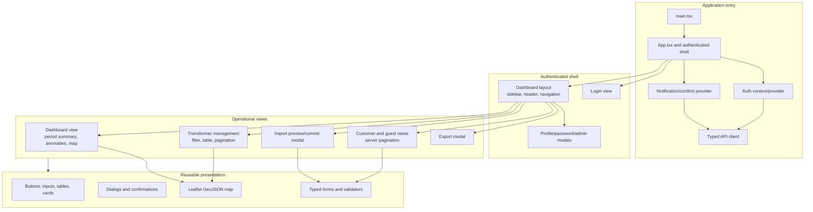
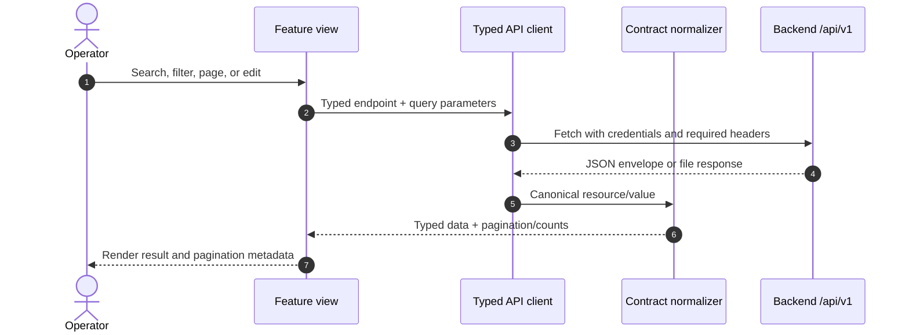
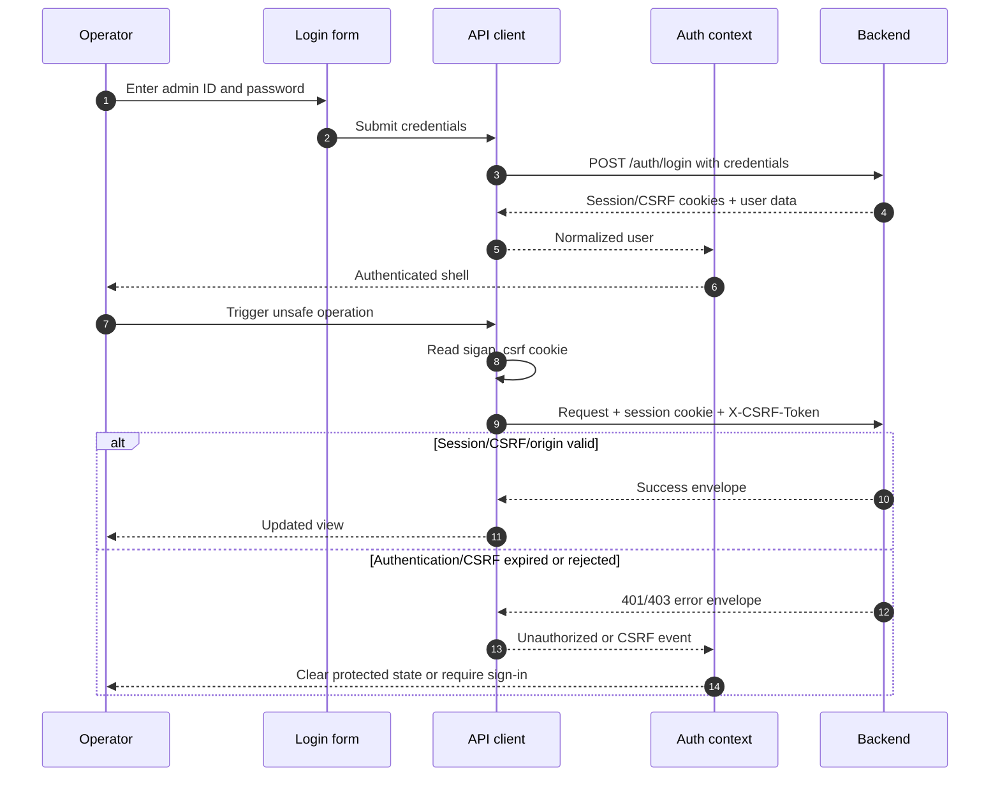
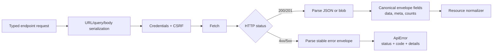
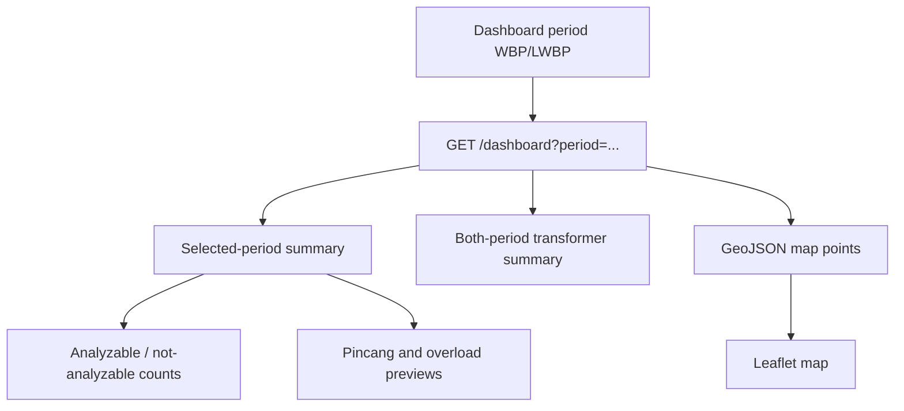
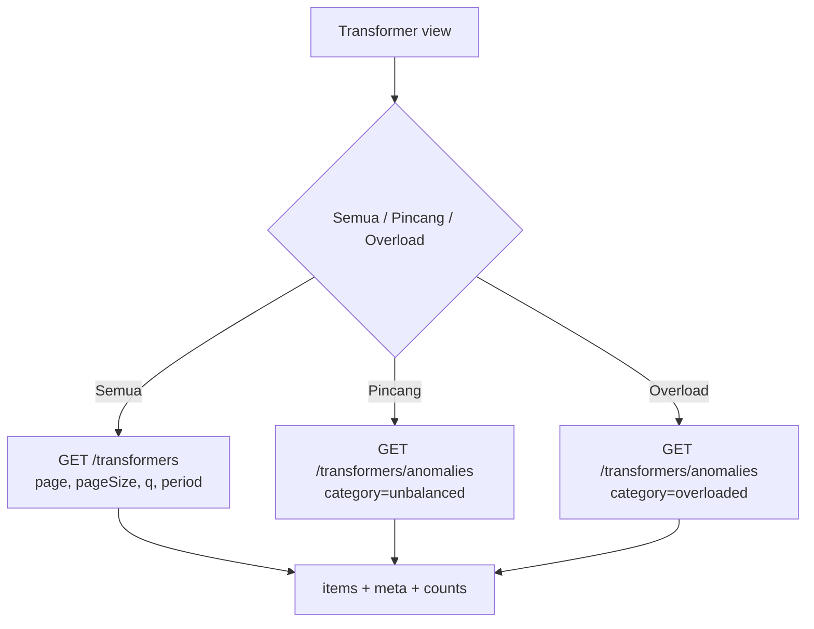
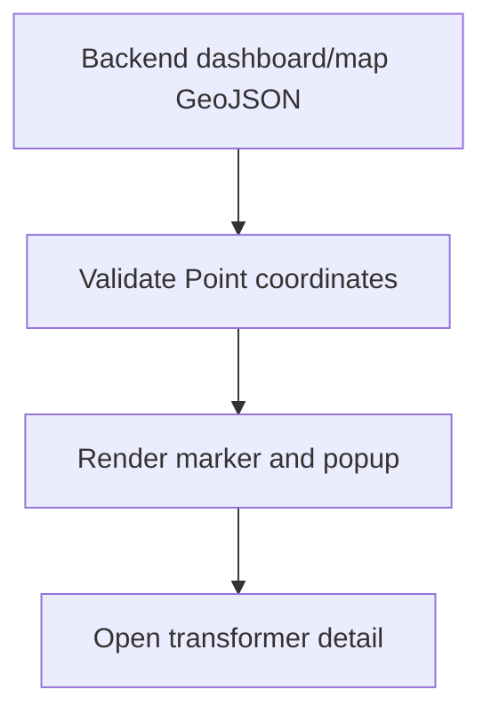

# Implemented Frontend Architecture — SIGAP ULP Labuhan

**Status:** Repository frontend implementation as reconciled on 27 November 2026. It describes the current React/Vite/TypeScript behavior and does not claim an approved production release or an unconditional pixel-identical match to the supplied HTML.  
**Contracts:** [API contract](../api/overview.md), [system architecture](overview.md), [ADR-0001](../decisions/ADR-0001-react-vite-frontend.md).

## 1. Implemented stack and boundaries

| Item | Implemented state |
|---|---|
| Framework | React 19 |
| Build tool | Vite 8 |
| Language | TypeScript 7 with strict type checking |
| Styling | Tailwind CSS 4 and local PLN visual assets |
| Map | Leaflet 1.9 with OpenStreetMap tiles |
| API access | Central typed client in `frontend/src/services/api.ts` |
| Runtime normalization | Defensive normalizers in `frontend/src/services/contracts.ts` |
| Unit/component tests | Vitest + React Testing Library |
| Browser verification | Playwright end-to-end and visual tests |
| Browser persistence | No canonical master-data store in `localStorage`/`sessionStorage`; session/CSRF remain cookies |

The frontend consumes the API as the canonical source. It does not ship the protected ground-truth files, MongoDB data, the Google Apps Script endpoint, or raw session tokens.

## 2. Component architecture

## 3. API-driven data flow

- Components do not construct undocumented URLs or response shapes.
- The API client owns URL/query/body serialization, credentials, CSRF attachment, response parsing, error normalization, and file downloads.
- Feature views own query and interaction state.
- List requests use server-side pagination. The browser does not fetch all 1,238 transformers or 68,742 customers to filter locally.
- Search inputs are debounced. Feature requests use `AbortController` and an active-response guard so an obsolete response does not replace a newer view.

## 4. Authentication and CSRF client flow

Client rules:

1. Use `credentials: "include"` for API requests.
2. Read the same-origin `sigap_csrf` cookie from `document.cookie` for every unsafe request and copy it to `X-CSRF-Token`. The token is never returned by the API in JSON, never kept in module/component state, and never written to `localStorage`/`sessionStorage`.
3. Do not read or persist the HttpOnly `sigap_session` cookie from JavaScript.
4. On `401`, clear user/session state and return to the login view; the client does not retry indefinitely.
5. On `403 CSRF_FAILED`, never retry the rejected state-changing request. The auth context performs one safe `/auth/me` refresh and otherwise requires a deliberate sign-in.
6. Do not log cookies, passwords, CSRF tokens, or unredacted customer PII.

## 5. State and browser persistence

| Data class | Browser policy |
|---|---|
| Transformer/customer/guest master data | Fetch from API; never use browser storage as authority |
| Dashboard/map data | In-memory view state; API remains authoritative |
| Import preview | Hold only the opaque job ID, one-time preview token, and summary needed for review; server job is authoritative |
| Session/CSRF | Browser-managed cookies under the API rules; session token is HttpOnly |
| User profile | In-memory authenticated state, refreshed from `/auth/me` |
| Filters/pagination | In-memory view state |

A browser cache may reduce repeat reads but cannot create, alter, or silently replace a canonical server record.

## 6. API client and normalization contract

The backend success contract is `{ "data": ... }`, with top-level `meta` for lists and top-level `counts` for transformer/anomaly lists. The frontend's internal `ApiEnvelope` also exposes compatibility fields such as `success`, `status`, and `message`; it derives them from the HTTP response and canonical payload rather than requiring them from the backend.

The client must:

- use the exact `page` and `pageSize` parameters (default 20, maximum 100 at the API boundary);
- read pagination totals from `meta`;
- preserve nullable canonical values;
- preserve backend error codes for user-facing decisions;
- normalize legacy-shaped responses defensively without changing the canonical backend contract; and
- download exports as blobs/files and surface server errors rather than saving an error page as CSV/XLSX.

## 7. Dashboard and period behavior

- The dashboard sends the selected `wbp` or `lwbp` period to the API.
- The selected period drives the summary, anomaly counts/previews, and map statuses.
- `notAnalyzable` is the count of records lacking valid analysis eligibility for the selected period.
- The response's `transformers.periods` retains summaries for both periods; the frontend does not replace the selected-period summary with a WBP fallback.
- The dashboard consumes the backend GeoJSON `FeatureCollection` embedded in the response and normalizes only valid longitude/latitude points.

## 8. Transformer and measurement behavior

### 8.1 Transformer lists and anomalies

- The “all” view uses the transformer list endpoint and its top-level `counts`.
- The anomaly views use `/transformers/anomalies`; they do not fetch the full transformer population and filter it in the browser.
- The frontend sends the selected period and a bounded search term.
- The response counts distinguish total, analyzable, not-analyzable, pincang, and overload.

### 8.2 Forms

- Transformer create/update requires an operator-entered name and sends nullable feeder, capacity text/numeric kVA, brand, grounding, GeoJSON location, and raw coordinate text independently.
- Transformer `PUT` is a full replacement; the form must not rely on omitted fields preserving old values.
- Manual measurement writes require explicit R/S/T voltage and R/S/T/N incoming values for the selected period.
- Measurement date is `YYYY-MM-DD`, time is `HH:mm`, and both remain empty/null unless entered.
- The display preserves the strict analysis thresholds and null behavior documented in the [API contract](../api/overview.md#72-analysis-rules).

## 9. Leaflet and GeoJSON behavior

- Backend coordinates are GeoJSON order `[longitude, latitude]`; the client does not reverse them.
- The audited canonical envelope is longitude `98.631590–98.731016`, latitude `3.639622–3.735425`.
- Only finite valid point features are rendered. The client does not geocode an address or invent a marker position.
- Popup attribution includes `© OpenStreetMap contributors`.
- A map/API failure does not replace canonical table/list data with fake records.

## 10. Customer, guest, import, and export behavior

| View | Implemented behavior |
|---|---|
| Customer | Preserve `customerId` as a string, show raw `power` and integer `powerVa`, use server search/pagination, show nullable source fields without invented values |
| Guest | Display source date separately from sync time, show the rejected/duplicate summary, and request synchronization only through the backend |
| Import preview | Upload the selected transformer/customer file, show total/valid/insert/update/unchanged/rejected counts and inline issues, retain the job/token, and require explicit commit |
| Import commit | Bind commit to job ID and one-time preview token; show the persisted result and refresh affected views |
| Export | Select CSV/XLSX and applicable filters, download the server file, and surface server errors instead of saving an error response as a data file |
| Guest sync payload | Send only `{}`; the browser has no Apps Script URL field |

## 11. Visual, accessibility, and resilience baseline

The supplied static HTML remains the visual/terminology reference. The implemented frontend preserves:

- Plus Jakarta Sans;
- the PLN blue/dark-blue/teal/yellow/red palette;
- responsive sidebar/header and the supplied login assets;
- dashboard cards, transformer/customer tables, filters, WBP/LWBP controls, modals, and notifications.

The acceptance statement is preservation of the supported states with documented visual evidence, not an unsupported claim that every rendered pixel is identical. The implemented UI also provides keyboard-operable dashboard cards, visible focus/pressed/disabled states, accessible form labels, modal accessibility handling, and distinct loading/empty/error states.

## 12. Frontend verification boundary

Frontend evidence consists of typecheck, production build, Vitest/component tests, Playwright end-to-end/visual tests, and API-contract coupling with the backend. The current evidence record must report actual test counts and environments. A local green frontend suite does not prove production deployment, production data migration, or external Google synchronization.
