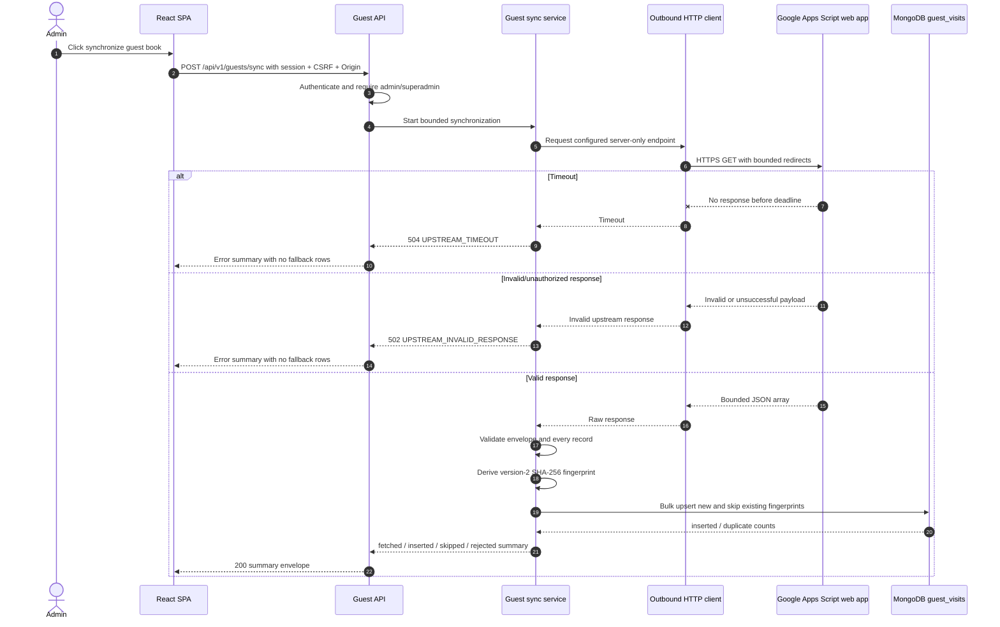
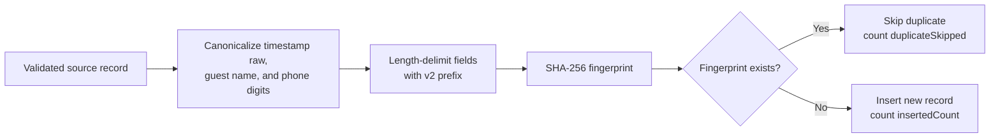
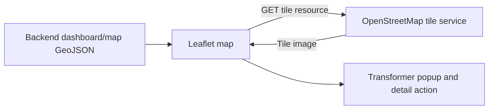

# Implemented External Integration Architecture — SIGAP ULP Labuhan

**Status:** Repository integration implementation as reconciled on 27 November 2026. It describes the backend-only guest synchronization and Leaflet/OpenStreetMap behavior. It does not claim that the real Google Apps Script deployment was contacted successfully or that its production contract/credential has been approved.  
**Decision:** [ADR-0007](../decisions/ADR-0007-google-form-sync-integration.md)  
**API contract:** [guest endpoints and error codes](../api/overview.md#10-guests-and-google-synchronization).

## 1. External dependencies

| Dependency | Direction | Browser exposure | Current boundary |
|---|---|---|---|
| Google Apps Script guest source | Backend fetches Google; Google does not write MongoDB directly | None | URL comes from server configuration; the real deployment identity, payload approval, and request-authentication strategy remain unresolved |
| OpenStreetMap tiles | Browser requests public tiles for map rendering | Tile URL only; no Google endpoint or credential | External availability and usage policy remain operational dependencies |

The browser may know the OpenStreetMap tile URL required to render the map. It must not know the Google Apps Script endpoint, Google credential, MongoDB URI, or any server secret.

## 2. Implemented Google guest synchronization

The frontend sends only `{}` to the sync endpoint. Client-provided URLs are ignored. The current route requires an authenticated `admin` or `superadmin`; login and the guest-sync route each have a dedicated rate limiter, and the guest-sync route additionally coalesces concurrent requests into one active upstream fetch and database upsert.

## 3. Configuration and outbound boundary

| Setting/behavior | Current implementation |
|---|---|
| Google Apps Script URL | Backend runtime environment variable `GOOGLE_FORM_APPS_SCRIPT_URL`; never bundled or returned |
| Request authentication | No request credential is currently sent by the implementation; the production Apps Script contract/authentication strategy is unresolved |
| URL validation | HTTPS only; no embedded credentials; standard HTTPS port; approved host/path shape; no localhost/demo fallback |
| Host allowlist | Server-side service allowlist; the current configuration resolves to `script.google.com` by default |
| Redirects | At most two; each destination is revalidated against HTTPS/host/path rules |
| Timeout | 10 seconds |
| Maximum response | 5 MiB, checked from `Content-Length` and while streaming |
| OpenStreetMap tile URL | Frontend public runtime/build configuration; contains no secret |

There is no `localhost`/development fallback, demo endpoint, hard-coded public script URL, or static guest seed in the production path.

## 4. Payload validation contract

The implemented upstream envelope is a JSON array. Each object is validated independently:

1. The response must be valid JSON and the top-level value must be an array.
2. Accepted source-key aliases are checked for timestamp, source ID, guest name, phone, customer ID, and purpose.
3. Guest name is required, trimmed, and at most 200 characters.
4. Phone is required and must contain 9–15 digits after non-digit characters are removed. The original string is preserved, so leading zeros are not lost.
5. Purpose is required, trimmed, and at most 1,000 characters.
6. Customer ID is optional and bounded to 64 characters; it is never invented.
7. Source timestamp text is bounded to 100 characters. A parseable value becomes `timestamp`; an unparseable value leaves `timestamp: null` and preserves `timestampRaw`.
8. Source record ID is optional and preserved when supplied.
9. Unknown fields are ignored rather than becoming canonical columns.
10. Malformed records are counted/reported and are never replaced with a placeholder.

The approved production Apps Script field/deployment contract is still an external gate. The repository's tolerant key aliases are an implemented compatibility behavior, not proof that a real deployment has been contract-tested.

## 5. Idempotency and fingerprinting

- The version-2 fingerprint covers normalized source timestamp text, guest name, and phone digits.
- Field values are length-delimited and versioned so separator ambiguity cannot create a collision.
- The unique MongoDB index on `syncFingerprint` is the final duplicate defense.
- A repeated synchronization of unchanged source rows produces no additional guest documents.
- The source visit timestamp and server synchronization time remain separate fields. `syncedAt` is never copied into `timestamp`.

## 6. Failure behavior

| Condition | HTTP/result | Data behavior |
|---|---|---|
| Integration configuration absent/invalid | `503 DEPENDENCY_UNAVAILABLE` | No fetch and no insert |
| DNS/TLS/connect/read timeout | `504 UPSTREAM_TIMEOUT` | No partial fallback records |
| Upstream non-success/invalid shape/body | `502 UPSTREAM_INVALID_RESPONSE` | No unvalidated record is inserted |
| One malformed record | `200` summary with `rejectedCount` when the enclosing array is valid | Valid records may be inserted; malformed record is not |
| Existing fingerprint | `200` summary with duplicate counts | No duplicate insert |
| MongoDB unavailable | `503 DEPENDENCY_UNAVAILABLE` | No false success summary |
| CSRF/origin/role failure | `403 CSRF_FAILED` or `403 FORBIDDEN` | No fetch/insert |

The current implementation inserts no static fallback guest.

## 7. OpenStreetMap integration

- Leaflet consumes backend GeoJSON `FeatureCollection` data.
- Backend coordinates are longitude-first; the frontend does not swap them.
- Only valid point features receive markers.
- OpenStreetMap attribution remains visible.
- Tile failure shows a map error state; it does not create fake transformer positions or alter canonical data.
- A custom/internal tile service may be selected later, but attribution and data-order rules remain unchanged.

## 8. Security and privacy

1. The Google endpoint is absent from frontend source maps, bundles, API responses, and browser storage.
2. The outbound request is HTTPS-only and validates every redirect destination.
3. Response size and timeout bound the upstream operation.
4. Logs/responses contain counts and safe errors, not full guest datasets or upstream bodies.
5. Guest/customer PII access, export, audit, and retention require the still-unapproved policy.
6. The guest-sync route has a dedicated per-user/per-address rate limiter and single-flight coordination, so a request burst cannot multiply upstream calls or database writes. Any upstream request-authentication mechanism must still be resolved or explicitly accepted before release.

## 9. Verification boundary

Integration tests use mocked upstream payloads to prove valid insert, duplicate skip, malformed-row rejection, no fallback insert, response limits, redirect/host validation, timeout/error behavior, single-flight coalescing of concurrent requests, the dedicated rate ceiling, and retry after a failed synchronization. They do not prove that the real Apps Script deployment is reachable, approved, or compatible. A real non-production smoke test remains required after the production contract and credential strategy are approved.
