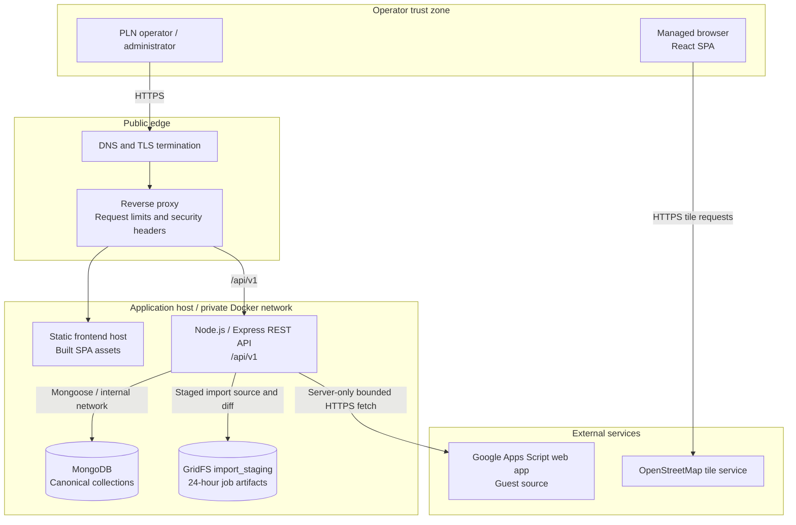
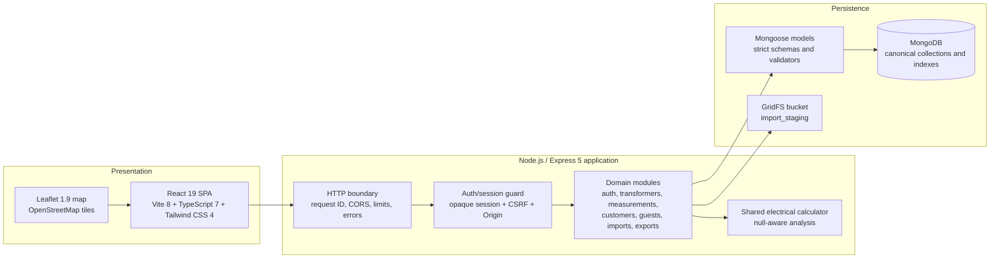
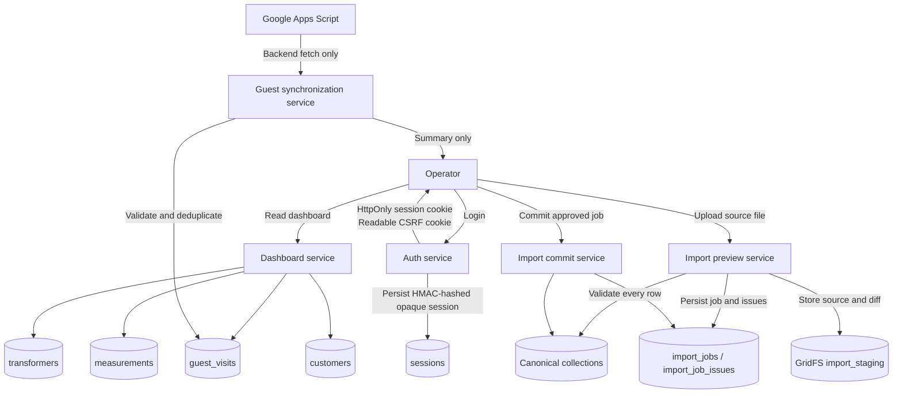
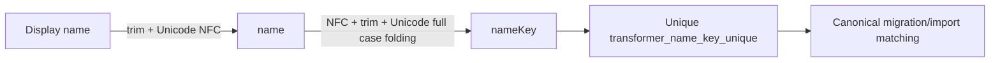
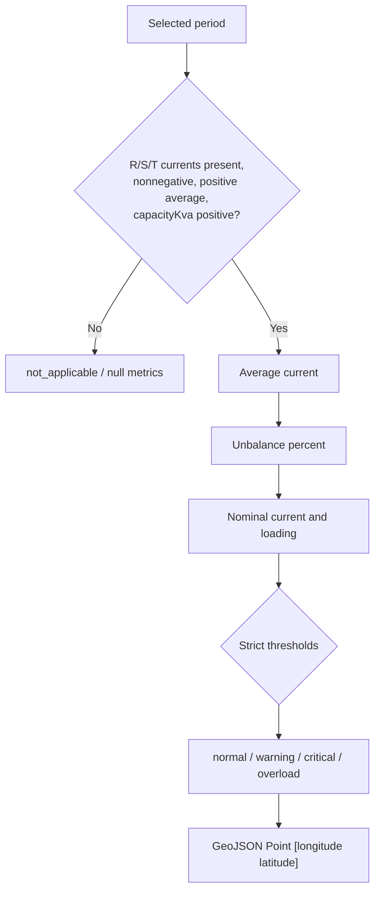

# Implemented System Architecture — SIGAP ULP Labuhan

**Architecture status:** Repository implementation as reconciled on 27 November 2026. It describes the backend, frontend, persistence, and integration boundaries implemented in this working tree. It does not claim production approval, a production migration, a successful deployment, or successful operation of an external service.  
**Release status:** **NO-GO** until transformer identity migration is rehearsed and approved, the seven unresolved HTML names are resolved, and the remaining deployment/external gates in the [implementation plan](../implementation-plan.md) are closed.  
**Contracts:** [API contract](../api/overview.md), [implemented schema](../database/schema.md), [migration guide](../database/migration.md), [Phase 0 audit](../audit/phase-0-audit.md).

## 1. Architecture truthfulness rule

The Phase 0 audit remains the historical record of the pre-implementation defects. This document describes the resulting repository behavior, not an assumed production state.

| Label | Meaning |
|---|---|
| **Implemented** | Present in the current backend/frontend/schema code and covered by the repository test/gate commands |
| **Verified evidence** | Observed in an isolated test database, dry run, or static gate on 27 November 2026 |
| **External gate** | Requires an environment, approval, credential, alias, or operation that the repository cannot prove by itself |
| **Not claimed** | Production approval, successful external synchronization, production migration, production image publication, or successful production deployment |

## 2. System context and trust boundaries

Trust-boundary rules:

1. The browser is untrusted. It receives no MongoDB credential, session-token hash, CSRF hash, Google endpoint, or Google credential.
2. The session token is an opaque cookie value. The browser may read only the independent CSRF cookie needed for unsafe requests.
3. The canonical MongoDB collections are the runtime authority for persisted application data.
4. `.temp/sigap/` is a read-only evidence source outside the runtime data path. Migration tooling reads it; the application and tests never write there.
5. The external Google service is untrusted input. Every record is validated before insertion and no fallback record is synthesized.
6. The reverse proxy/container topology is designed so MongoDB is not published to the host or public network. The disposable local image build and Compose runtime health check passed; production image publication/deployment evidence remains open.

## 3. Implemented container and module architecture

The repository uses route → controller → service → Mongoose model boundaries. A separate repository layer is not required and is not presented as implemented. Shared validation, error, name-key, GeoJSON, and electrical-calculation utilities remain framework-independent.

## 4. Implemented runtime data flows

## 5. Component responsibilities and current state

| Component | Implemented responsibility | Current evidence/state |
|---|---|---|
| Frontend | React/Vite/TypeScript SPA; API-driven views; CSRF-aware client; server pagination; Leaflet; import/export/profile modals | Typecheck, build, unit/component tests, and Playwright desktop/mobile evidence are rerun in the current verification record |
| Backend API | Versioned Express API with stable envelopes, request IDs, AJV validation, centralized errors, role checks, and domain modules | Static API-contract gate and backend unit/integration suite exist in the repository |
| Authentication | Revocable opaque server-side session, independent session-bound CSRF, exact-origin checks, credentialed CORS allowlist, controlled admin bootstrap | Password change/logout/deactivation revoke affected sessions; raw tokens are never returned in JSON |
| Transformer domain | Canonical `name`/`nameKey`, full-replacement writes, nullable provenance, GeoJSON, period-aware list/detail/map/anomaly queries | Production startup verifies canonical identity and the unique index before accepting traffic |
| Measurement domain | One current WBP/LWBP document per transformer/period; manual `PUT` replacement | `POST` is deliberately `405`; omitted date/time/branches are not fabricated |
| Customer domain | 12-digit string identity, raw/scaled power, search, pagination, full-replacement writes | CSV/XLSX ground-truth reconciliation completed in an isolated migration dry run |
| Guest integration | Backend-only fetch, strict per-record validation, versioned fingerprint idempotency, no fallback rows | The real Apps Script contract/credential and successful external smoke test remain unresolved |
| Import/export | Persisted preview/job/issues, owner/token/hash binding, lease, conflict detection, bounded commit, complete bounded exports | 100,000-row and 64 MiB export ceilings, capped concurrent exports; CSV uses semicolons, UTF-8 BOM, and spreadsheet-safe output |
| Database | Mongoose models, unique business keys, TTL session/import metadata, GridFS staging | Implemented field/index details are normative in the [schema](../database/schema.md) |
| Deployment | Docker/Compose/Nginx artifacts and release-control scripts exist in the working tree | Disposable local image build/runtime health passed; production image scan/publication and deployment remain open |

## 6. Cross-component contracts

### 6.1 Data authority

- The transformer CSV is canonical for 1,238 transformer master records.
- The customer CSV is canonical for 68,742 customer records. The equivalent XLSX is a reconciliation source, not a second population.
- The HTML source contains 53 transformer names and 106 period objects. It supplies 46 reconciled names/92 eligible period records and leaves 7 names/14 period records unresolved.
- Missing values are `null`. Source and operator values are not replaced with defaults.

### 6.2 Transformer identity

- `name` is the operator-visible spelling.
- `nameKey` is the canonical identity and upsert key.
- The exact backfill command is `npm run migrate:transformer-name-keys`; it defaults to dry-run and supports `--apply` and `--report`.
- Missing/mismatched keys fail closed with `TRANSFORMER_NAME_KEY_BACKFILL_REQUIRED`.
- Duplicate canonical keys fail closed with `TRANSFORMER_IDENTITY_DUPLICATE_KEYS`; no record is merged or deleted.

### 6.3 HTTP and security

- Success bodies use `{ "data": ... }`; list pagination uses top-level `meta`; transformer/anomaly lists also use top-level `counts`.
- Errors use `{ "error": { "code", "message", "details"? } }` and do not expose internal exceptions.
- Every response has `X-Request-ID`. A valid inbound ID is reused; otherwise a UUID is generated.
- Unsafe methods require a valid session, an exact allowed `Origin`, a readable CSRF cookie, an equal `X-CSRF-Token`, and a matching server-side CSRF hash.
- The session token is stored as an HMAC-SHA-256 hash keyed by `SESSION_SECRET`; the CSRF token is stored as a SHA-256 hash.

### 6.4 Electrical analysis and GIS

- Pincang is strictly `>10%`; overload is strictly `>80%`.
- Recommendation critical is unbalance `>15%` or neutral current `>40 A`; visual critical is unbalance `>20%`.
- An unavailable map/visual/recommendation status is `unknown`.
- The map consumes the backend GeoJSON `FeatureCollection`; the frontend does not reverse coordinates or fabricate markers.

### 6.5 Imports and exports

- Preview parses and compares every selected source row, persists the job/issues in MongoDB, and stores source/diff artifacts in GridFS.
- Commit remains bound to the original owner and opaque preview token, checks expiry/state/source hash, uses a renewable 15-minute lease and 1,000-row batches, detects changed targets, and never deletes.
- Committed records carry `source: "operator_import"`, source file/row, and `sourceMetadata.importJobId`.
- Export is a file response. The maximum population is 100,000 rows and the generated file is capped at 64 MiB; a larger set fails explicitly rather than returning a partial file. Exports are generated into a bounded temporary file and streamed to the client, and at most two exports may be generated concurrently.

## 7. Architectural quality attributes

| Attribute | Implemented mechanism | Evidence still required for production |
|---|---|---|
| Security | Opaque revocable sessions, session-bound CSRF, exact-origin/CORS checks, rate limit, upload/body limits, safe error redaction | Approved production configuration, scan results, and operational review |
| Data integrity | Canonical keys, unique indexes, full-replacement writes, source hashes, provenance, owner-bound import jobs | Approved migration rehearsal and alias resolution |
| Performance | Database-side pagination and bounded search; no browser-side load of the full customer/transformer population | Representative production-like latency/query-plan evidence |
| Reliability | Bounded upstream calls, import leases, idempotent upserts, TTL metadata, health/readiness | Backup/restore and production topology rehearsal |
| Usability | PLN visual identity, dashboard/table/map workflows, period controls, accessible controls | Final visual/e2e evidence review against the supported states |
| Maintainability | Explicit API/schema/migration contracts and static contract/ground-truth gates | Keep API, schema, migration, ADR, and frontend types synchronized |
| Privacy | Role checks, PII-aware responses/log policy, server-only Google endpoint, explicit export controls | Approved PII retention/export/audit policy |

## 8. Release blockers and evidence boundary

The repository is not release-ready while any of the following remains unresolved:

1. The production transformer `nameKey` migration has not been approved and rehearsed against the target volume.
2. The seven unresolved HTML names/14 period objects still require approved aliases or an explicit exclusion decision.
3. The production Google Apps Script contract, URL/deployment identity, credential strategy, and non-production smoke test require owner approval.
4. Production domain, DNS, firewall/TLS, MongoDB topology, backup/restore target, PII policy, and supported version matrix remain operational decisions.
5. The disposable local Docker image build and runtime health check passed, but approved production image digests/scans and a production-like deployment/rehearsal record are still required.

The current documentation and test evidence do not convert any of these blockers into a completed production operation.

## 9. Architecture documents

- [Backend architecture](backend.md)
- [Frontend architecture](frontend.md)
- [Database architecture](database.md)
- [External integrations](integrations.md)
- [Deployment and CI architecture](deployment.md)
- [Data migration strategy](../database/migration.md)
- [Architecture decision records](../decisions/README.md)
