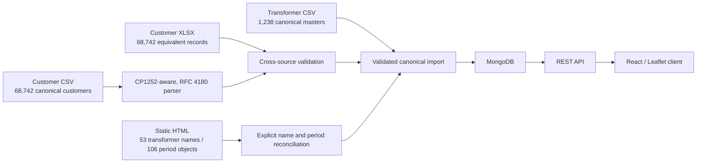

# Phase 0 Audit Report — SIGAP ULP Labuhan

**Audit date:** 26 November 2026  
**Repository:** `20261109_053845`  
**Baseline commit:** `870dd8ed7eec79075ae2b617ee6fa7e2cdbca2ef`  
**Audit status:** **PASS WITH EXPLICIT EXCEPTIONS**

**Reconciliation note (27 November 2026):** This document remains the historical pre-implementation audit. Its findings describe the baseline at commit `870dd8e`; the current working tree has subsequently implemented many of the required corrections. Where this audit used “measurement snapshot” as shorthand, the exact source model is **53 HTML transformer names containing 106 period objects**. Reconciliation produces **46 names / 92 eligible period records** and **7 names / 14 unresolved period records**. The Docker daemon was unavailable at the audit baseline; a later disposable local image build and Compose runtime health check passed after the initialization path was corrected. See the [implemented schema](../database/schema.md), [migration guide](../database/migration.md), and [testing strategy](../testing/strategy.md) for current behavior.

## 1. Purpose and audit boundary

Phase 0 establishes the implementation baseline before production code is changed. It inventories the supplied files, verifies data profiles, records the behavior of the static application, identifies the current implementation state, and resolves source-of-truth conflicts using the following precedence:

1. Supplied files in `.temp/sigap/`
2. Supplied static HTML behavior and terminology
3. Existing repository implementation
4. Documented interpretation only where the preceding sources do not define a value

The audit was read-only with respect to `.temp/sigap/`. No source file in that directory was modified, moved, renamed, or deleted. A pre-audit backup was created outside the repository under the approved temporary directory.

## 2. Repository baseline

| Item | Verified state |
|---|---|
| Branch | `main` |
| Commit | `870dd8ed7eec79075ae2b617ee6fa7e2cdbca2ef` |
| Remote state | `main` synchronized with `origin` at audit start |
| Pre-existing working tree | Dirty: 5 modified tracked files plus untracked `backend/`, `frontend/src/`, and `docs/` |
| Audit-created repository changes | Phase 0 documentation only; the supplied data and existing implementation were not reset or discarded |
| Release rule | No commit or push to `main` without explicit user approval |

The dirty tree is treated as potentially user-owned. Implementation work must use targeted edits and preserve unrelated changes.

## 3. Supplied-file inventory and provenance

The directory `.temp/sigap/` contains exactly six files and no subdirectories.

| File | Role | SHA-256 |
|---|---|---|
| `Manajemen Trafo (SupaBase).csv` | Canonical transformer master | `17E46E48BC04AFC3F1825EADF5FE6240FEF2C9480087ABCC5EA9A169276125CC` |
| `Data Pelanggan (SupaBase).csv` | Canonical customer export, CP1252-compatible | `AB2D7D3D69983AA61B9A218F1610DD1B65DCDC161C491CC0A3D8F9F504D88BD4` |
| `Data Pelanggan.xlsx` | Equivalent customer workbook with numeric power values | `F94F7E4FB8EF95B581BC5A782343D71ACA134FF17D68E5EF7A2B0259DA071E11` |
| `SIGAP ULP LABUHAN.html` | Static UI, terminology, workflow, and measurement period-object reference | `F56FE763252AE594B089E31E8EBEE1CDD87004B1902385AE312D20C65B8880AB` |
| `Logo_PLN.png` | Corporate logo | `67AC91E8C8AB60E2337B3BAE43E5A9CDE83826E9103DB401F1556277681F700D` |
| `Tema_Utama.jfif` | Login background | `ACEE23AE3810132D5EFB4F43FD624E813D7DF4605410FB6F2819B7F0DDD4D7C1` |

### 3.1 Data lineage

## 4. Canonical data profile

### 4.1 Transformer master

| Property | Verified result |
|---|---|
| Encoding / delimiter | UTF-8 with BOM; semicolon; CRLF |
| Header | `nama_trafo;penyulang;kapasitas;titik_koordinat` |
| Data rows | 1,238, all with exactly four fields |
| Name uniqueness | 1,238 exact and case-folded distinct values |
| Feeder | 46 non-empty values; 14 empty values |
| Capacity | 676 empty values; 10 non-empty textual forms, including one `500/300/865 kVA` record |
| Coordinates | 1,238 valid and distinct `POINT (longitude latitude)` values |
| Coordinate bounds | Longitude `98.631590–98.731016`; latitude `3.639622–3.735425` |

The CSV is the authoritative source for transformer name, feeder, capacity, and coordinates. Missing feeder/capacity values remain missing; the importer must not invent values.

### 4.2 Customer master

| Property | Verified result |
|---|---|
| Encoding / delimiter | CP1252-compatible, not valid UTF-8; semicolon; CRLF |
| Header | `id_pelanggan;nama;tarif;daya;alamat` |
| Data rows | 68,742, all with exactly five parsed fields |
| Customer ID | Exactly 12 ASCII digits; all unique; stored as a string |
| Name | 45,194 distinct values; names are not a unique key |
| Tariff | 11 codes |
| Address | 54,842 distinct values; 43 quoted addresses contain internal semicolons |
| Power | 15 distinct VA values; 23,554 values use Indonesian thousands notation such as `1.300` |
| XLSX equivalence | Same IDs, order, names, addresses, and tariffs; numeric `DAYA` agrees after normalizing thousands notation |

The CSV and XLSX are alternate representations of one population, not separate customer populations. The CSV is the canonical import path; the XLSX supplies a cross-check. Customer power must retain the original source text and a correctly scaled integer VA value.

### 4.3 Static HTML datasets

| Dataset | Actual records | Interpretation |
|---|---:|---|
| `trafoData` | 53 | Older/divergent transformer-name set, despite a misleading “DATA FULL 1,238 TRAFO” comment |
| `pelangganData` | 2 | UI examples only; not customer-master data |
| `tamuData` | 1 | Guest schema/example reference |
| `bebanDatabase` | 53 names / 106 period objects | One WBP and one LWBP electrical period object per transformer name |

All measurement `updatedAt` and `updatedTime` values are `null`; dates must not be fabricated.

### 4.4 Transformer reconciliation

- 46 transformer names occur in both the canonical CSV and the HTML source; each contributes WBP and LWBP period objects.
- 7 HTML-only names occur: `ML Pancing 1 6`, `ML Pancing V 1`, `ML Pancing V 2`, `ML Pancing V 3`, `ML Pancing V 4`, `ML.592`, and `PDAM TIRTANADI`.
- For all 46 common names, HTML coordinates equal CSV coordinates after reversing the HTML's latitude-first representation to WKT longitude-first order.
- 29 of 46 common records have different capacity values. The canonical CSV wins.
- `ML.691` has feeder `PY.2` in HTML and an empty feeder in the CSV. The canonical empty value wins.

### 4.5 Measurement reconciliation

The HTML supplies one WBP and one LWBP period object for each of its 53 transformer names: 106 period objects in total. The canonical database model keeps only the current period document per transformer and period, matching static behavior.

The 46 reconciled names produce 92 eligible period records. The seven HTML-only transformer names have no explicit alias to a canonical transformer and therefore produce 14 unresolved period records. The migration reports those records but does not attach, fabricate, or silently discard them. An explicit operator-supplied alias mapping is required before they can be imported.

## 5. Static feature and workflow inventory

The following behavior is preserved unless a security or data-integrity defect requires an explicit, documented change.

| Area | Preserved behavior |
|---|---|
| Identity | PLN logo, Plus Jakarta Sans, blue/dark-blue/yellow/red palette, responsive sidebar and header |
| Authentication | ID Admin and password login, registration UI, profile/password controls, Indonesian notifications |
| Dashboard | Transformer count, unbalance count, overload count, customer/guest counts, Leaflet map, conditional navigation |
| Transformers | Table, search/filter, all/unbalanced/overload views, WBP/LWBP basis, detail, add/edit, load-entry modals |
| Customers | Customer and guest tabs, search, table, detail/add/edit, status display, import/export entry points |
| Electrical analysis | Average phase current, unbalance percentage, nominal current from transformer kVA, loading percentage, recommendation |
| Import | Transformer and customer CSV/XLSX flows, preview, validation, and controlled upsert |
| Export | Transformer and customer CSV exports with UTF-8 BOM and spreadsheet-safe quoting |
| Guest sync | Google Apps Script ingestion into the guest book |

### 5.1 Calculation parity

The static application deliberately uses two related rules:

- **Visual unbalance label:** critical above 20%; warning above 10%.
- **Recommendation severity:** critical above 15% unbalance or neutral current above 40 A; warning above 10% unbalance.
- **Overload:** loading above 80% takes priority.

The implementation and tests must preserve these thresholds rather than collapsing them into one rule.

## 6. Current implementation assessment

The pre-existing implementation provides useful module boundaries and visual assets, but it is not production-ready.

### 6.1 Critical and high findings

| Severity | Finding | Required correction |
|---|---|---|
| Critical | `NormalizePreservedData.py` parses dotted Indonesian power as a float, dividing 23,554 values by 1,000 | Parse IDs and power as strings; apply an explicit locale-aware thousands rule; keep raw and numeric values |
| Critical | The frontend cannot build under the installed TypeScript 7 toolchain, and the application is not reproducible from the synchronized branch because most implementation is untracked and `backend/src/database` is accidentally ignored | Use a TypeScript 7-compatible configuration, anchor runtime-data ignore rules to the repository root, and include the complete application and lockfiles in the reviewed release set |
| Critical | Predictable fallback JWT/session/cookie secrets and a default seeded admin password | Remove secret fallbacks in production; require explicit one-time provisioning inputs; never ship a usable default password |
| High | `migrateCustomers.js` reads CP1252 as UTF-8 and splits physical lines instead of parsing CSV | Use `csv-parse`, explicit encoding fallback, and RFC 4180 quoting semantics |
| High | Leaflet popup content is interpolated with `innerHTML`, creating a stored-XSS sink | Construct popup content with DOM nodes and `textContent`; never interpolate database values as HTML |
| High | Guest sync accepts a client-controlled URL and performs an unrestricted outbound fetch, creating an SSRF risk | Use only the server-configured endpoint, enforce an exact destination allowlist, timeout, redirect policy, and response-size limit |
| High | The archive script can package `.env`, local database files, normalized customer data, and prior archives | Use an explicit source allowlist or comprehensive exclusions and run a sensitive-file preflight |
| High | CORS callback accepts every origin | Allow only configured origins; reject untrusted origins |
| High | Authentication is a stateless JWT cookie rather than a revocable server-side session | Store opaque session identifiers in MongoDB; rotate and revoke on logout/password change |
| High | State-changing requests have no CSRF/origin enforcement | Require a session-bound CSRF token and validated `Origin` for unsafe methods |
| High | Guest sync inserts static fallback records | Accept and persist only valid external records; reject malformed payloads without inserting placeholders |
| High | Import previews are cached in memory and customer matching checks only the first 500 IDs | Persist or sign short-lived preview state; compare every row and report mismatches |
| High | Import defaults invent tariff/power values | Preserve missing source values and require explicit mapping only when the user supplies one |
| High | Customer export truncates at 20,000 rows | Stream the complete population and enforce a documented safe maximum |
| Medium | Seven baseline HTML transformer names / 14 period objects cannot be attached | Report as unresolved and require an explicit alias decision |
| Medium | `geoParser.js` does not safely parse the HTML's decimal-comma latitude-first coordinates | Support explicit WKT, HTML latitude-first, and decimal-comma formats without ambiguity |
| Medium | Frontend TypeScript 7 configuration uses removed `baseUrl` and non-relative path options | Use a TypeScript 7-compatible configuration and relative imports or supported resolution |
| Medium | `xlsx@0.18.5` has a known high-severity advisory with no npm-provided fix | Replace it with a maintained, audited workbook parser or isolate a safer supported alternative |
| Medium | Docker CLI exists, but the Docker daemon is unavailable | Validate images in CI/when a daemon is available; report the local limitation truthfully |
| Medium | Static login accepts any non-empty credential and simulates registration/password changes | Replace simulation with real backend-controlled authentication and admin provisioning |

### 6.2 Positive baseline findings

- Backend JavaScript syntax is valid across the inspected 38 source files.
- The frontend visual identity and major workflows are already substantially implemented.
- `frontend/assets/logo_pln.png` is byte-identical to the supplied logo.
- `frontend/assets/bg_landing_page.png` faithfully preserves the supplied login background pixels.
- Transformer WKT migration logic correctly treats canonical coordinates as longitude-first.
- The frontend dependency audit is clean; the root audit's high finding is isolated to `xlsx`.
- MongoDB Server 9.0.4 is available locally for isolated integration tests.
- Docker and Docker Compose CLIs are available; only the daemon is inactive.

## 7. Baseline test and build evidence

| Check | Baseline result |
|---|---|
| Backend JavaScript syntax | Passed for all inspected backend files |
| Root test command | Failed: no test files were present |
| Frontend type check / build | Failed: TypeScript 7 removed `baseUrl` and rejected the configured non-relative path alias; source-level diagnostics remain after bypassing that configuration |
| Node runtime compatibility | The complete command set requires Node 22.13+ within 22.x, Node 24.x, or Node 26+; the project did not declare this baseline |
| Root `npm audit` | One high direct vulnerability from `xlsx@0.18.5`; no npm fix available |
| Frontend `npm audit` | Clean |
| Docker image build | Not locally verifiable because the Docker daemon was inactive |
| Static visual baselines | Captured outside the repository for login, dashboard, transformers, customers, and mobile login |

These are baseline findings, not final acceptance results.

## 8. External environment and unresolved dependencies

The following cannot be completed from the supplied repository and must remain explicit blockers for production release:

- Production domain, DNS, VPS access, firewall, and TLS configuration
- Production MongoDB credentials, topology, backup schedule, and restore target
- Real Google Apps Script URL, deployment identity, expected payload contract, and authentication strategy
- Explicit alias mapping for the seven HTML-only measurement names
- Operational approval for the data-retention and privacy treatment of customer PII
- Accessible local Docker daemon for a local container build

The application will implement real contracts and fail closed when these dependencies are absent. It will not ship production mocks or placeholder data.

## 9. Phase 0 gate decision

### Accepted baseline

- Canonical transformer population: 1,238 records from the supplied transformer CSV.
- Canonical customer population: 68,742 records from the supplied customer CSV, cross-validated with the XLSX.
- Static UI, terminology, workflows, and electrical rules: preserve, with explicit corrections for security and data integrity.
- Measurement population: 53 HTML transformer names containing 106 period objects; 46 names reconcile to 92 eligible period records, while 7 names leave 14 period records unresolved pending an alias decision.
- Coordinates: canonical source uses WKT longitude-first; HTML uses latitude-first; parsed latitude/longitude must be stored explicitly and raw input retained for audit.

### Required implementation gates

Phase 1 and later may proceed only with these invariants:

1. No modification of `.temp/sigap/`.
2. No fabrication of missing transformer fields, measurement dates, aliases, tariffs, power values, or external API data.
3. No production fallback records, permissive CORS, reusable secrets, unsigned client state, or incomplete exports.
4. All migrations are encoding-aware, schema-validated, idempotent, dry-run capable, and produce mismatch reports.
5. All user-facing changes are covered by automated unit, integration, end-to-end, or visual evidence appropriate to the behavior.

**Gate result:** Phase 0 is complete. Implementation may proceed under the exceptions and invariants recorded above.
