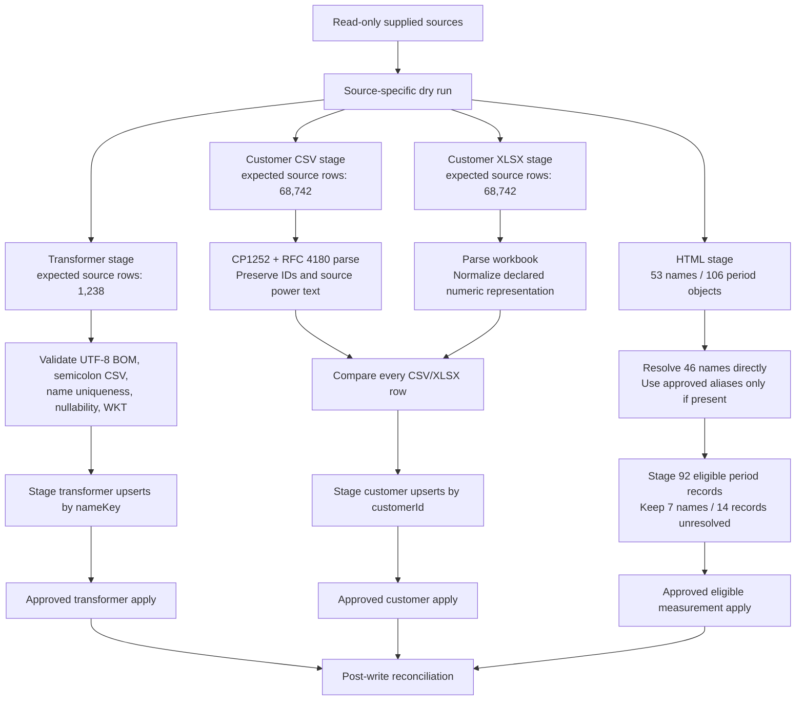
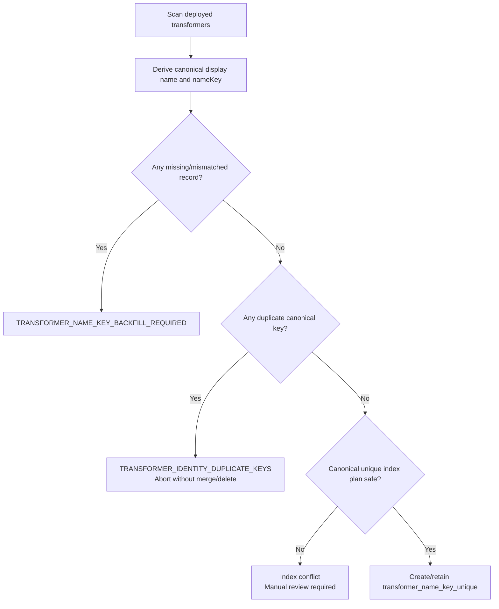
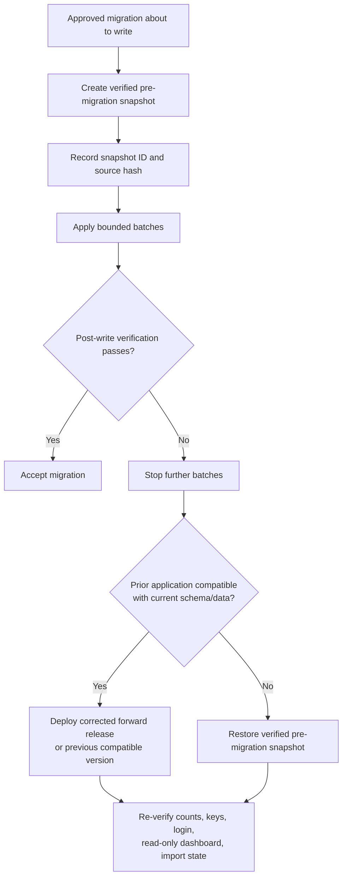

# Implemented Data Migration Strategy — SIGAP ULP Labuhan

**Status:** Repository migration implementation and isolated rehearsal evidence as of 27 November 2026. The procedures below are implemented; the production migration itself remains unapproved and unperformed by this documentation work.  
**Release status:** **NO-GO** until a production-target dry run is reviewed/approved, transformer identity is canonical and uniquely indexed, and the seven unresolved names are resolved or explicitly excluded.  
**Contracts:** [implemented schema](schema.md), [import decision](../decisions/ADR-0006-import-preview-and-upsert.md), [data authority decision](../decisions/ADR-0003-mongodb-data-modeling.md), [implementation plan](../implementation-plan.md#4-data-migration-strategy).

## 1. Source boundary and verified profiles

`.temp/sigap/` is read-only ground truth. Migration code reads it or uses separately managed copies; it never writes, moves, renames, or deletes a supplied file. Report output is rejected when its path is inside `.temp/`.

| Source | Verified profile | Role |
|---|---|---|
| `Manajemen Trafo (SupaBase).csv` | UTF-8 with BOM; semicolon; CRLF; 1,238 data rows | Canonical transformer master |
| `Data Pelanggan (SupaBase).csv` | CP1252-compatible; semicolon; CRLF; 68,742 data rows | Canonical customer import path |
| `Data Pelanggan.xlsx` | 68,742 equivalent records; numeric power agrees after declared normalization | Customer cross-check |
| `SIGAP ULP LABUHAN.html` | 53 transformer names; one WBP and one LWBP object per name = 106 period objects; source dates/times null | Measurement source and UI terminology |

The HTML contains **53 transformer names**, not 53 independent measurement records. The migration code retains the historical constant name `EXPECTED_SNAPSHOT_ROWS = 53`, but its canonical meaning is the number of source transformer names.

## 2. Implemented migration flow



`migrateAll.js` runs transformer, transformer-identity, customer, and measurement stages in dependency order. Its dry run does not write. In apply mode, the identity stage reads and reconciles the deployed transformer volume before continuing.

## 3. Source-specific rules

### 3.1 Transformer CSV

1. Decode as UTF-8 with BOM and parse semicolon-delimited records with a standards-compliant CSV parser.
2. Validate the header `nama_trafo;penyulang;kapasitas;titik_koordinat` and exactly four fields per data row.
3. Normalize the transformer display name with trim + Unicode NFC and derive `nameKey` with NFC + trim + Unicode full case folding.
4. Preserve absent feeder and capacity as `null`; preserve the original capacity label.
5. Populate `capacityKva` only for one unambiguous positive numeric value or an explicit approved mapping. A multi-valued label remains raw with numeric capacity `null`.
6. Parse WKT `POINT (longitude latitude)` without reversing the canonical order and preserve `rawCoordinates`.
7. Validate the audited coordinate envelope: longitude `98.631590–98.731016`, latitude `3.639622–3.735425`.
8. Upsert by unique `nameKey`.

### 3.2 Customer CSV

1. Decode as CP1252. Reject an invalid decode; do not silently replace characters.
2. Parse semicolon-delimited RFC 4180 records. Quoted addresses containing internal semicolons remain one field.
3. Validate the header `id_pelanggan;nama;tarif;daya;alamat` and exactly five parsed fields per data row.
4. Validate `customerId` as exactly 12 ASCII digits and store it as a string with leading zeros.
5. Preserve raw power text in `powerRaw` and derive `powerVa` as a nonnegative integer using the explicit Indonesian thousands rule.
6. Keep missing tariff, power, or address as `null`.
7. Compare every customer ID and normalized field with the XLSX. Any unexplained difference blocks the migration.
8. Upsert by unique `customerId`.

### 3.3 Customer XLSX equivalence

The CSV and XLSX are alternate representations of one population, not separate import populations.

| Field | Equivalence rule |
|---|---|
| Customer ID | Exact 12-digit string equality |
| Name | Exact equality after representation-preserving trimming |
| Tariff | Exact equality after case-preserving trimming |
| Power | Exact source representation and integer VA agree after the declared normalization |
| Address | Exact equality after representation-preserving trimming; internal semicolons preserved |
| Row count | Both populations contain 68,742 rows |

A missing row, extra row, duplicate ID, or field difference is a blocking mismatch report. The migration never chooses the XLSX value merely because the CSV row was rejected.

### 3.4 HTML measurements and aliases

1. Extract 53 transformer names and 106 period objects.
2. Preserve the null source `updatedAt` and `updatedTime` values as null `measurementDate` and `measurementTime`.
3. Match 46 names directly to canonical transformer IDs using the approved normalized-name rule.
4. Resolve a remaining name only through an approved `transformer_aliases` record. The alias does not create or rename the canonical transformer.
5. Upsert at most one current measurement per `(transformerId, period)`.
6. Do not create a transformer for an HTML-only name.
7. Keep 7 unresolved names/14 unresolved period records in the migration report until an explicit alias is approved. The unresolved names are:

   - `ML Pancing 1 6`
   - `ML Pancing V 1`
   - `ML Pancing V 2`
   - `ML Pancing V 3`
   - `ML Pancing V 4`
   - `ML.592`
   - `PDAM TIRTANADI`

8. When an approved alias exists, create/reuse the alias record and rerun the measurement dry run. The canonical transformer remains unchanged.

The current alias registry uses `aliasKey`, `approvedBy`, `approvedAt`, `source`, and `sourceVersion`; it does not use the obsolete `aliasNameKey`/`approvedByUserId` names.

## 4. Transformer identity reconciliation

The canonical identity pair is:

- display name: trim + Unicode NFC;
- business key: NFC + trim + lowercase.

The exact command is:

```bash
npm run migrate:transformer-name-keys
```

It defaults to dry-run and supports `--apply` and `--report`.



- The migration backfills in bounded batches and does not change `updatedAt`.
- Duplicate canonical keys abort the command; no record is merged or deleted.
- The migration preserves unrelated indexes and manages only the canonical/known legacy `nameKey` indexes.
- Production startup calls the same readiness analysis and fails before accepting traffic if identity is not canonical or protected by the unique index.

## 5. Commands, modes, and controls

| Command | Default behavior | Purpose |
|---|---|---|
| `npm run migrate:trafo` | Dry run | Transformer CSV validation/plan |
| `npm run migrate:customers` | Dry run | Customer CSV/XLSX reconciliation/plan |
| `npm run migrate:measurements` | Dry run | HTML name/period reconciliation/plan |
| `npm run migrate:all` | Dry run | Ordered aggregate plan with no writes |
| `npm run migrate:transformer-name-keys` | Dry run | Deployed transformer identity/index analysis |

Database-changing scripts require explicit `--apply`. They support source-path overrides, an optional per-stage `--limit` for rehearsal, and an atomic JSON `--report` written outside `.temp/`.

A dry-run report records:

- source file name/path, encoding, SHA-256, and byte/row counts;
- expected and actual source-row counts;
- insert/update/unchanged/rejected counts by business key;
- field-level validation issues;
- customer CSV/XLSX differences;
- transformer/measurement reconciliation, including the 46 reconciled and 7 unresolved names;
- measurement period-record counts; and
- target collection and stable key for every proposed write.

## 6. Idempotency and checkpoints

| Data set | Stable key | Idempotent behavior |
|---|---|---|
| Transformer | `nameKey` | Reapply updates the same record; no duplicate canonical name |
| Customer | `customerId` | Reapply updates the same record; no duplicate ID |
| Measurement | `(transformerId, period)` | Reapply updates the current period document |
| Alias | `aliasKey` | Approved mapping is reused or conflicts explicitly |

- Writes use bounded batches and persist progress suitable for retry.
- An unchanged migration creates no duplicate canonical record and no unintended update.
- The migration runner does not use a fixed “first 500 IDs” comparison limit.
- Import-job commit uses a renewable 15-minute lease and 1,000-row batches; migration scripts use their own bounded plans.

## 7. Ordering and isolation

1. Apply transformer records first because measurements and aliases reference transformer IDs.
2. Reconcile transformer identity and the unique index on the deployed volume.
3. Apply eligible measurements and approved aliases second.
4. Apply customers third; customers do not reference measurements.
5. Migrate users/sessions only through controlled administrator bootstrap and runtime authentication paths. Ground truth contains no administrator credential.
6. Use a dedicated migration database or explicitly approved isolated environment for rehearsal.
7. Do not combine the first production migration with unrelated application releases without an approved rollback plan.

## 8. Validation and rejection behavior

| Failure | Behavior |
|---|---|
| Invalid encoding | Stop the affected source; no partial canonical write |
| Wrong header/field count | Reject the file/row with a source-location issue |
| Invalid customer ID | Reject the row; do not truncate, pad, or convert it |
| Invalid/ambiguous power | Reject the row; do not use zero or a default tariff/power |
| Missing feeder/capacity | Store `null` where the row is otherwise valid |
| Invalid coordinates | Reject the row for review; do not clamp or swap coordinates |
| Duplicate source business key | Reject the duplicate and report both source locations |
| CSV/XLSX mismatch | Block the customer migration and report row/field differences |
| Unmatched HTML name | Keep the name/period records unresolved; require an explicit alias |

A migration may contain valid rows and rejected rows, but it must not transform a rejected row into a partially fabricated record.

## 9. Verification oracle

After an approved apply, re-read MongoDB and verify:

| Check | Expected result |
|---|---|
| Transformer count | 1,238 canonical records after the approved transformer migration |
| Transformer key uniqueness | 1,238 unique canonical `nameKey` values |
| Transformer coordinates | Every canonical point has valid longitude/latitude order; no source coordinate was silently changed |
| Customer count | 68,742 canonical records after the approved customer migration |
| Customer key uniqueness | 68,742 unique 12-digit string `customerId` values |
| Customer power | Raw representation and scaled integer agree for every valid row |
| CSV/XLSX | No unexplained population or field difference |
| HTML source population | 53 names / 106 period objects |
| Eligible measurement population | 46 reconciled names / 92 period records unless approved aliases extend it |
| Unresolved measurement population | 7 names / 14 period records until approved aliases exist |
| Measurement uniqueness | At most one current document per transformer and period |
| Source dates/times | Remain null where the HTML supplied no source date/time |

Counts are checked with both total and distinct business-key queries. A sample is for human review only; it does not replace complete key/count reconciliation.

## 10. 27 November 2026 isolated evidence

The following evidence was supplied for the current repository implementation. It was obtained in isolated test databases; it is not a production migration or deployment claim.

### 10.1 Aggregate dry run

| Evidence item | Result |
|---|---|
| Command | `migrateAll.js --dry-run` |
| Isolated database | `sigap_ulp_labuhan_migration_dry_run` |
| Source records read | 70,033 total: 1,238 transformer rows + 68,742 customer rows + 53 HTML transformer names |
| Invalid records | 0 |
| Planned transformer/customer upserts | 69,980 (1,238 + 68,742) |
| Measurement period objects | 106 total from 53 names |
| Eligible measurement records | 92 from 46 reconciled names |
| Unresolved names/period records | 7 names / 14 period records |
| CSV/XLSX mismatches | 0 |
| Database writes | 0 |

The aggregate report's `planned.upserts` counter is the sum of transformer and customer upserts. The measurement stage reports 92 eligible period records separately in `planned.measurementRecords`; it does not add those 92 to `planned.upserts`.

### 10.2 Transformer identity migration

| Scenario | Result |
|---|---|
| Dry run against isolated empty DB | Passed; 0 pending updates, 0 duplicate keys, plan for `transformer_name_key_unique` |
| Apply against isolated legacy DB | Succeeded; `Trafo Legacy` → `trafo legacy`, `Café Trafo` → `café trafo`; canonical unique index created |
| Duplicate-key scenario | Exited 1; both records retained unchanged and without `nameKey`; no canonical index created; no merge/deletion |

These results prove the command behavior in isolated databases. They do not prove that the production volume is migrated or that its index state is approved.

## 11. Rollback



- A database snapshot is created before the first production write.
- Application rollback and data rollback are separate decisions.
- A prior application image is rolled back first only when it remains schema-compatible.
- The pre-migration snapshot is restored when compatibility cannot be proven.
- A destructive down-migration is not assumed.
- Rollback never deletes or modifies `.temp/sigap/`.

## 12. Migration acceptance gate

The migration implementation passes only when it demonstrates:

1. The audited transformer/customer profiles and the 53-name/106-period reconciliation result.
2. CP1252 decoding and RFC 4180 quoting, including addresses with internal semicolons.
3. Full CSV/XLSX customer equivalence over every row.
4. Preservation of 12-digit customer IDs and raw/scaled power.
5. Correct GeoJSON order and no coordinate clamping.
6. Null-preserving missing fields and no fabricated dates/values.
7. Dry-run capability, bounded progress, retry safety, and idempotency.
8. Full post-write count/key reconciliation.
9. Transformer identity backfill plus the unique index, with duplicate-key fail-closed behavior.
10. A backup/restore and migration rollback rehearsal.
11. Proof that `.temp/sigap/` remains unchanged.

Items 1–8 and the repository's identity behavior have isolated evidence. Production-target rehearsal/approval, a production-approved backup/restore rehearsal, and the seven unresolved aliases remain open release gates.
