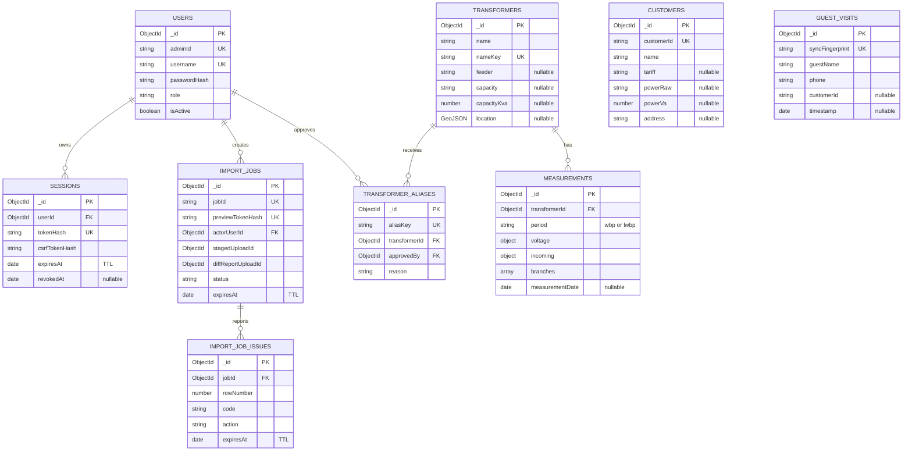
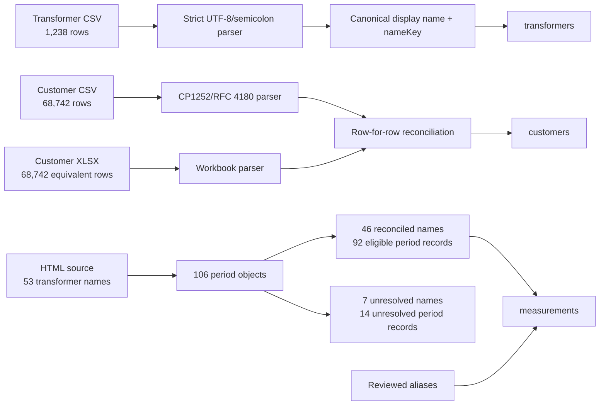
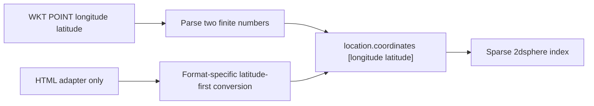

# Implemented MongoDB and Mongoose Schema — SIGAP ULP Labuhan

**Schema status:** Canonical description of the repository's implemented Mongoose models, reconciled on 27 November 2026. It describes repository behavior; it does not assert that a production database has been migrated, approved, or released.  
**Related records:** [implementation plan](../implementation-plan.md), [API contract](../api/overview.md), [migration guide](migration.md), [Phase 0 audit](../audit/phase-0-audit.md), [ADR-0003](../decisions/ADR-0003-mongodb-data-modeling.md), [ADR-0005](../decisions/ADR-0005-secure-cookie-session-auth.md), [ADR-0006](../decisions/ADR-0006-import-preview-and-upsert.md).

## 1. Schema rules

1. The runtime collections are `users`, `sessions`, `transformers`, `measurements`, `customers`, `guest_visits`, `import_jobs`, `import_job_issues`, and `transformer_aliases`. Import source and diff artifacts use the GridFS bucket `import_staging`.
2. Mongoose schemas are strict and use automatic `createdAt`/`updatedAt` timestamps. API serializers, not Mongoose documents, define the public resource shapes.
3. `_id` is a MongoDB ObjectId. Most resource serializers expose it as a lowercase hexadecimal string named `id`; the transformer-alias endpoints are the current exception and return Mongoose alias objects.
4. Unique indexes are the final defense for business keys. Application-level duplicate checks improve error messages but do not replace an index.
5. `null` is the explicit representation for an unavailable API value. A missing model field may remain absent when no write path assigns it.
6. Source-derived values are not replaced with business defaults. Explicit model defaults are limited to system metadata such as `users.isActive`, `users.avatar`, `guest_visits.source`, and import-job lifecycle fields.
7. `createdAt` and `updatedAt` are server processing timestamps. They are not source measurement dates.
8. The production MongoDB/Mongoose version matrix remains an unresolved release decision in the [implementation plan](../implementation-plan.md#8-explicit-unresolved-decisions).

## 2. Collections and relationships

The HTML source contains one WBP object and one LWBP object for each of 53 transformer names. The canonical reconciliation result is therefore 106 period objects: 92 eligible period records from 46 reconciled names and 14 unresolved period records from 7 unresolved names.

## 3. Common conventions

| Notation | Meaning |
|---|---|
| `ObjectId` | MongoDB ObjectId |
| `String` | UTF-8 string; trim/length rules are field-specific |
| `Number` | JavaScript number; validators define integer/finite/range behavior |
| `Boolean` | Boolean value |
| `Date` | BSON UTC date/time |
| `GeoJSON Point` | `{ type: "Point", coordinates: [longitude, latitude] }` |
| `Mixed` | Validated or service-owned object; allowed keys are controlled by the writer |
| `Nullable` | The API/service may persist `null` |
| `Server-managed` | The model or service supplies the value |

## 4. `users`

Stores administrator identities and credential verifiers. There is no plaintext password field and no shipped usable default credential.

| Field | Type | Required | Rules |
|---|---|---|---|
| `_id` | `ObjectId` | Yes | Generated |
| `adminId` | `String` | Yes | Lowercase and trimmed; 3–64 characters; unique; `^[A-Za-z0-9][A-Za-z0-9._-]*$` before model normalization |
| `username` | `String` | Yes | Trimmed; 3–64 characters; unique with the model's default MongoDB collation |
| `passwordHash` | `String` | Yes | Bcrypt hash generated with work factor 10 |
| `fullName` | `String` | Yes | Trimmed; maximum 120 characters; model default `''`; API serializer emits `null` for an empty value |
| `email` | `String` | Yes | Lowercase and trimmed; maximum 254 characters; unique and sparse |
| `avatar` | `String` | Yes | Maximum 512 characters; model default `''`; normally an authenticated avatar URL |
| `avatarMetadata` | `Object` | No | Stored upload path, filename, original name, MIME type, size, and upload time |
| `role` | `String` | Yes | Enum `superadmin`, `admin`; model default `admin` |
| `isActive` | `Boolean` | Yes | Model default `true` |
| `createdAt` | `Date` | Yes | Server-managed |
| `updatedAt` | `Date` | Yes | Server-managed |

Indexes:

| Index | Type | Purpose |
|---|---|---|
| `{ adminId: 1 }` | Unique | Login/business identifier |
| `{ username: 1 }` | Unique | Username uniqueness |
| `{ email: 1 }` | Unique, sparse | Optional email uniqueness |
| `{ isActive: 1 }` | Non-unique | Active-user filtering |

The first administrator is provisioned through a controlled server-side bootstrap command with explicit input. The public API can create another `admin` only for an authenticated `superadmin`.

## 5. `sessions`

Stores revocable server-side session state. Raw session and CSRF tokens are never stored.

| Field | Type | Required | Rules |
|---|---|---|---|
| `_id` | `ObjectId` | Yes | Generated |
| `userId` | `ObjectId` | Yes | References `users._id` |
| `tokenHash` | `String` | Yes | 64 lowercase hexadecimal characters; HMAC-SHA-256 of the raw opaque token, keyed by `SESSION_SECRET`; unique |
| `csrfTokenHash` | `String` | Yes | 64 lowercase hexadecimal characters; SHA-256 of the independent CSRF token |
| `createdAt` | `Date` | Yes | Immutable creation time |
| `lastUsedAt` | `Date` | Yes | Last authorized-request timestamp; does not extend absolute expiry |
| `expiresAt` | `Date` | Yes | Absolute expiry; default lifetime eight hours, configurable from 1–168 hours |
| `revokedAt` | `Date` | No | `null` while active; set on revocation |
| `revokedReason` | `String` | No | Bounded to 64 characters; not an enum in the current model |
| `updatedAt` | `Date` | Yes | Server-managed |

Indexes:

| Index | Type | Purpose |
|---|---|---|
| `{ tokenHash: 1 }` | Unique | Opaque session lookup |
| `{ userId: 1 }` | Non-unique | Revoke all sessions for a user |
| `{ expiresAt: 1 }` | TTL, `expireAfterSeconds: 0` | Remove expired sessions |

The current session model does **not** store raw IP addresses, user-agent text, IP hashes, or user-agent hashes. MongoDB TTL deletion is asynchronous; authorization still checks `expiresAt` and `revokedAt` on every protected request.

## 6. `transformers`

Stores the canonical transformer master.

| Field | Type | Required | Rules |
|---|---|---|---|
| `_id` | `ObjectId` | Yes | Generated or preserved during validated migration |
| `name` | `String` | Yes | Trimmed and Unicode-NFC normalized; maximum 200 characters |
| `nameKey` | `String` | Yes | NFC + trim + Unicode full case-folded lookup key; maximum 600 characters after case expansion; unique |
| `feeder` | `String` | No | Trimmed; nullable; maximum 200 characters |
| `capacity` | `String` | No | Trimmed source/operator label; nullable; maximum 200 characters |
| `capacityKva` | `Number` | No | Nullable; finite, strictly positive, and at most 1,000,000 kVA when present |
| `brand` | `String` | No | Trimmed; nullable; maximum 200 characters |
| `grounding` | `String` | No | Trimmed; nullable; maximum 200 characters |
| `location` | `GeoJSON Point` | No | Nullable; valid `Point` when present |
| `location.type` | `String` | Conditional | Exactly `Point` |
| `location.coordinates` | `[Number]` | Conditional | Exactly two finite values in longitude/latitude order |
| `rawCoordinates` | `String` | No | Trimmed source/operator coordinate text; nullable; maximum 500 characters |
| `source` | `String` | No | Trimmed provenance kind; the current model does not enforce an enum |
| `sourceFile` | `String` | No | Maximum 255 characters; nullable |
| `sourceRow` | `Number` | No | One-based source row; minimum 1; nullable |
| `sourceMetadata` | `Mixed` | No | Structured provenance such as `importJobId`; nullable |
| `createdAt` | `Date` | Yes | Server-managed |
| `updatedAt` | `Date` | Yes | Server-managed |

Indexes:

| Index | Type | Purpose |
|---|---|---|
| `{ nameKey: 1 }` | Unique, named `transformer_name_key_unique` | Canonical transformer identity and upsert key |
| `{ location: "2dsphere" }` | Sparse geospatial | GeoJSON map queries |
| `{ feeder: 1 }` | Non-unique | Feeder filtering |

### 6.1 Canonical identity

The display name is `trim` + Unicode NFC. The business key is NFC + trim + Unicode full case folding. This treats Greek final sigma, long s, and German sharp s according to Unicode case-folding mappings instead of locale-sensitive lowercasing. Model hooks keep the pair synchronized for creates, document replacements, updates, and bulk writes.

Production startup verifies every transformer against this rule before accepting traffic:

- Missing or mismatched `nameKey` fails with `TRANSFORMER_NAME_KEY_BACKFILL_REQUIRED`.
- Duplicate canonical keys fail with `TRANSFORMER_IDENTITY_DUPLICATE_KEYS`; no record is merged or deleted.
- The startup gate creates or verifies the canonical unique `transformer_name_key_unique` index without dropping unmanaged indexes.

The exact backfill CLI is `npm run migrate:transformer-name-keys`. It defaults to dry-run and supports `--apply` and `--report`.

### 6.2 Capacity rules

`capacity` preserves the source label. `capacityKva` is populated only for one unambiguous positive numeric kVA value. A compound label such as `500/300/865 kVA` remains in `capacity` with `capacityKva: null` until operator review. If both forms are supplied, they must agree.

### 6.3 GeoJSON order

The canonical transformer CSV is longitude-first. HTML-only coordinate conversion is isolated from the canonical CSV adapter. Values are validated rather than silently clamped or swapped.

## 7. `measurements`

Stores at most one current WBP and one current LWBP document per transformer.

| Field | Type | Required | Rules |
|---|---|---|---|
| `_id` | `ObjectId` | Yes | Generated or preserved during validated migration |
| `transformerId` | `ObjectId` | Yes | References `transformers._id` |
| `period` | `String` | Yes | Enum `wbp`, `lwbp`; trimmed and lowercased |
| `voltage.r/s/t` | `Number` | No | Nullable in migrated data; 0–500 when present |
| `incoming.r/s/t/n` | `Number` | No | Nullable in migrated data; 0–100,000 A when present |
| `branches` | `[Object]` | No | Branch array; manual API writes use `[]` when omitted |
| `branches[].name` | `String` | No | Nullable; trimmed; maximum 300 characters |
| `branches[].r/s/t/n` | `Number` | No | Nullable; 0–100,000 A when present |
| `branches[].fuse` | `String` | No | Nullable; trimmed; maximum 300 characters |
| `branches[].note` | `String` | No | Nullable; trimmed; maximum 300 characters |
| `measurementDate` | `Date` | No | Source/operator date only; nullable |
| `measurementTime` | `String` | No | `HH:mm`; nullable |
| `source` | `String` | Yes | Enum `html_snapshot`, `operator_import`, `manual` |
| `sourceRecordKey` | `String` | No | Maximum 300 characters; nullable |
| `createdAt` | `Date` | Yes | Server-managed; not a measurement date |
| `updatedAt` | `Date` | Yes | Server-managed; not a measurement date |

Indexes:

| Index | Type | Purpose |
|---|---|---|
| `{ transformerId: 1, period: 1 }` | Unique | One current measurement per transformer and period |
| `{ transformerId: 1 }` | Non-unique | Transformer detail lookup; prefix of the unique index |
| `{ measurementDate: -1 }` | Sparse non-unique | Real source-date filtering |

A manual `PUT /measurements/:transformerId` replaces the selected period document. It requires complete R/S/T voltage and R/S/T/N incoming values, clears omitted date/time/branches as defined by the API contract, sets `source: "manual"`, and clears `sourceRecordKey`.

## 8. `customers`

Stores the canonical customer population.

| Field | Type | Required | Rules |
|---|---|---|---|
| `_id` | `ObjectId` | Yes | Generated or preserved during validated migration |
| `customerId` | `String` | Yes | Exactly 12 ASCII digits; trimmed; unique |
| `name` | `String` | Yes | Trimmed; maximum 300 characters; not unique |
| `tariff` | `String` | No | Trimmed; nullable; maximum 100 characters; no default tariff |
| `powerRaw` | `String` | No | Canonical stored raw power text; exposed by the API as `power`; nullable; maximum 100 characters |
| `powerVa` | `Number` | No | Nullable nonnegative safe-integer VA value |
| `address` | `String` | No | Trimmed; nullable; maximum 1,000 characters; internal semicolons remain data |
| `feeder` | `String` | No | Trimmed; nullable |
| `status` | `String` | No | Trimmed; nullable |
| `source` | `String` | No | Trimmed provenance kind; the current model does not enforce an enum |
| `sourceFile` | `String` | No | Maximum 255 characters; nullable |
| `sourceRow` | `Number` | No | One-based source row; minimum 1; nullable |
| `sourceMetadata` | `Mixed` | No | Structured provenance such as `importJobId`; nullable |
| `createdAt` | `Date` | Yes | Server-managed |
| `updatedAt` | `Date` | Yes | Server-managed |

Indexes:

| Index | Type | Purpose |
|---|---|---|
| `{ customerId: 1 }` | Unique | Canonical customer business key and upsert key |
| `{ name: 1 }` | Non-unique | Name lookup/order support |
| `{ address: 1 }` | Non-unique | Address lookup support |
| `{ feeder: 1 }` | Non-unique | Feeder filtering |

The model stores raw power in `powerRaw` and exposes `power` as its Mongoose alias. The API serializer emits `power` as the raw text and `powerVa` as the derived integer. The API never exposes a stored `powerRaw` field name.

Power values follow the explicit Indonesian rule: `900` is 900 VA and `1.300` is 1,300 VA. Missing power remains `null`; malformed or ambiguous values are rejected rather than converted to zero.

## 9. `guest_visits`

Stores validated records received through the backend-only Google synchronization.

| Field | Type | Required | Rules |
|---|---|---|---|
| `_id` | `ObjectId` | Yes | Generated |
| `syncFingerprint` | `String` | Yes | SHA-256 fingerprint; unique |
| `timestamp` | `Date` | No | Parsed source visit time; nullable; never replaced by sync time |
| `timestampRaw` | `String` | No | Original upstream timestamp text; nullable |
| `sourceRecordId` | `String` | No | Trimmed stable upstream identifier; nullable |
| `syncedAt` | `Date` | No | Server synchronization time; nullable in the model and set by the sync service |
| `guestName` | `String` | Yes | Trimmed; nonempty |
| `phone` | `String` | Yes | Trimmed; leading zeros are preserved |
| `customerId` | `String` | No | Trimmed upstream customer reference; nullable |
| `purpose` | `String` | Yes | Trimmed; nonempty |
| `source` | `String` | Yes | Enum `google_form`, `manual`; default `google_form` |
| `createdAt` | `Date` | Yes | Server-managed |
| `updatedAt` | `Date` | Yes | Server-managed |

Indexes:

| Index | Type | Purpose |
|---|---|---|
| `{ syncFingerprint: 1 }` | Unique | Idempotent Google synchronization |

The version-2 fingerprint uses length-delimited, normalized timestamp text, guest name, and phone digits. `syncedAt` is never copied into `timestamp`.

## 10. `import_jobs`

Stores short-lived, server-authoritative import preview state.

| Field | Type | Required | Rules |
|---|---|---|---|
| `_id` | `ObjectId` | Yes | Generated |
| `jobId` | `String` | Yes | UUID; unique public identifier |
| `kind` | `String` | Yes | Enum `transformer`, `customer` |
| `origin` | `String` | Yes | Enum `api_import`, `ground_truth_migration`; default `api_import` |
| `format` | `String` | Yes | Enum `csv`, `xlsx` |
| `sourceEncoding` | `String` | No | `utf-8-sig`, `cp1252`, or null for XLSX |
| `sourceWorksheetName` | `String` | No | Selected worksheet; maximum 255 characters |
| `sourceFilename` | `String` | Yes | Bounded display filename; maximum 255 characters |
| `sourceSizeBytes` | `Number` | Yes | Minimum 1 |
| `sourceSha256` | `String` | Yes | 64 lowercase hexadecimal characters |
| `stagedUploadId` | `ObjectId` | Yes | GridFS source artifact in `import_staging` |
| `diffReportUploadId` | `ObjectId` | Yes | GridFS diff artifact in `import_staging` |
| `diffReportSha256` | `String` | Yes | 64 lowercase hexadecimal characters |
| `previewTokenHash` | `String` | Yes | SHA-256 of the opaque preview token; unique |
| `actorUserId` | `ObjectId` | Yes | References `users._id`; owner boundary |
| `status` | `String` | Yes | `previewed`, `committing`, `committed`, `failed`, `expired` |
| `summary` | `Object` | Yes | Total, valid, insert, update, unchanged, and rejected counts |
| `issueCount` | `Number` | Yes | Minimum 0 |
| `mapping` | `Mixed` | No | Requested source-to-canonical mapping |
| `resolvedMapping` | `Mixed` | No | Effective mapping used by the preview |
| `commitProgress` | `Mixed` | No | Applied/remaining commit progress |
| `commitError` | `Mixed` | No | Safe failure metadata |
| `commitLeaseUntil` | `Date` | No | Renewable 15-minute commit lease deadline |
| `committedAt` | `Date` | No | Commit completion time |
| `commitResult` | `Mixed` | No | Stored idempotent commit result |
| `expiresAt` | `Date` | Yes | Preview/job expiry, 24 hours after creation |
| `createdAt` | `Date` | Yes | Server-managed |
| `updatedAt` | `Date` | Yes | Server-managed |

Indexes:

| Index | Type | Purpose |
|---|---|---|
| `{ jobId: 1 }` | Unique | Public job lookup |
| `{ previewTokenHash: 1 }` | Unique | One-time/session-bound token lookup |
| `{ expiresAt: 1 }` | TTL, `expireAfterSeconds: 0` | Remove expired job metadata |
| `{ actorUserId: 1 }` | Non-unique | Owner lookup |
| `{ status: 1 }` | Non-unique | Lifecycle monitoring |
| `{ commitLeaseUntil: 1 }` | Non-unique | Expired-lease recovery |
| `{ actorUserId: 1, createdAt: -1 }` | Non-unique | Owner history |

The raw preview token is returned once and never stored. A successful commit stores its result so a repeated request can return the same result idempotently.

## 11. `import_job_issues`

Stores field-level preview issues outside the bounded job document.

| Field | Type | Required | Rules |
|---|---|---|---|
| `_id` | `ObjectId` | Yes | Generated |
| `jobId` | `ObjectId` | Yes | References the owning `import_jobs._id` |
| `rowNumber` | `Number` | Yes | Positive one-based physical source row |
| `field` | `String` | No | Canonical/source field path; nullable |
| `code` | `String` | Yes | Stable validation code |
| `message` | `String` | Yes | Safe operator-facing description |
| `rawValue` | `String` | No | Bounded source value; maximum 4,096 characters; nullable |
| `action` | `String` | Yes | Enum `reject`, `skip`, `warn`; default `reject` |
| `expiresAt` | `Date` | Yes | Aligned with job expiry |
| `createdAt` | `Date` | Yes | Server-managed |
| `updatedAt` | `Date` | Yes | Server-managed |

Indexes:

| Index | Type | Purpose |
|---|---|---|
| `{ jobId: 1, rowNumber: 1, field: 1 }` | Non-unique | Ordered issue retrieval |
| `{ jobId: 1, code: 1 }` | Non-unique | Issue filtering |
| `{ expiresAt: 1 }` | TTL, `expireAfterSeconds: 0` | Remove issue metadata with job expiry |

## 12. `transformer_aliases`

Stores explicit operator approvals that map one source name to one canonical transformer. It is not an automatic fuzzy-match table.

| Field | Type | Required | Rules |
|---|---|---|---|
| `_id` | `ObjectId` | Yes | Generated |
| `aliasName` | `String` | Yes | Trimmed source alias text; maximum 200 characters |
| `aliasKey` | `String` | Yes | Canonical alias lookup key (shared Unicode full case folding); unique; maximum 600 characters |
| `transformerId` | `ObjectId` | Yes | References an existing `transformers._id` |
| `reason` | `String` | Yes | Trimmed operator explanation; maximum 1,000 characters |
| `approvedBy` | `ObjectId` | Yes | References the approving `users._id` |
| `approvedAt` | `Date` | Yes | Approval time |
| `source` | `String` | Yes | Trimmed provenance kind; default `static-html`; maximum 64 characters |
| `sourceVersion` | `String` | Yes | Trimmed source/version label; maximum 100 characters |
| `createdAt` | `Date` | Yes | Server-managed |
| `updatedAt` | `Date` | Yes | Server-managed |

Indexes:

| Index | Type | Purpose |
|---|---|---|
| `{ aliasKey: 1 }` | Unique | One canonical mapping per source name |
| `{ transformerId: 1 }` | Non-unique | Aliases targeting a transformer |
| `{ approvedBy: 1 }` | Non-unique | Approval audit lookup |

The current API field names are `aliasKey`, `approvedBy`, `approvedAt`, `source`, and `sourceVersion`; they are not `aliasNameKey` or `approvedByUserId`.

The seven unresolved HTML names remain absent until an operator supplies and approves each mapping. See the [migration guide](migration.md#34-html-measurements-and-aliases).

## 13. Index and consistency summary

| Collection | Unique constraints | TTL | Other important indexes |
|---|---|---|---|
| `users` | `adminId`, `username`, optional `email` | None | `isActive` |
| `sessions` | `tokenHash` | `expiresAt` | `userId` |
| `transformers` | `nameKey` (`transformer_name_key_unique`) | None | Sparse `location` 2dsphere, `feeder` |
| `measurements` | `(transformerId, period)` | None | Sparse `measurementDate` |
| `customers` | `customerId` | None | `name`, `address`, `feeder` |
| `guest_visits` | `syncFingerprint` | None | None beyond the unique key |
| `import_jobs` | `jobId`, `previewTokenHash` | `expiresAt` | Owner/history, status, lease |
| `import_job_issues` | None | `expiresAt` | Job/row, job/code |
| `transformer_aliases` | `aliasKey` | None | Transformer and approver |

Application writes translate MongoDB duplicate-key errors into the documented `409 DUPLICATE_RESOURCE` response. A unique-index violation is never bypassed by an application-level “last write wins” rule.

## 14. Migration invariants

1. Transformer migration uses the canonical `nameKey` as its upsert key and creates 1,238 canonical records from the supplied CSV after validation.
2. Customer migration uses `customerId` as its upsert key and creates 68,742 canonical records after complete CSV/XLSX reconciliation.
3. Customer IDs are strings; raw power is stored in `powerRaw` and exposed as `power`; `powerVa` is a correctly scaled nonnegative integer.
4. The HTML source contains 53 transformer names and 106 period objects. Forty-six reconciled names produce 92 eligible period records; seven unresolved names produce 14 unresolved period records.
5. Only eligible period records are upserted, with one document per transformer and period.
6. Every migration is dry-run capable, encoding-aware, schema-validated, idempotent, and mismatch-reporting.
7. `.temp/sigap/` remains read-only. A rollback restores a database snapshot and never modifies or deletes the supplied source files.
