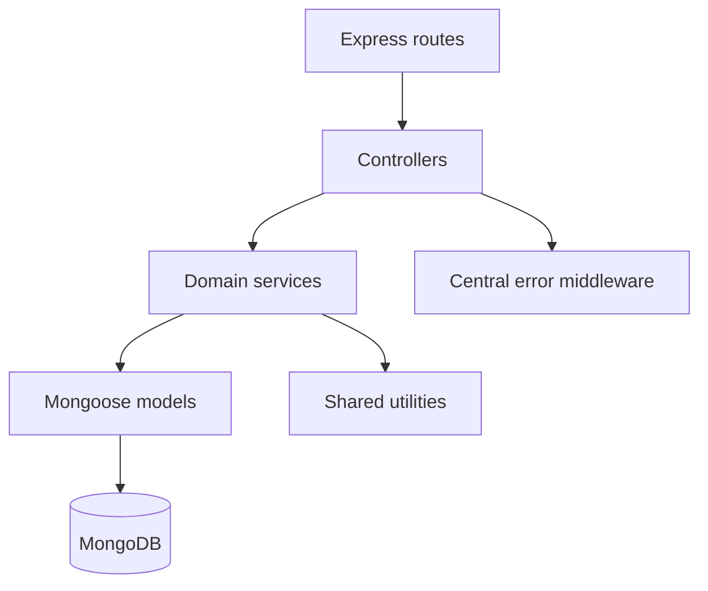

# ADR-0002: Modular Express/Mongoose Backend with CommonJS

## Status

Accepted — implemented in the repository and reconciled on 27 November 2026. Production release remains subject to the gates in the [implementation plan](../implementation-plan.md).

## Date

Originally 2026-11-26; implementation reconciliation 2026-11-27.

## Context

The root package uses CommonJS and the backend depends on Express 5, Mongoose 9, AJV, CSV/workbook libraries, and security middleware. The application must keep domain rules independent of HTTP parsing while supporting authentication, transformer/measurement/customer/guest operations, imports, exports, and dashboard aggregation.

## Decision

1. Keep **CommonJS** for the backend runtime.
2. Use the following domain modules:
   - `auth`: credentials, opaque sessions, CSRF, profile/account/avatar;
   - `transformers`: canonical CRUD, map/anomaly queries, alias registry;
   - `measurements`: current WBP/LWBP replacement;
   - `customers`: canonical CRUD, search, pagination;
   - `dashboard`: selected-period summary and map data;
   - `guests`: list and server-only Google synchronization;
   - `imports`: preview, persisted jobs/issues, commit;
   - `exports`: CSV/XLSX generation.
3. Use route → controller → service → Mongoose model boundaries.
4. Keep shared error, validation, name-key, GeoJSON, and electrical-calculation utilities framework-independent.
5. Apply cross-cutting request-ID, CORS, body-limit, session, CSRF, origin, role, and rate-limit behavior at route composition boundaries.
6. Normalize errors through one middleware into the stable public error envelope.
7. Do not require a separate repository layer. Services query Mongoose models directly where that is the current implementation; introduce a repository only when it materially improves a concrete boundary.

## Consequences

### Positive

- HTTP concerns remain at the route/controller boundary.
- Electrical, import, identity, and synchronization rules can be tested without Express.
- CommonJS avoids an ESM migration in the current dependency/runtime shape.
- Mongoose remains the final schema/index enforcement point.

### Negative and operational

- Direct model access in services means query behavior must be reviewed for pagination and consistency.
- MongoDB multi-document transactions are not assumed without an approved topology.
- The production MongoDB/Mongoose/base-image support matrix remains unresolved.

## Alternatives considered and rejected

| Alternative | Reason rejected |
|---|---|
| Migrate the backend to ESM now | Unnecessary compatibility risk without a demonstrated requirement. |
| Put all logic in route handlers | Couples business rules to HTTP and weakens testability. |
| Create empty repository/service layers | Adds indirection without implementing a useful boundary. |
| Use multiple databases/ODMs | Splits authority and complicates transactions/operations. |

## Related documents

- [Backend architecture](../architecture/backend.md)
- [API contract](../api/overview.md)
- [ADR-0003](ADR-0003-mongodb-data-modeling.md)
