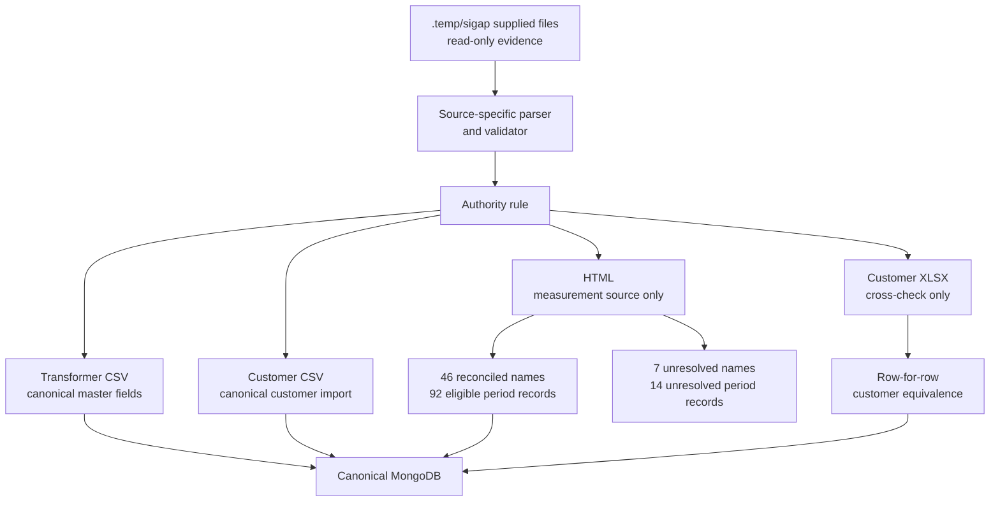

# ADR-0003: Data Authority, Canonicalization, and MongoDB Modeling

## Status

Accepted — implemented in the repository and reconciled on 27 November 2026. Production population migration and approval remain open release gates.

## Date

Originally 2026-11-26; implementation reconciliation 2026-11-27.

## Context

The supplied sources contain different populations and levels of authority:

- the transformer CSV contains 1,238 canonical transformer master records;
- the customer CSV contains 68,742 canonical customer records and is CP1252-compatible;
- the customer XLSX contains the same 68,742 customer records as an alternate representation;
- the static HTML contains 53 transformer names and 106 period objects; 46 names reconcile directly and 7 do not;
- source fields are incomplete or semantically ambiguous, including missing feeder/capacity, a multi-valued capacity label, and absent measurement dates/times.

The Phase 0 audit found implementation defects that could divide Indonesian thousands notation, invent defaults, store latitude/longitude in the wrong order, or retain multiple “current” measurements for one transformer/period.

## Decision

### 1. Authority precedence

1. `.temp/sigap/` is read-only ground truth. Runtime and migration code never modify, move, or delete it.
2. The transformer CSV is authoritative for transformer name, feeder, capacity text, and coordinates.
3. The customer CSV is the canonical import path. The customer XLSX is a cross-check and cannot silently add, remove, or override CSV rows.
4. The HTML is authoritative only for the electrical period values it contains. It is not transformer master authority.
5. When HTML and the transformer CSV conflict on a common transformer, the CSV value wins.
6. An absent authoritative source value is `null`. The system does not default it.

### 2. Canonical transformer representation and identity

- Store `name` as the trimmed, Unicode-NFC display value.
- Derive `nameKey` by NFC + trim + Unicode full case folding; enforce unique `{ nameKey: 1 }` as `transformer_name_key_unique`.
- Node.js 22 does not expose a Unicode full-case-fold operation, so the implementation pins the narrowly scoped MIT-licensed `unicode-case-folding` package. The server-owned key permits up to 600 characters because full folding can expand a 200-character display name.
- Keep `nameKey` synchronized through model create/update/replace/bulk-write hooks.
- Store `feeder`, `capacity`, `brand`, and `grounding` as independently nullable strings.
- Store `capacityKva` as a nullable positive number no greater than 1,000,000 kVA. Populate it only for one unambiguous numeric value or explicit operator mapping. A label such as `500/300/865 kVA` remains raw with `capacityKva: null` until reviewed.
- Store `location` as GeoJSON `Point` with coordinates exactly `[longitude, latitude]` and a sparse `2dsphere` index.
- Preserve `rawCoordinates` for audit.
- Do not reverse canonical CSV coordinates. Only the HTML-specific adapter knows that the HTML representation is latitude-first.

Production startup fails closed until every transformer's identity is canonical and uniquely indexed:

| Condition | Error code | Behavior |
|---|---|---|
| Missing/mismatched `nameKey` | `TRANSFORMER_NAME_KEY_BACKFILL_REQUIRED` | Do not accept traffic; run the approved backfill |
| Duplicate canonical key | `TRANSFORMER_IDENTITY_DUPLICATE_KEYS` | Abort; merge/delete no record |
| Conflicting name-key index | `TRANSFORMER_NAME_KEY_INDEX_CONFLICT` / `TRANSFORMER_NAME_KEY_INDEX_INVALID` | Manual index review required |

The exact CLI is `npm run migrate:transformer-name-keys` (dry-run by default; `--apply` and `--report` supported).

### 3. Canonical customer representation

- Store `customerId` as a string containing exactly 12 ASCII digits; preserve leading zeros.
- Store `name` as a required non-unique trimmed string of at most 300 characters.
- Store `tariff`, raw power, numeric power, and `address` as independently nullable, with defensive maximum lengths of 100, 100, and 1,000 characters for the string fields.
- Store raw power text in `powerRaw`; `power` is the Mongoose compatibility alias. The API exposes the raw text as `power` and the derived value as `powerVa`.
- Derive `powerVa` as a nonnegative integer using an explicit Indonesian thousands rule. Missing power is `null`, never zero.
- Preserve internal semicolons and punctuation in quoted address fields.
- Enforce unique `{ customerId: 1 }` and use indexes for name/address/feeder lookups.

### 4. Canonical measurement representation

- Store the current WBP and LWBP measurement as separate documents.
- Enforce unique `{ transformerId: 1, period: 1 }`, so at most one current measurement exists for each transformer/period.
- Keep `measurementDate` and `measurementTime` nullable and preserve source absence. `createdAt`/`updatedAt` are server processing timestamps, not substitutes for source measurement time.
- Keep `voltage`, `incoming`, and branch values nullable where the migration source is missing them. Direct writes and imports use the same finite operational bounds: voltage up to 500 V and current up to 100,000 A; non-finite derived analysis fails closed.
- Do not keep measurement history under this collection. A future history requirement requires a separate approved model and retention policy.

### 5. HTML reconciliation

- Extract 53 transformer names and 106 period objects during migration.
- Reconcile exactly 46 common names to canonical transformer IDs and upsert their 92 eligible transformer/period measurements.
- Do not create a transformer for an HTML-only name.
- Do not attach, fabricate, or silently discard the 7 unresolved names/14 period records. Require an explicit operator-approved alias first:

  - `ML Pancing 1 6`
  - `ML Pancing V 1`
  - `ML Pancing V 2`
  - `ML Pancing V 3`
  - `ML Pancing V 4`
  - `ML.592`
  - `PDAM TIRTANADI`

### 6. Provenance, aliases, and mutation rules

- Canonical records identify source kind and, where applicable, source filename/row or source record key.
- Runtime edits create/update the canonical record but do not rewrite `.temp/sigap/`.
- Migrations and imports are dry-run capable, encoding-aware, schema-validated, idempotent, progress-reporting, and mismatch-reporting.
- MongoDB unique indexes are the final defense for all canonical business keys.
- Alias records use `aliasName`, unique `aliasKey`, `transformerId`, `reason`, `approvedBy`, `approvedAt`, `source`, and `sourceVersion`.
- `aliasKey` is server-owned and derived from `aliasName` through the same shared Unicode full case-folding path as `nameKey` (no locale-sensitive lowercasing), with a 600-character bound after case expansion; alias writes accept only the display name, the target transformer, the approval reason, and the optional source revision.
- Operator import provenance is `source: "operator_import"`, source file/row, and `sourceMetadata.importJobId`.

## Consequences

### Positive

- Transformer/customer conflicts have a deterministic outcome.
- Source incompleteness remains visible instead of being hidden behind defaults.
- The 53-name/106-period reconciliation result is repeatable and auditable.
- Unique indexes and stable keys make migrations/imports idempotent.
- Customer IDs and power values retain the supplied representation and precision.
- GeoJSON order is consistent across migration, API, MongoDB, and Leaflet.

### Negative and operational

- Nullable capacity/tariff/power/date fields require null-aware analysis and filters.
- Customer CSV/XLSX equivalence requires complete row-level reconciliation.
- The seven unresolved names/14 period records cannot be migrated until aliases are approved.
- Current measurements overwrite the prior period document; historical analysis is unavailable under this model.
- More provenance fields and strict validators increase schema/migration complexity.
- Unicode full case folding adds one small pinned runtime dependency and requires a longer maximum for the derived key.

## Alternatives considered and rejected

| Alternative | Reason rejected |
|---|---|
| Treat the HTML as the master transformer population | It contains only 53 older/divergent names and conflicts with the 1,238-record canonical CSV. |
| Let CSV and XLSX customer rows merge by update order | The files are equivalent representations of one population. |
| Default missing values to 100 kVA, 220 V, a tariff, or zero VA | Invents facts and can change analysis results. |
| Normalize and discard all original text | Loses auditability and makes equivalence hard to prove. |
| Automatically fuzzy-match the seven HTML-only names | A plausible match is not explicit authority. |
| Store latitude first because the HTML uses it | Violates GeoJSON/MongoDB longitude-first order. |
| Allow multiple current measurements per transformer/period | Makes “latest” ambiguous. |
| Store measurement history in the same collection with the current unique key | The lifecycle models conflict. |

## Related documents

- [Implemented schema](../database/schema.md)
- [Data migration strategy](../database/migration.md)
- [Implementation plan](../implementation-plan.md#4-data-migration-strategy)
- [Phase 0 audit](../audit/phase-0-audit.md)
