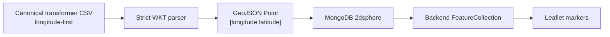

# ADR-0004: Leaflet and OpenStreetMap Map with Canonical GeoJSON

## Status

Accepted — implemented in the repository and reconciled on 27 November 2026. Operational tile/performance evidence remains a release concern.

## Date

Originally 2026-11-26; implementation reconciliation 2026-11-27.

## Context

The original static application used a Google My Maps iframe, which cannot reflect canonical transformer edits or measurement analysis. The static frontend also contains a Leaflet implementation that provides the interaction baseline.

The supplied coordinate sources use different representations:

- the canonical transformer CSV uses WKT `POINT (longitude latitude)`;
- the static HTML uses a latitude-first coordinate representation;
- GeoJSON and MongoDB's `2dsphere` index require `[longitude, latitude]`.

The audited canonical coordinate envelope is longitude `98.631590–98.731016` and latitude `3.639622–3.735425`.

## Decision

1. Use a Leaflet component with OpenStreetMap tiles.
2. Fetch backend map data from `GET /api/v1/transformers/map-points` and consume the dashboard's equivalent GeoJSON summary.
3. Store and emit coordinates as `[longitude, latitude]`. The canonical CSV adapter must not reverse them; only the HTML-specific adapter converts the HTML's latitude-first representation.
4. Validate longitude/latitude as finite values in their valid global ranges and report values outside the audited canonical envelope for review. Do not clamp or silently swap them.
5. Render a marker only for a transformer with a valid location. A missing/invalid coordinate produces no marker; the system does not geocode an address or invent a position.
6. Keep the raw source coordinate in `rawCoordinates` for audit.
7. Show available transformer name, feeder, capacity, and analysis status in the popup and provide a detail action. Missing fields remain null rather than receiving data defaults.
8. Display OpenStreetMap attribution.
9. Use the same backend transformer collection for map and table views.
10. Measure map behavior with the canonical 1,238-transformer target population. Marker clustering or viewport filtering may optimize rendering, but records must not be silently omitted from counts or exports.

## Consequences

### Positive

- Map markers follow canonical database changes rather than a manually maintained external map.
- GeoJSON order is consistent across storage, API, and rendering.
- Invalid/missing coordinates are visible as data-quality issues rather than fake locations.
- The map can later use an approved internal/custom tile service without changing transformer data.

### Negative and operational

- OpenStreetMap tile availability and usage policy are operational dependencies.
- The client handles tile/network failure without showing fabricated markers.
- A 1,238-point target population requires measured rendering performance and possibly clustering.
- Historical HTML coordinate conversion remains an auditable migration concern.

## Alternatives considered and rejected

| Alternative | Reason rejected |
|---|---|
| Keep the Google My Maps iframe as canonical | It cannot react to canonical transformer/measurement changes. |
| Use Google Maps paid tiles/API | Adds credential/cost/availability requirements without a current requirement. |
| Store latitude first for consistency with the HTML | Violates GeoJSON/MongoDB order and canonical CSV truth. |
| Geocode missing addresses | Adds an external source and can fabricate positions. |
| Clamp out-of-range coordinates | Hides source errors and corrupts the source value. |
| Generate separate map-only records | Creates a second transformer authority. |

## Related documents

- [Implemented schema](../database/schema.md#6-transformers)
- [API contract](../api/overview.md#7-transformers-and-gis)
- [Frontend architecture](../architecture/frontend.md#9-leaflet-and-geojson-behavior)
- [ADR-0003](ADR-0003-mongodb-data-modeling.md)
