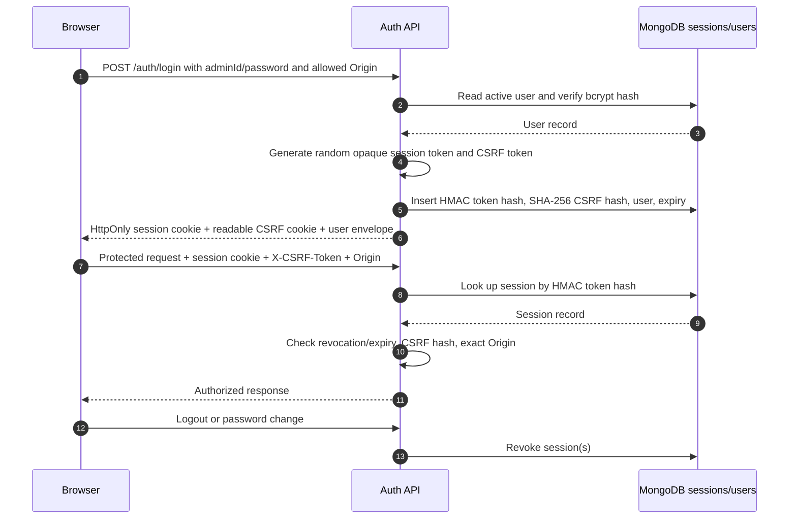

# ADR-0005: Revocable Opaque Sessions and Session-Bound CSRF

## Status

Accepted — implemented in the repository and reconciled on 27 November 2026. Production configuration and operational deployment remain release gates.

## Date

Originally 2026-11-26; implementation reconciliation 2026-11-27.

## Context

The Phase 0 baseline used a stateless JWT cookie. A stateless token cannot be centrally revoked when an account is disabled or a password changes. The audit also found missing CSRF/origin enforcement, permissive credentialed CORS, predictable secret fallback risk, and a default seeded administrator credential.

SIGAP is a browser application exposed through HTTP(S). Authentication therefore needs browser-safe cookies, server-side revocation, explicit origin controls, and controlled administrator provisioning.

## Decision

### 1. Credentials and administrator provisioning

1. Login uses administrator ID and password.
2. Passwords are stored only as bcrypt hashes with work factor 10.
3. No public registration flow exists.
4. The first administrator is provisioned through a controlled server-side CLI with explicit input. No default username/password/email or usable fallback secret is shipped.
5. Additional administrator creation requires an authenticated `superadmin` through `POST /api/v1/auth/register-admin`.
6. Password, username, profile, and avatar changes are separate authenticated endpoints.

### 2. Opaque server-side session

1. Generate a random 32-byte opaque session token.
2. Send the raw session token only in the `sigap_session` cookie.
3. Store only its HMAC-SHA-256 hash, keyed by `SESSION_SECRET`, in `sessions`; never store or log the raw token.
4. Cookie attributes are `HttpOnly`, `SameSite=Lax`, `Path=/`, and `Secure` in production.
5. Use a default eight-hour absolute lifetime, configurable from 1–168 hours. `lastUsedAt` does not extend the absolute expiry.
6. The server checks expiry and revocation on every protected request. MongoDB TTL cleanup is asynchronous and is not the authorization check.
7. Logout revokes the current session. Password change, account deactivation, and explicit administrative action revoke affected sessions and require reauthentication where specified.
8. Session identifiers and hashes are not returned by an API response.
9. The session model stores no raw IP address, user-agent text, IP hash, or user-agent hash.

### 3. Session-bound CSRF and origin enforcement

1. Generate an independent random 32-byte CSRF token for each session with a cryptographically secure source. It is not derived from the session token, user, or deployment secret.
2. Store only its SHA-256 hash in the session record.
3. Set the token in a `sigap_csrf` same-origin cookie that the SPA can read to populate `X-CSRF-Token`. The cookie is not `HttpOnly`, uses `SameSite=Lax`, `Path=/`, production `Secure`, and the session lifetime.
4. For `POST`, `PUT`, `PATCH`, and `DELETE`, require:
   - a valid session cookie;
   - an `X-CSRF-Token` equal to the CSRF cookie, compared in constant time;
   - a session record whose CSRF hash matches; and
   - an exact configured `Origin` value.
5. Missing, `null`, malformed, and unlisted origins are rejected.
6. `SameSite=Lax` is defense in depth, not a substitute for the CSRF/origin checks.
7. Credentialed CORS allows only configured exact frontend origins (`CLIENT_URL` plus optional `CLIENT_URLS`). Arbitrary-origin reflection is prohibited.
8. Login requires an allowed origin but has no pre-session CSRF token.
9. Neither raw token is returned in JSON, and both cookies are cleared when the session is revoked or invalidated.

### 4. Safe errors, limits, and configuration

- Invalid login returns the same generic `401 INVALID_CREDENTIALS` whether the administrator is unknown, inactive, or the password is wrong.
- Login is rate limited.
- Password/session/CSRF/Google credentials never appear in logs, error details, or database query traces.
- Production startup fails closed when required secret/configuration values are missing or contain known placeholders.
- `SESSION_SECRET` is read from the environment or a secret file, not a committed fallback.

## Consequences

### Positive

- Logout, password change, and account deactivation revoke access immediately at the server.
- The database session cannot authenticate a raw token that was not stored.
- CSRF protection binds the browser request to the authenticated session and configured deployment origin.
- CORS cannot be widened by a request-supplied origin.
- The audit trail can record session creation/revocation without exposing raw tokens.

### Negative and operational

- Authentication and logout depend on MongoDB availability.
- Session cleanup needs a TTL index and an operational revocation path.
- The browser must attach credentials, read the CSRF cookie, and send the CSRF header on unsafe requests.
- Eight-hour absolute expiry requires users to reauthenticate even if activity continues.
- A lost database or invalid session store causes protected access to fail closed.

## Alternatives considered and rejected

| Alternative | Reason rejected |
|---|---|
| Stateless JWT session | Cannot be centrally revoked without recreating server-side session state. |
| JWT in `localStorage` | Increases token exposure through XSS. |
| Self-contained signed/encrypted cookie only | Contents remain replayable until expiry; revocation is not immediate. |
| `SameSite` cookie without a CSRF token | Does not bind the request to the server-side session. |
| CSRF token without `Origin` validation | Leaves deployment-origin mistakes unresolved. |
| Reflect every request origin in credentialed CORS | Defeats the browser same-origin boundary. |
| Plain SHA-256 session-token hash | The deployment secret provides a keyed HMAC boundary and avoids an unkeyed digest of the bearer token. |
| Ship a default administrator password | Creates a known usable credential. |
| Ship a predictable session-secret fallback | Allows token manipulation in deployments with missing configuration. |

## Related documents

- [Implemented schema](../database/schema.md#5-sessions)
- [API contract](../api/overview.md#4-authentication-sessions-csrf-and-cors)
- [Backend architecture](../architecture/backend.md#5-authentication-and-request-security)
- [Phase 0 audit](../audit/phase-0-audit.md)
