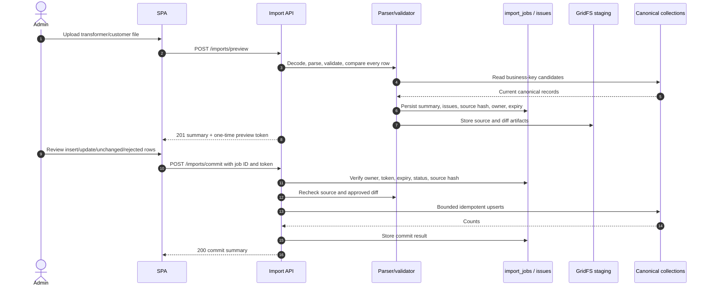

# ADR-0006: Persisted Import Preview and Validated Upsert

## Status

Accepted — implemented in the repository and reconciled on 27 November 2026. Production import execution and release approval remain separate operational decisions.

## Date

Originally 2026-11-26; implementation reconciliation 2026-11-27.

## Context

Transformer/customer imports can alter thousands of canonical records. The Phase 0 baseline kept preview state in process memory, compared only a sample of customer IDs, could invent tariff/power defaults, and did not guarantee that committed bytes were the reviewed bytes.

The source formats require strict handling:

- the canonical transformer CSV is UTF-8 with BOM, semicolon-delimited, and uses WKT coordinates;
- the canonical customer CSV is CP1252-compatible, semicolon-delimited, uses RFC 4180 quoting, and has Indonesian thousands notation in power values;
- the customer XLSX is an equivalent representation of the same 68,742-row population and is a cross-check, not a second population.

## Decision

### 1. Two-stage, server-authoritative workflow

1. `POST /imports/preview` parses and validates the complete source and computes a full diff against canonical collections.
2. The response distinguishes total, valid, insert, update, unchanged, and rejected rows and reports field-level issues.
3. The preview is persisted in `import_jobs`; the raw preview token is returned once and only its SHA-256 hash is stored.
4. The reviewed source and diff report are stored in GridFS bucket `import_staging` and bound to the job by SHA-256.
5. `POST /imports/commit` requires the job ID and preview token and rechecks the authenticated owner, expiry, job state, and staged-source hash.
6. Commit writes only validated insert/update rows. Unchanged rows are rechecked and skipped without a write. Rejected rows are not written.
7. The operation is an upsert only. It never deletes a canonical record.
8. A repeated commit for the same successful job returns the stored result and does not apply rows twice.
9. A target changed after preview returns `409 IMPORT_TARGET_CONFLICT` and requires a new preview.
10. Rows/issues are owner-scoped; `superadmin` may inspect another job, but commit remains bound to the original owner.

### 2. Source-format and canonicalization rules

1. The canonical delimiter is semicolon (`;`). A different or ambiguous delimiter is rejected rather than guessed.
2. Transformer CSV decoding is UTF-8 with BOM. Customer CSV decoding is CP1252-aware and must not silently replace invalid bytes.
3. CSV parsing follows RFC 4180 semantics, including quoted delimiters and multiline fields.
4. XLSX parsing uses ExcelJS. The Phase 0 vulnerable `xlsx@0.18.5` dependency is not part of the current import path.
5. Canonical ground-truth migration checks customer CSV/XLSX equivalence for every row and field after declared encoding/type normalization. A difference blocks the migration. An ad hoc runtime import validates only the operator-selected file.
6. Customer IDs remain 12-digit strings.
7. Customer power preserves source text in `powerRaw` and derives a correctly scaled integer VA value. Missing or ambiguous power remains null and is rejected/reported, never defaulted.
8. Transformer matching uses canonical `nameKey`; customer matching uses unique `customerId`.
9. Capacity, tariff, feeder, dates, times, aliases, and other missing source values remain null unless an explicit operator mapping is supplied.
10. Formula-like source values are handled according to the spreadsheet-safety policy without inventing a business value.

### 3. ImportJob lifecycle

- A preview job has a 24-hour expiry.
- `import_jobs.expiresAt` and `import_job_issues.expiresAt` have MongoDB TTL indexes with `expireAfterSeconds: 0`.
- The service checks expiry before accepting a commit; asynchronous TTL cleanup is not the authorization check.
- The cleanup scheduler removes staged source/diff artifacts and associated issues and prevents late commits.
- A committing job holds a renewable 15-minute lease. A retry may reclaim the job after the lease expires; rows already applied by the same job are recognized and are not written twice.
- Commit uses a database batch size of 1,000.
- Status is one of `previewed`, `committing`, `committed`, `failed`, or `expired`.
- The actor ID is stored with the job. A different user cannot commit it.
- The first 100 issues are returned inline; full issues are available through the paginated issues endpoint.

### 4. Provenance

Committed transformer/customer records carry:

- `source: "operator_import"`;
- `sourceFile`;
- `sourceRow`; and
- `sourceMetadata.importJobId`.

The import is an upsert and does not delete records or rewrite `.temp/sigap/`.

### 5. Ground-truth migration relationship

The ground-truth migration uses separate controlled scripts for transformer/customer/HTML reconciliation, with the same canonical keys and null-preserving rules. The HTML source contains 53 names/106 period objects: 46 names produce 92 eligible period records and 7 names leave 14 period records unresolved until approved aliases exist. The migration does not claim to import the runtime upload modal's source population.

## Consequences

### Positive

- Operators see a complete, field-level diff before canonical data changes.
- The committed source is cryptographically bound to the reviewed preview.
- The workflow survives restarts/multi-instance routing and does not depend on in-memory cache state.
- Every customer row is checked, eliminating the first-500-ID gap.
- Duplicate commits and repeated migrations are idempotent.
- Customer CSV/XLSX differences become visible blockers instead of order-dependent writes.

### Negative and operational

- A second upload/storage step, job records, issue collection, cleanup scheduler, and staging capacity are required.
- Preview may take longer for 68,742 rows because all rows are compared.
- The API client must retain the one-time token and job ID until commit/expiry.
- Strict equivalence means an innocuous-looking XLSX type/format difference may block a job.
- Staged source must be protected as customer PII and removed on expiry.

## Alternatives considered and rejected

| Alternative | Reason rejected |
|---|---|
| Upload and write directly | Gives no reliable pre-write diff and increases corruption/overwrite risk. |
| Preview only in process memory | Lost on restart/multi-instance routing and not authoritatively bound to source/user. |
| Sign all preview rows into one client token | Token size grows with the population. |
| Compare only the first N customer IDs | Leaves most of the population unchecked. |
| Apply default tariff/power/capacity values | Fabricates source facts. |
| Treat CSV and XLSX as independent populations | Creates duplicate customer IDs and order-dependent conflicts. |
| Commit a re-uploaded file without a source hash | Committed bytes may differ from reviewed bytes. |
| Treat import as delete-and-replace | A partial/failed import could destroy valid records. |
| Auto-create transformers for unmatched names | Converts source labels into unapproved master records. |
| Keep the known-vulnerable workbook parser | Does not resolve the Phase 0 dependency finding. |

## Related documents

- [Implemented schema](../database/schema.md#10-import_jobs)
- [API contract](../api/overview.md#11-imports)
- [Backend architecture](../architecture/backend.md#9-import-processing)
- [ADR-0003](ADR-0003-mongodb-data-modeling.md)
