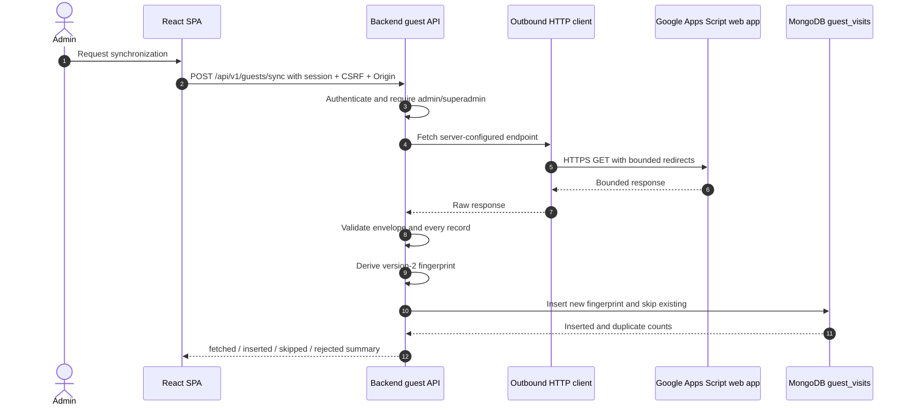
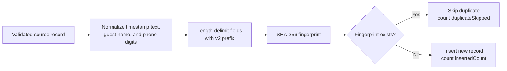

# ADR-0007: Server-Only Google Guest Synchronization with Fingerprint Idempotency

## Status

Accepted — implemented in the repository and reconciled on 27 November 2026. The real Google Apps Script deployment contract, request-authentication strategy, and non-production smoke test remain unresolved release gates. No successful external synchronization is claimed.

## Date

Originally 2026-11-26; implementation reconciliation 2026-11-27.

## Context

The guest book is populated through Google Form/Apps Script. SIGAP must let an administrator retrieve those records without exposing the external endpoint or credential to the browser, duplicating records on repeated synchronization, or inserting fallback data when the upstream service is unavailable.

The Phase 0 audit found that the baseline could insert static fallback records. It also established that the real Apps Script URL, deployment identity, expected payload contract, and authentication strategy had not been supplied. Those external dependencies cannot be inferred safely.

## Decision

### 1. Server-only integration

1. The browser calls only `POST /api/v1/guests/sync` on the SIGAP backend and sends only `{}`.
2. The Apps Script URL is runtime server configuration. It is not embedded in frontend source, source maps, API responses, browser storage, or normal logs.
3. Client-supplied URLs and other body values are ignored.
4. The backend performs the outbound HTTPS request with a 10-second timeout, a 5 MiB response limit, and at most two redirects.
5. Every redirect destination is revalidated against the HTTPS, host-allowlist, and path rules.
6. Missing or invalid configuration fails closed with `503 DEPENDENCY_UNAVAILABLE`; there is no localhost, demo, or production fallback.
7. The external service cannot write MongoDB directly. The backend is the only integration writer.
8. The current implementation does not send an upstream request credential. The production request-authentication mechanism must be approved separately before release.
9. The route has a dedicated rate limiter scoped to the authenticated user and the trusted client address. The default budget is 10 requests per 60 seconds per bucket (`GUEST_SYNC_RATE_LIMIT_MAX`, `GUEST_SYNC_RATE_LIMIT_WINDOW_MS`) and a rejected request returns `429 RATE_LIMITED` without reaching the upstream integration.
10. Concurrent synchronization requests are coalesced into one active upstream fetch and database upsert. The first caller and every waiting caller receive the same result, and a failed operation releases the active slot so the next request retries.

### 2. Strict record validation and no placeholders

1. Validate the response envelope and every record independently under the implemented compatibility contract.
2. The top-level response must be a JSON array.
3. Require a non-empty guest name of at most 200 characters, a purpose of at most 1,000 characters, and a phone containing 9–15 digits after non-digit characters are removed.
4. Preserve the original phone text so leading zeros are not lost.
5. Keep customer ID optional and bounded; never invent one.
6. Preserve source timestamp text. A parseable value becomes `timestamp`; an unparseable value leaves `timestamp: null` and retains `timestampRaw`. Never substitute the server synchronization time.
7. Preserve an optional source record ID.
8. Ignore unknown upstream fields rather than promoting them to canonical columns.
9. Reject malformed records and report `rejectedCount`; do not insert a placeholder, fallback guest, or synthetic canonical field.
10. An invalid upstream envelope, unsuccessful response, invalid redirect, or timeout produces an error and no fallback insertion.

The implemented accepted source-key aliases are documented in the [integration architecture](../architecture/integrations.md#4-payload-validation-contract). They are compatibility behavior, not proof that a real deployment has been contract-tested.

### 3. Idempotency

1. Derive a version-2 SHA-256 fingerprint from normalized source timestamp text, guest name, and phone digits using length-delimited fields.
2. Enforce a unique index on `syncFingerprint`.
3. Insert a new valid record when the fingerprint is absent; skip it when present.
4. Repeated synchronization of unchanged source rows produces no additional guest documents.
5. Store `syncedAt` separately from the source visit timestamp.

### 4. Result and failure reporting

A successful synchronization returns counts for fetched, inserted, duplicate-skipped, and rejected records plus the server completion time. Error responses use the exact API codes and never expose the upstream body, endpoint, or credential.

| Failure | Result | Insert behavior |
|---|---|---|
| Missing or invalid configuration | `503 DEPENDENCY_UNAVAILABLE` | No insert |
| Timeout | `504 UPSTREAM_TIMEOUT` | No fallback insert |
| Invalid/upstream unsuccessful payload | `502 UPSTREAM_INVALID_RESPONSE` | No unvalidated insert |
| Malformed individual record | `200` summary with rejected count when the enclosing payload is valid | Only valid records may insert |
| Existing fingerprint | `200` summary with duplicate count | No duplicate insert |
| Request rate above the dedicated ceiling | `429 RATE_LIMITED` | No upstream call and no insert |
| Database unavailable | `503 DEPENDENCY_UNAVAILABLE` | No false success |

## Consequences

### Positive

- The external URL remains server-side.
- Repeated synchronization is idempotent and auditable.
- A request burst produces one upstream fetch and one upsert instead of one per request.
- Missing/malformed upstream data cannot become a fabricated guest record.
- Source visit time and synchronization time remain distinguishable.
- Operators receive a clear count summary and actionable error code.

### Negative and operational

- Synchronization depends on an external Apps Script deployment whose real contract is still unknown.
- The backend must maintain and protect runtime configuration.
- Strict per-record validation can reject records that previously appeared as fallback data.
- Fingerprint semantics must be versioned so a future canonicalization change does not silently deduplicate differently.
- The single-flight coordinator is process-local. A deployment that runs more than one backend instance would need a shared lock to keep one upstream call active across instances.
- The upstream service can still be unavailable; fail-closed behavior is intentional.
- Upstream request authentication is not yet implemented.

## Alternatives considered and rejected

| Alternative | Reason rejected |
|---|---|
| Let the browser call Apps Script directly | Exposes the endpoint/credential and bypasses validation, authorization, and deduplication. |
| Let Google write MongoDB directly | Exposes database access and creates a second, unaudited write path. |
| Insert a fallback guest when upstream fails | Fabricates a visit and pollutes operational/legal records. |
| Trust every upstream field and coerce malformed values to zero/empty | Destroys source distinctions and hides integration defects. |
| Use only a timestamp as the idempotency key | Two legitimate visits can share a coarse timestamp. |
| Include mutable purpose in the fingerprint | A later purpose correction creates a duplicate visit. |
| Poll continuously from the browser | Keeps the external dependency exposed and makes retry/load behavior uncontrolled. |
| Use an opaque public Apps Script URL with no request authentication | URL secrecy alone is not an authentication strategy and can permit unauthorized data fetches. |

## Related documents

- [Canonical schema](../database/schema.md#9-guest_visits)
- [API contract](../api/overview.md#10-guests-and-google-synchronization)
- [Integration architecture](../architecture/integrations.md)
- [Implementation plan unresolved decisions](../implementation-plan.md#8-explicit-unresolved-decisions)
