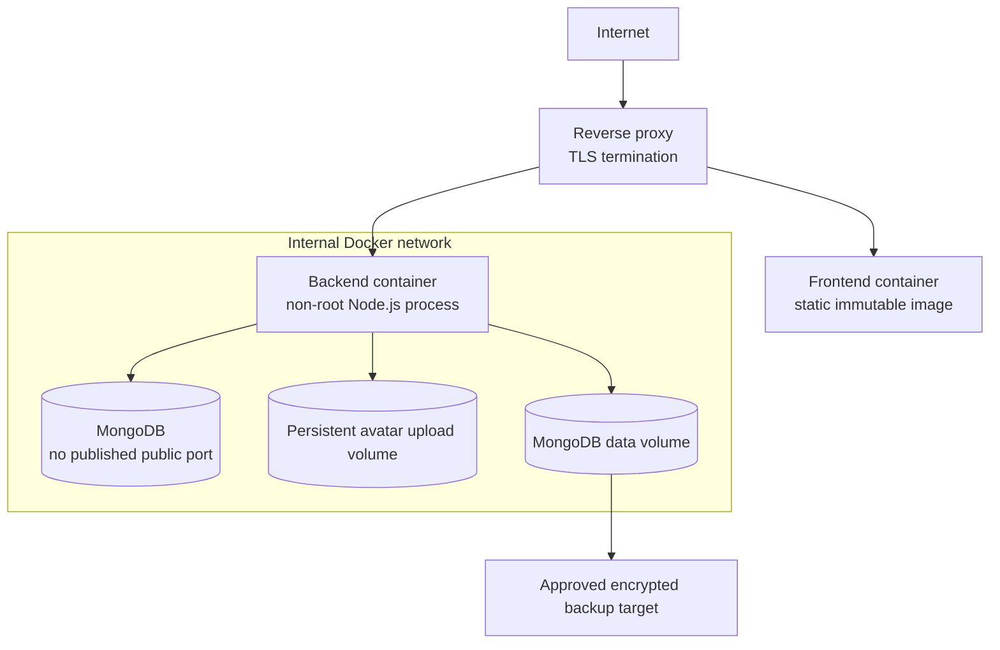
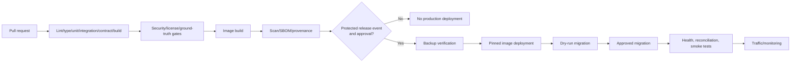

# ADR-0008: Containerized Deployment on a Docker-Host VPS

## Status

Accepted — repository artifacts implement the intended topology, reconciled on 27 November 2026. The disposable local image build and Compose runtime health check passed; no production deployment is claimed.

## Date

Originally 2026-11-26; implementation reconciliation 2026-11-27.

## Context

SIGAP needs a reproducible deployment for an internal PLN operating environment with:

- a browser frontend and Node.js API;
- MongoDB with persistent data and no public database port;
- TLS termination and controlled public ingress;
- runtime-only secrets;
- health checks, backup, migration, rollback, and audit evidence.

The Phase 0 audit found Docker/Compose CLIs but an inactive daemon and no tracked container artifacts at that point. The current working tree now contains Dockerfiles, Compose configuration, Nginx configuration, CI/release-control files, and backup/restore tooling. A disposable local backend/frontend image build and Compose runtime health check passed on 27 November 2026 after the MongoDB initialization path was corrected, and Trivy (pinned `0.58.1` digest) reported 0 HIGH and 0 CRITICAL findings for the filesystem and for both rebuilt application images. Production infrastructure, production image scanning/publication, and a production deployment remain unresolved.

## Decision

### 1. Docker-host VPS topology

1. Use Docker Compose on an approved Linux VPS for frontend, backend, and MongoDB services, or an equivalent Compose-managed MongoDB topology.
2. Expose only the reverse proxy to the public network. MongoDB must have no published public port.
3. Keep frontend and API on the internal network and route `/api/v1` to the backend.
4. Persist MongoDB and avatar-upload data in named volumes with an approved backup/restore policy.
5. Run the backend as a non-root user and use restricted filesystems where practical.
6. Provide liveness, readiness, and dependency health checks.
7. Pin base/runtime/container versions to a supported matrix and publish images by immutable digest. The exact matrix remains an unresolved release decision.
8. Supply secrets only at runtime from an approved secret store/protected deployment environment.
9. Do not bake `.temp/sigap/`, customer data, or development credentials into images.

### 2. CI/CD and release boundary

1. CI runs lint, typecheck, unit/integration/contract tests, frontend build, and relevant end-to-end/visual tests.
2. CI builds images, scans dependencies/images/secrets, and generates SBOM/provenance.
3. Production publication/deployment is protected by an explicit approval boundary.
4. Deployment order is: verify prior artifacts → create/verify backup → deploy application → health check → migration dry run → approved migration → reconciliation/smoke → traffic/monitoring.
5. The deployment workflow does not run an unreviewed production migration.

### 3. Release and rollback gates

1. Required CI checks and security scans pass with no unapproved critical/high finding.
2. Production configuration and all external dependencies are approved.
3. A backup exists and an isolated restore rehearsal succeeds before production data is touched.
4. Migration dry run matches the reviewed counts/diff and transformer identity is canonical/uniquely indexed.
5. Health/readiness, API smoke, login, and read-only dashboard checks pass.
6. The release manifest is signed with the operator key and verified with the operator public key before the rollout; an unsigned or tampered manifest is refused.
7. The recorded rollback reference names the complete approved four-image set (backend, frontend, MongoDB, Caddy) of the previous revision; an incomplete set is refused, and the effective host image set is compared with the signed manifest before the rollout.
8. If application/schema compatibility is broken, restore the verified pre-release database snapshot.
9. After rollback, re-verify counts/keys, login, API health, read-only dashboard behavior, and import-job state.
10. Rollback never modifies `.temp/sigap/`.

## Consequences

### Positive

- Frontend, API, and database environments are reproducible and version-pinned.
- Network isolation reduces database exposure.
- Runtime secret injection avoids credentials in source/images.
- Backup, immutable prior images, and rehearsed rollback provide a controlled recovery path.
- A signed release manifest, a recorded four-image rollback reference, and a host image-set comparison make the rollout auditable and refuse an unapproved image set.

### Negative and operational

- The team must operate Docker, Compose, a reverse proxy, TLS renewal, MongoDB, backups, monitoring, and capacity planning.
- Container images and dependencies require ongoing scanning/rebuilding.
- MongoDB backup/restore and Compose upgrades require disciplined maintenance.
- A passing local runtime check does not prove production image scanning/publication, topology, rollback, or deployment.
- Containerization alone does not provide high availability or managed-database operations.

## Alternatives considered and rejected

| Alternative | Reason rejected |
|---|---|
| Run Node/MongoDB directly on the host | Increases drift and weakens dependency/network isolation. |
| Publish MongoDB publicly | Increases direct database attack surface. |
| Bake secrets into committed Compose/environment files | Creates persistent credential leakage and rotation problems. |
| Deploy on every pull request | Allows unreviewed code/data changes to reach production. |
| Run production migrations before review | Can write incorrect/unreconciled data. |
| Assume rollback means re-running an older container | May be incompatible with a newer schema/data snapshot. |
| Use a destructive database down-migration by default | Increases data-loss risk after failed releases. |

## Related documents

- [Deployment architecture](../architecture/deployment.md)
- [Implementation plan deployment/rollback gates](../implementation-plan.md#6-deployment-and-rollback-gates)
- [Database migration strategy](../database/migration.md)
- [Phase 0 audit](../audit/phase-0-audit.md)
