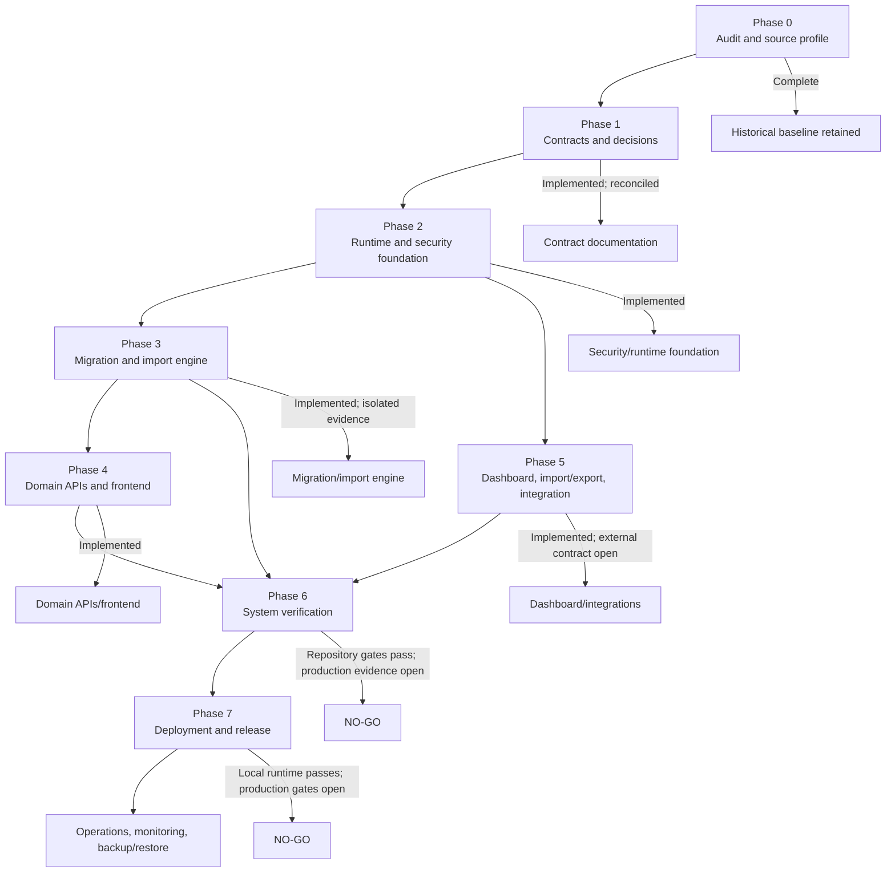
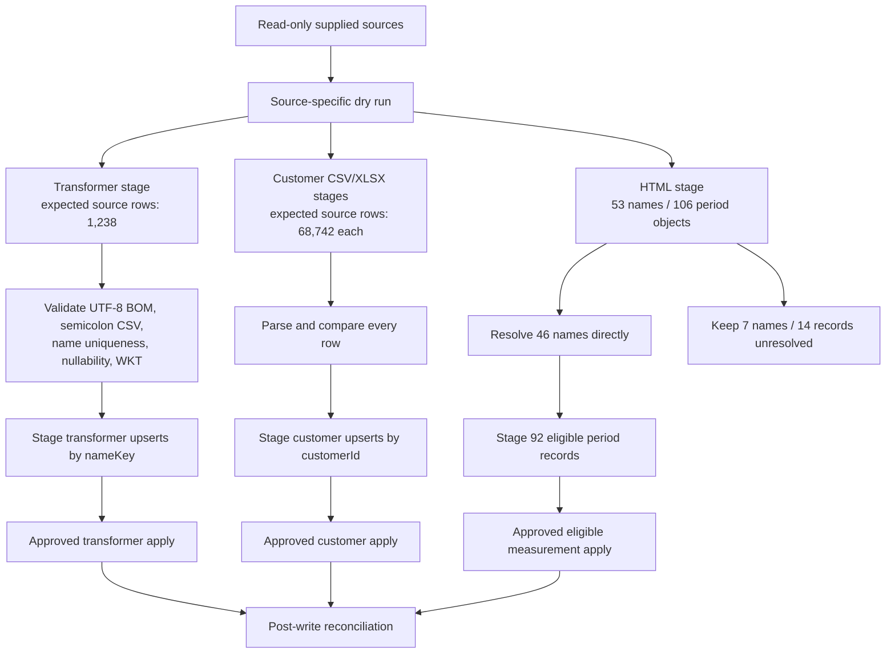
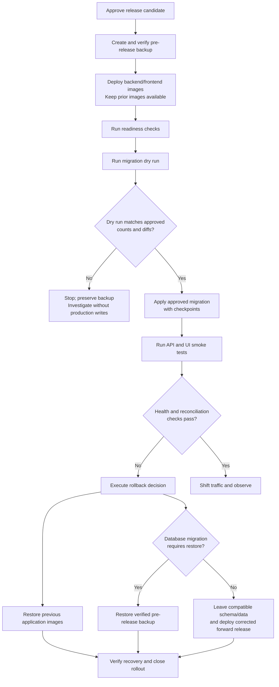

# Implementation and Release Plan — SIGAP ULP Labuhan

**Plan status:** Repository implementation and documentation are reconciled as of 27 November 2026.  
**Release status:** **NO-GO**.  
**Historical baseline:** [Phase 0 audit](audit/phase-0-audit.md)  
**Contracts:** [API](api/overview.md), [schema](database/schema.md), [migration](database/migration.md), [architecture](architecture/overview.md), [testing](testing/strategy.md).

> **NO-GO means:** production migration rehearsal/approval and the seven unresolved HTML-name aliases are not complete. The Google Apps Script contract, production topology/configuration, a production-approved backup/restore rehearsal, and production image scan/publication/deployment evidence also remain open. No production deployment or successful external operation is claimed.

## 1. Scope and non-negotiable invariants

The implementation covers the frontend, backend, MongoDB models, controlled migration/import/export, guest synchronization, security controls, and repository test/gate tooling.

### 1.1 Verified source baseline

| Source | Verified baseline | Authority |
|---|---|---|
| `.temp/sigap/Manajemen Trafo (SupaBase).csv` | 1,238 transformer records | Canonical transformer master |
| `.temp/sigap/Data Pelanggan (SupaBase).csv` | 68,742 customer records; CP1252-compatible | Canonical customer import path |
| `.temp/sigap/Data Pelanggan.xlsx` | 68,742 equivalent customer records | Cross-check for the same customer population |
| `.temp/sigap/SIGAP ULP LABUHAN.html` | 53 transformer names containing 106 period objects | Measurement source and UI terminology |
| `.temp/sigap/` as a whole | Six supplied files | Read-only ground truth |

Forty-six HTML names reconcile directly and yield 92 eligible period records. Seven names remain unresolved and yield 14 unresolved period records until explicit aliases are approved.

### 1.2 Invariants

1. `.temp/sigap/` remains read-only. Runtime imports use separately staged copies and never write back to the supplied files.
2. Missing feeder, capacity, numeric capacity, tariff, power, measurement date/time, and external values remain null. No source fact is fabricated.
3. The transformer CSV wins master-data conflicts. The customer CSV is canonical and the XLSX reconciles row-for-row with it.
4. GeoJSON coordinates are `[longitude, latitude]`; raw source coordinates remain available for audit.
5. The customer CSV parser is CP1252-aware and RFC 4180 compliant, including quoted delimiters inside fields.
6. Customer IDs remain 12-digit strings with leading zeros. Customer power retains source text and a correctly scaled integer VA value.
7. CSV and XLSX customer files describe one population. A mismatch is a validation failure, not a merge instruction.
8. The HTML has 53 transformer names and 106 period objects. Only the 92 eligible period records from 46 reconciled names may be attached automatically; 14 records from seven names remain unresolved pending aliases.
9. Transformer display identity is trim + NFC; business identity is NFC + trim + Unicode full case folding `nameKey`. The key is unique and used consistently by migration/import matching.
10. Authentication uses revocable server-side opaque sessions. Unsafe methods require a session-bound CSRF token and an allowed `Origin`.
11. Imports are fully previewed, persisted in a short-lived `ImportJob`, and committed as validated upserts. Preview state is not held only in process memory.
12. Google synchronization is initiated only by the backend. The external URL is never returned to a browser.
13. Exports do not silently truncate. The implemented maximum is 100,000 rows and an over-limit export fails explicitly. Exports also have a 64 MiB output-byte ceiling, are streamed from a bounded temporary file instead of being buffered in memory, and concurrent exports are capped.
14. Documentation distinguishes implemented repository behavior, isolated evidence, and unresolved external/production gates.

## 2. Delivery model and current status



| Phase | Historical purpose | Current repository state | Release boundary |
|---|---|---|---|
| 0 | Audit/source profile | Complete and retained as historical evidence | Does not imply current implementation passed |
| 1 | Contracts/decisions | Implemented documentation set reconciled with code | Approval of production configuration remains separate |
| 2 | Runtime/data/security foundation | Implemented in the working tree | Production secret/config review remains open |
| 3 | Encoding-aware migration/import | Implemented; isolated dry-run and identity evidence exist | Production-target rehearsal/approval is open |
| 4 | Domain APIs/frontend | Implemented in the working tree | Production smoke/performance evidence is open |
| 5 | Dashboard, import/export, Google integration | Implemented with mocked/isolated evidence | Real Apps Script contract/smoke test is open |
| 6 | System verification | Repository test/gate matrix exists and has current evidence | Backup/restore, production threat review, and release exceptions are open |
| 7 | Containerized deployment/control | Docker/Compose/Nginx/CI/release artifacts exist; disposable local image build/runtime health passed | Production image scan/publication, topology, and deployment evidence remain open |

## 3. Implemented deliverables and gates

### Phase 0 — Audit and evidence baseline

**Status:** Complete.

The source inventory, hashes, encoding/count profiles, conflict analysis, pre-implementation findings, and external blockers remain in the [Phase 0 audit](audit/phase-0-audit.md). The audit's original implementation findings are historical and are not rewritten as if the current working tree still contained those defects.

### Phase 1 — Documentation and contract baseline

**Status:** Implemented and reconciled.

Deliverables:

- exact REST envelopes, endpoint contracts, status/error codes, pagination, and auth/CSRF behavior;
- implemented Mongoose collection definitions, nullability, indexes, TTL behavior, and data relationships;
- implemented frontend/backend/database/integration architecture;
- architecture decision records with consequences and rejected alternatives; and
- relative-link documentation index.

Gate G1 is satisfied at repository level: API/schema/architecture/ADR terminology is aligned, diagrams are Mermaid, and unresolved external decisions are not presented as implemented facts.

### Phase 2 — Runtime, data, and security foundation

**Status:** Implemented in the working tree.

1. Environment validation has no production secret fallback or usable default administrator password.
2. Strict Mongoose models, validation, and indexes implement the canonical keys.
3. Opaque sessions use HMAC-SHA-256 token-hash storage, expiry, revocation, logout, password-change revocation, independent session-bound CSRF, exact-origin checks, and an exact-origin CORS allowlist.
4. Success/error envelopes and `X-Request-ID` are standardized.
5. `/api/health` and `/api/ready` disclose no secret.
6. Production startup verifies canonical transformer identity and the unique index before accepting traffic.

Gate G2 evidence is represented by the unit/integration suites and static gates. Production configuration remains a separate release gate.

### Phase 3 — Encoding-aware migration and import engine

**Status:** Implemented; isolated rehearsal evidence exists; production rehearsal is not complete.

1. Migration tooling reads or stages source data without modifying `.temp/sigap/`.
2. Transformer CSV parsing handles UTF-8 BOM, semicolon delimiter, CRLF, and WKT `POINT (longitude latitude)`.
3. Customer CSV parsing handles CP1252, semicolon delimiter, CRLF, RFC 4180 quoting, and Indonesian thousands notation.
4. XLSX parsing reconciles every customer row with the canonical CSV population.
5. HTML extraction preserves null dates/times and records 53 names/106 period objects, 46 reconciled names/92 eligible period records, and 7 unresolved names/14 unresolved period records.
6. Persisted preview jobs store owner, source hash, diff artifacts, token hash, issues, expiry, and progress.
7. Commit uses owner/token/hash/state checks, a renewable 15-minute lease, 1,000-row batches, conflict detection, idempotent result storage, and explicit alias resolution for unresolved names.

Gate G3 remains open for production because the production-target dry run and approval have not occurred.

### Phase 4 — Domain APIs and frontend integration

**Status:** Implemented in the working tree.

1. Authentication/profile, dashboard, transformer/anomaly, measurement, customer, guest, import, alias, and export endpoints follow the API contract.
2. List/search operations use bounded database-side pagination.
3. Transformer/measurement/customer writes implement the documented replacement and null semantics.
4. The frontend API client handles envelopes, CSRF, request errors, session expiry, and file downloads.
5. Dashboard/Leaflet use backend GeoJSON `[longitude, latitude]` points.
6. The frontend uses `/transformers/anomalies` for anomaly views and does not filter the full transformer population in the browser.

Gate G4 is supported by backend/frontend tests and the current Playwright evidence. Production-like performance and accessibility review remain open.

### Phase 5 — Dashboard, imports/exports, and external integration

**Status:** Implemented; real external contract/smoke test open.

1. Dashboard summary, anomaly previews, and map data use the selected period and canonical transformer population.
2. Import preview/commit UI is bound to the persisted job and one-time token.
3. Transformer, customer, and guest exports are complete within the 100,000-row limit; CSV uses semicolons, UTF-8 BOM, and spreadsheet-safe output.
4. Google synchronization is server-only, bounded, strict per record, fingerprint-idempotent, and inserts no fallback rows.
5. Sync results distinguish fetched, inserted, duplicate-skipped, and rejected records.

Gate G5 remains open for the real Apps Script deployment until its contract, request authentication, and non-production smoke test are approved.

### Phase 6 — System verification and release readiness

**Status:** Repository tests and static gates pass in the current evidence record; production release evidence is incomplete.

The current matrix covers lint, typecheck, unit, integration, contract, script, build, frontend, end-to-end/visual, security/license, and ground-truth checks. See the [testing strategy](testing/strategy.md) for exact counts and the concurrent-test evidence boundary.

Still required for production:

1. approved backup/restore and migration-rollback rehearsal;
2. production threat/configuration review with every placeholder replaced;
3. production-scale latency/query-plan and map-render evidence;
4. approved PII retention/export/audit policy;
5. disposition of every security/release-control finding; and
6. explicit approval of the production migration and unresolved aliases.

### Phase 7 — Containerized deployment and controlled rollout

**Status:** Repository artifacts exist, and the disposable local backend/frontend image build plus Compose runtime health check passed on the current tree. No production image publication, scan, deployment, or external-operation claim is made.

1. Frontend/backend Dockerfiles, Compose topology, Nginx configuration, CI/release-control workflows, and backup/restore tooling exist in the working tree.
2. The intended topology isolates MongoDB on the internal network and persists database/upload data.
3. Release order is: verify artifacts → create/verify backup → deploy → health/readiness → migration dry run → approved migration → reconciliation/smoke → traffic/monitoring.
4. Previous image digests and compatible configuration remain available for application rollback; an incompatible schema/data state requires restore of the verified snapshot.

The repository-level local G7 build/runtime check passes. Gate G7 remains **not closed for production** because approved image digests/scans, production topology/configuration, deployment rehearsal, and rollback evidence are still missing. No production endpoint has been deployed.

## 4. Data migration strategy

### 4.1 Authority and conflict rules

| Data domain | Canonical authority | Conflict rule |
|---|---|---|
| Transformer identity, feeder, capacity text, coordinates | Transformer CSV | CSV value wins; HTML may supply only a non-conflicting measurement period object. |
| Customer ID, name, tariff, power, address | Customer CSV | XLSX must equal CSV after declared encoding/type normalization; a difference blocks migration. |
| Electrical period values | Static HTML | Attach only when the transformer name reconciles; preserve null source dates/times. |
| Missing values | Absence in the source | Store null; never substitute a default or infer a value from another source. |
| Conflicting HTML-only names | No canonical authority until approval | Keep the name/period records unresolved and require an explicit alias record. |

### 4.2 Migration sequence



### 4.3 Transformer identity

The canonical display/business pair is:

- `name`: trim + Unicode NFC;
- `nameKey`: NFC + trim + Unicode full case folding.

The exact command is:

```bash
npm run migrate:transformer-name-keys
```

It defaults to dry-run and supports `--apply` and `--report`.

- Missing/mismatched keys: `TRANSFORMER_NAME_KEY_BACKFILL_REQUIRED`.
- Duplicate canonical keys: `TRANSFORMER_IDENTITY_DUPLICATE_KEYS`; abort without merging or deleting records.
- Canonical index: `transformer_name_key_unique` on `{nameKey: 1}`.
- Production startup uses the same readiness analysis and fails closed before accepting traffic.

### 4.4 Transformer/customer transformation rules

1. Decode transformer CSV as UTF-8 with BOM and parse semicolon-delimited records with a standards-compliant CSV parser.
2. Keep absent feeder/capacity null; keep the original capacity label.
3. Populate `capacityKva` only for one unambiguous positive numeric value or an explicit approved mapping. A compound label remains raw with numeric capacity null.
4. Parse WKT `POINT (longitude latitude)` without reversing the canonical order and retain `rawCoordinates`.
5. Validate finite longitude/latitude and the audited envelope: longitude `98.631590–98.731016`, latitude `3.639622–3.735425`.
6. Decode customer CSV as CP1252 and reject an invalid decode.
7. Parse semicolon-delimited RFC 4180 records so quoted internal semicolons remain one field.
8. Validate `customerId` as exactly 12 ASCII digits and store it as a string.
9. Preserve raw power text and derive integer VA with the explicit Indonesian thousands rule.
10. Keep missing tariff, power, or address null.
11. Compare every CSV row with the XLSX; the XLSX cannot silently override CSV.
12. Upsert by unique `customerId`.

### 4.5 Measurement and alias rules

1. Extract 53 transformer names and 106 period objects; preserve absent source `updatedAt`/`updatedTime` as null.
2. Match 46 names directly to canonical transformer IDs using the approved normalized-name rule.
3. Do not create a transformer for an HTML-only name.
4. Upsert at most one current measurement per `(transformerId, period)`.
5. Keep these seven names/14 period records unresolved until an explicit alias is approved:
   - `ML Pancing 1 6`
   - `ML Pancing V 1`
   - `ML Pancing V 2`
   - `ML Pancing V 3`
   - `ML Pancing V 4`
   - `ML.592`
   - `PDAM TIRTANADI`
6. The alias registry stores `aliasName`, unique `aliasKey`, `transformerId`, `reason`, `approvedBy`, `approvedAt`, `source`, and `sourceVersion`.

### 4.6 Idempotency, checkpoints, and rollback

- Stable keys are transformer `nameKey`, customer `customerId`, measurement `(transformerId, period)`, and alias `aliasKey`.
- Writes use bounded batches and report progress suitable for retry.
- Re-running against unchanged sources creates no duplicate canonical record and no unintended update.
- The first production write requires a verified pre-migration snapshot.
- Application rollback and data rollback are separate decisions. Restore the snapshot when prior application compatibility cannot be proven.
- Rollback never deletes or modifies `.temp/sigap/`.

## 5. Test matrix

| Area | Representative cases | Oracle/evidence | Current state |
|---|---|---|---|
| Transformer source | 1,238 rows; empty feeder/capacity; compound capacity; WKT order | Dry-run count/validation | Isolated evidence |
| Customer encoding | CP1252; invalid decoding; quoted semicolon; CRLF | Parser fixture and RFC 4180 behavior | Unit/integration tests |
| Customer power | `900`; `1.300`; missing/ambiguous | Raw text unchanged; exact scaled VA; missing null | Unit/integration tests |
| Customer equivalence | Every CSV/XLSX row; changed field | Any difference blocks migration | Isolated zero-mismatch evidence |
| HTML measurements | 53 names/106 period objects; 46/92 eligible; 7/14 unresolved; null date/time | Exact reconciliation report | Isolated evidence |
| Transformer identity | Missing key; duplicate key; index plan/apply | Exact error codes; no merge/delete | Unit/integration + isolated evidence |
| Import lifecycle | Full preview; invalid row; expired/wrong-user/changed-source job | Persisted owner/hash/token/job state | Integration tests |
| GeoJSON | `[longitude, latitude]`; invalid pair; audited envelope | Correct point or explicit error | Unit/integration tests |
| Measurement uniqueness | Same transformer/period repeated | One current document per period | Integration tests |
| Sessions/CSRF/Origin | Login/logout/expiry/revocation; token/cookie/session mismatch; origin | Protected route denied except valid case | Unit/integration tests |
| Envelopes/pagination | Success/error; page/pageSize; fixed ordering | API-contract gate and integration behavior | Contract gate + tests |
| Electrical analysis | Strict 10/15/20/40/80 boundaries; missing input | Null-aware calculation and status | Unit/frontend contract tests |
| Dashboard/anomalies | Selected period; counts; anomaly endpoint | Reconcile with filtered queries | Unit/integration/frontend tests |
| Exports | Full population; formula-like text; limit exceeded | Complete row count; BOM/safe CSV; explicit error | Integration tests |
| Guest sync | Valid/duplicate/malformed/timeout/config | No fallback; strict counts | Integration tests |
| Frontend | Login, expired session, API error, map, forms, import | Component/E2E/visual evidence | Frontend + Playwright |
| Security/release controls | CORS, limits, dependency/license/control checks | No wildcard CORS; approved finding disposition | Repository gates |
| Container deployment | Image build, health, migration, smoke, rollback | CI/release record and restore rehearsal | **Local build/runtime passed; production publication/deployment open** |

The matrix defines coverage and evidence; it does not convert an open production gate into a pass.

## 6. Deployment and rollback gates

### 6.1 Pre-deployment gates

- Production domain, DNS, firewall, TLS, and VPS ownership are approved.
- MongoDB topology, credentials, backup schedule, retention, and restore target are approved.
- Container base images and runtime versions are pinned and supported.
- Runtime secrets are injected from an approved secret store; no default/development secret is accepted in production.
- The production-target migration dry run is reviewed against 1,238 transformer records, 68,742 customer records, 53 names/106 period objects, and the 46/92 plus 7/14 reconciliation result.
- Transformer identity is canonical and uniquely indexed.
- The seven unresolved names are resolved or explicitly excluded by the data owner.
- A backup has been created and successfully restored in an isolated target.
- CI is green, artifacts are scanned, and the release candidate is identified by immutable digest.

### 6.2 Rollout flow



### 6.3 Mandatory rollback triggers

- Health/readiness failure, elevated 5xx rate, authentication failure, or data-integrity reconciliation failure.
- Unauthorized write, duplicate business key, truncated export, or unexpected source-value replacement.
- Import commit hash, owner, job state, or expected diff does not match the approved preview.
- Backup or restore integrity cannot be established.

### 6.4 Rollback constraints

- Application rollback uses previously recorded immutable image digests.
- A schema/data migration is rolled back by restoring the verified pre-migration snapshot when the prior application is incompatible. A destructive down-migration is not assumed.
- The rollback procedure does not modify `.temp/sigap/`.
- Counts, business keys, authentication, and read-only dashboard behavior are re-verified before normal traffic resumes.

### 6.5 Implemented release-control automation

The repository implements the mechanical part of the rollout flow; the human approvals and infrastructure are still open.

| Control | Implementation | Failure behaviour |
|---|---|---|
| Release manifest signing | `scripts/create-release-manifest.js` signs the manifest with the operator key; the publish job requires `RELEASE_MANIFEST_SIGNING_KEY_B64` and refuses an unsigned manifest | Publish job fails before a release artifact exists |
| Signature verification | `scripts/validate-release-manifest.js` verifies the detached signature with the operator public key; the deploy job always sets `REQUIRE_RELEASE_MANIFEST_SIGNATURE=true` | Rollout is refused for a missing, wrong-key, or tampered signature |
| Bundle integrity | `SHA256SUMS` is mandatory in a release bundle, and the recorded manifest checksum is verified against the actual archive bytes | Bundle verification and the manifest gate fail closed |
| Published-image scanning | The publish job scans the exact published backend/frontend digests with the pinned, digest-referenced Trivy image | The publish job fails on any HIGH/CRITICAL finding |
| Approved image set on the host | `scripts/verify-host-image-set.sh` compares the effective Compose image set with the digests in the signed manifest; the rollout removes the four image variables from the ambient environment first | The rollout is refused when the host would deploy an unapproved image |
| Rollback reference | `scripts/prepare-release-env.sh` records the complete four-image set (backend, frontend, MongoDB, Caddy) of the previous revision; an incomplete set is refused | The rollout is refused unless a complete rollback reference exists, or the initial installation is recorded explicitly |

These controls are verified by the release-control script suite and by a local end-to-end release simulation. They do not replace the production approvals, the signing key pair, the VPS/TLS setup, or the remote GitHub `production` environment and rulesets, which do not exist yet.

## 7. 27 November 2026 evidence record

| Evidence | Result | Scope |
|---|---|---|
| Aggregate migration dry run | Passed in isolated DB `sigap_ulp_labuhan_migration_dry_run`; 70,033 source records read; 0 invalid; 69,980 planned transformer/customer upserts; 106 period objects; 92 eligible/14 unresolved; 0 CSV/XLSX mismatches; 0 writes | Isolated only |
| Transformer identity dry run | Passed against isolated empty DB: 0 pending updates/duplicates; plan for `transformer_name_key_unique` | Isolated only |
| Transformer identity apply | Passed on isolated legacy DB; `Trafo Legacy` → `trafo legacy`, `Café Trafo` → `café trafo`; unique index created | Isolated only |
| Duplicate identity scenario | Exited 1; both records retained unchanged and without `nameKey`; no canonical index; no merge/deletion | Isolated only |
| Playwright E2E/visual | 4/4 passed on desktop/mobile Chromium using isolated MongoMemoryServer DB `sigap_ulp_labuhan_e2e` | Current rerun; isolated Mongo listener supplied on 127.0.0.1:27018 |
| Repository test/gate matrix | Aggregate root suite 272/272 (31 files) and frontend 39/39 passed; lint/typecheck/build/API-contract/security/license/action-pin/ground-truth gates passed; actionlint, `bash -n`, Gitleaks, Trivy filesystem and image scans, Mermaid parse, and Markdown link checks passed | Repository only |
| Docker image build | Passed for disposable backend/frontend images under Compose project `sigap-validation`, rebuilt from the final tree after the export/alias/release hardening | Local build only; no production image publication |
| Docker runtime | Passed on the current tree: MongoDB, backend, and frontend containers healthy; frontend `/healthz` and backend `/api/ready` returned `200` | Local disposable runtime only; no production deployment |
| Container and dependency image scans | Passed: Trivy 0.58.1 (pinned digest) reported 0 HIGH and 0 CRITICAL findings for the filesystem and for both rebuilt application images | Local scan only; production image scanning still runs in CI and the deploy workflow |
| Production migration/deployment | Not performed | Explicitly not claimed |

## 8. Explicit unresolved decisions

These are blockers or bounded product decisions, not assumed facts. Each has a safe current behavior.

| ID | Decision required | Responsible role | Blocks | Safe current behavior |
|---|---|---|---|---|
| UD-01 | Approve a canonical transformer/alias for each of the seven unresolved HTML names | Data owner and operations owner | Measurement migration for 14 period records | Keep 7 names/14 records unresolved; attach only 46 names/92 eligible records |
| UD-02 | Approve the Google Apps Script response schema, deployment identity, and request authentication | Integration owner | Production guest sync | Fail closed; no fallback/speculative rows |
| UD-03 | Select the production domain, DNS owner, VPS, firewall scope, and TLS renewal owner | Operations owner | Production deployment | Do not expose a production endpoint |
| UD-04 | Select MongoDB topology, credentials, backup schedule, retention, and restore target | Operations owner and DBA role | Production data migration/operations | Use isolated non-production databases only |
| UD-05 | Approve customer PII access, export, audit, and retention policy | Data governance owner | Production customer access/export | Restrict to minimum required role and do not expand exports |
| UD-06 | Confirm supported production Node.js, MongoDB, Mongoose, and container base-image versions | Engineering owner | Production support commitment | Use the repository engine floor for development only |
| UD-07 | Decide whether historical measurement retention is required beyond current period documents | Product and data owner | Future measurement-history feature | Keep one current document per transformer/period |
| UD-08 | Administrative account creation policy | Security owner | — | **Resolved in implementation:** only authenticated `superadmin` may create another administrator |
| UD-09 | Export row limit | Product and operations owner | — | **Implemented:** 100,000-row maximum for all export types; larger sets fail explicitly. A 64 MiB output-byte ceiling, streaming generation from a bounded temporary file, and a concurrent-export cap are implemented in the same control |
| UD-10 | Approve production image digests/scans and provide a CI execution environment for release validation | Engineering owner | Production publication and deployment automation | Preserve the disposable-project boundary; make no production image/deployment claim |
| UD-11 | Decide the dedicated guest-sync rate-limit control | Security owner | Production guest-sync exposure | **Implemented:** dedicated per-user/per-address rate limiter (`429 RATE_LIMITED`) and single-flight coalescing of concurrent syncs; role/CSRF/origin and bounded upstream calls remain enforced |
| UD-12 | Approve and rehearse the production-target migration | Data owner, operations owner, DBA role | Production data write | Continue to use isolated databases; release remains NO-GO |

## 9. Release decision

The repository is not release-ready. The minimum release decision requires all of the following:

1. a reviewed, approved production-target migration dry run with exact key/count reconciliation;
2. canonical transformer identity plus the unique `transformer_name_key_unique` index in the target;
3. the seven unresolved names resolved or explicitly excluded;
4. approved Google Apps Script contract/request authentication and a non-production smoke test;
5. approved production topology, secrets, PII policy, backup/restore rehearsal, and release-control evidence;
6. a clean root ESLint gate for the exact release-candidate revision; and
7. approved production image digests/scans and a production-like deployment/rehearsal record.

Until those conditions are met and recorded, the release status stays **NO-GO**.
