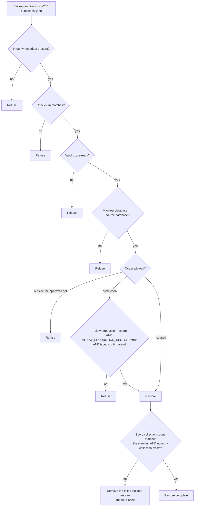

# Backup and restore runbook — SIGAP ULP Labuhan

This runbook describes the backup and restore behaviour that
`scripts/backup-mongodb.sh` and `scripts/restore-mongodb.sh` implement, and it
lists the external obligations that the scripts explicitly do **not** satisfy.

## 1. Backup

### 1.1 What the script guarantees

| Property | Implementation |
|---|---|
| Scoped identity | The dump runs as `MONGO_BACKUP_USERNAME`, the database-scoped backup user. The bootstrap root user and the bootstrap root password are rejected. |
| One backup at a time | A portable `mkdir`-based lock (`.backup.lock` in the output directory) prevents concurrent runs. |
| Unique archive name | The archive name carries the UTC timestamp **and** a per-run token (the process id plus a random suffix), so two backups that start in the same second cannot produce the same file name. The lock serialises the runs; it does not make their names unique. |
| No overwrite | If a file with the generated archive name already exists, the run fails instead of replacing an existing archive, checksum, or manifest. |
| Unique temporary file | The dump is written to `mktemp` `.partial` file; the final name is published with an atomic rename only after validation. |
| Gzip validation | `gzip --test` must succeed before the archive is published. |
| Empty-archive refusal | An empty dump fails the run. |
| Checksum | `SHA256SUMS`-style sidecar `<archive>.sha256` with the SHA-256 digest. |
| Collection census | The manifest records the document count of every collection that is **actually in the archive**. The count query and the dump are driven by the same `EXCLUDED_COLLECTIONS` array, so the excluded collections are skipped by both. |
| Manifest | `<archive>.manifest.json` records the backup id, timestamp, database, archive name, checksum, gzip validation flag, the collection counts, and the excluded collections. |
| Failure atomicity | A failed run removes the partial archive; it never leaves a file that looks like a complete backup. |
| File permissions | `umask 077`; the archive, the checksum, and the manifest are `chmod 600`. |

### 1.2 Excluded collections

The dump excludes the operational collections, because they are transient
session and import-job state:

```
sessions
import_jobs
import_job_records
import_job_issues
import_job_sources
```

The manifest lists them explicitly so that a restore reconciliation is not
confused by their absence.

**The count query uses exactly this list.** The `EXCLUDED_COLLECTIONS` array
in `scripts/backup-mongodb.sh` is the single source of truth:

- the `--excludeCollection` arguments of `mongodump` are generated from it,
- the `mongosh` census expression skips the same names through
  `EXCLUDED_COLLECTIONS_JSON`,
- the dry-run representation prints both the generated dump command and the
  generated count command, so the two can be compared before a real run.

If the count query had counted the excluded collections while the dump
excluded them, the manifest would describe collections that the archive does
not contain, and the restore reconciliation would fail for the wrong reason.

### 1.3 Usage

```bash
# Dry run: shows the archive path, the dump command, and the excluded
# collections without touching the database.
MONGO_DATABASE=sigap_ulp_labuhan \
MONGO_BACKUP_USERNAME=sigap_backup \
MONGO_BACKUP_PASSWORD="$MONGO_BACKUP_PASSWORD" \
MONGO_ROOT_USERNAME=sigap_root \
MONGO_ROOT_PASSWORD="$MONGO_ROOT_PASSWORD" \
  scripts/backup-mongodb.sh --dry-run

# Real backup.
MONGO_DATABASE=sigap_ulp_labuhan \
MONGO_BACKUP_USERNAME=sigap_backup \
MONGO_BACKUP_PASSWORD="$MONGO_BACKUP_PASSWORD" \
MONGO_ROOT_USERNAME=sigap_root \
MONGO_ROOT_PASSWORD="$MONGO_ROOT_PASSWORD" \
  scripts/backup-mongodb.sh --output-dir /var/backups/sigap
```

The script must run on the deployment host, where the Compose project is
available, because it uses `docker compose exec mongo`.

### 1.4 Output

```
/var/backups/sigap/
├── mongodb-sigap_ulp_labuhan-20261127T040000Z.archive.gz
├── mongodb-sigap_ulp_labuhan-20261127T040000Z.archive.gz.sha256
└── mongodb-sigap_ulp_labuhan-20261127T040000Z.archive.gz.manifest.json
```

### 1.5 Schedule and retention

The schedule and the retention period are an **operator decision** and are
not configured by this repository. A typical arrangement is a daily logical
dump with a 14-day local retention and a 90-day off-host retention, but the
actual policy must be agreed and enforced outside the repository — for
example with a `cron` entry or a systemd timer on the host.

## 2. Restore

### 2.1 The default target is isolated

The restore script defaults to `MONGO_RESTORE_DATABASE`
(`sigap_ulp_labuhan_restore` by default), never to the production database.



### 2.2 Guards in detail

| Guard | Behaviour |
|---|---|
| Missing integrity metadata | The restore is refused when `<archive>.sha256` or `<archive>.manifest.json` is missing. |
| Checksum mismatch | Refused. |
| Invalid gzip stream | Refused. |
| Manifest database mismatch | Refused — the manifest must describe the configured source database. |
| Manifest hash mismatch | Refused. |
| Restore database equals source database | Refused — `MONGO_RESTORE_DATABASE` must differ from `MONGO_DATABASE`. |
| Target outside the approved set | Refused — the approved targets are the isolated restore database and, with the break-glass flags, the production database. |
| Rehearsal against the production database | Refused, even when the break-glass flags are present. |
| Production restore without the break-glass flags | Refused. |
| Production restore with the flags | Requires the typed confirmation `RESTORE-PRODUCTION` on stdin. |
| Isolated restore with `--drop` | Requires the typed confirmation `RESTORE`. |
| Count reconciliation mismatch | The restore is rejected and the isolated target is dropped. |
| **Extra collection in the target** | Rejected. A restore that does not drop the target must not leave stale collections behind: every collection that exists in the restored database must also be recorded in the backup manifest. A collection that the manifest does not record is reported as `exists in the restored database but is not recorded in the backup manifest` and the restore fails closed. |
| Missing collection in the target | Rejected — a collection recorded in the manifest must exist in the restored database. |
| Count mismatch | Rejected — the document count must equal the count recorded in the manifest. |

### 2.3 Isolated restore rehearsal

The rehearsal mode is the routine way to prove that a backup can be restored:

```bash
MONGO_DATABASE=sigap_ulp_labuhan \
MONGO_RESTORE_DATABASE=sigap_ulp_labuhan_restore \
MONGO_RESTORE_USERNAME=sigap_restore \
MONGO_RESTORE_PASSWORD="$MONGO_RESTORE_PASSWORD" \
  scripts/restore-mongodb.sh \
    /var/backups/sigap/mongodb-sigap_ulp_labuhan-<timestamp>.archive.gz \
    --rehearsal
```

`--rehearsal` implies `--drop`, forces the target to be empty, restores into
the isolated restore database, reconciles the collection counts, and then
**removes the rehearsal database** when the reconciliation succeeded. Use
`--keep-rehearsal` to keep the restored database for inspection; the script
then prints a warning that the database must be removed manually.

A rehearsal can be planned without touching the database:

```bash
... scripts/restore-mongodb.sh <archive> --rehearsal --dry-run
```

The dry run prints the target, the source database, the authentication
database, the drop flag, and the expected collection counts.

### 2.4 Production restore is a break-glass operation

A production restore is **never** the default and must never be performed
without an incident record. It requires all of:

1. the flag `--allow-production-restore`;
2. the environment variable `ALLOW_PRODUCTION_RESTORE=true`;
3. the typed confirmation `RESTORE-PRODUCTION`;
4. a verified backup archive with a matching checksum and manifest;
5. an approved incident record that names the operator, the reason, and the
   backup that is being restored.

```bash
ALLOW_PRODUCTION_RESTORE=true \
MONGO_DATABASE=sigap_ulp_labuhan \
MONGO_RESTORE_USERNAME=sigap_restore \
MONGO_RESTORE_PASSWORD="$MONGO_RESTORE_PASSWORD" \
  scripts/restore-mongodb.sh <archive> \
    --target sigap_ulp_labuhan --drop --allow-production-restore
```

The script asks for the confirmation interactively. It must be run from an
interactive terminal; a non-interactive invocation is refused at the
confirmation step.

**If a production restore fails, the production database may already be
modified.** The cleanup routine does not drop the production database, but a
`--drop` restore removes or replaces the existing collections before it
writes the archive, so a failure can leave the production database partially
restored. The script says so explicitly:

> The production restore failed. The cleanup routine does not drop the
> production database, but the production database may already have been
> modified: a --drop restore removes or replaces the existing collections
> before it writes the archive, so a failure can leave the production database
> partially restored. Treat the production database as modified and follow the
> break-glass runbook.

Only an **isolated** restore is cleaned up automatically, by dropping the
isolated restore database.

### 2.5 Local identity smoke rehearsal (27 November 2026)

A disposable Compose project (`sigap-validation`) validated the MongoDB role
boundaries after the custom-role initialization script was corrected:

1. the application identity inserted a smoke document;
2. the scoped backup identity produced a gzip archive for that collection;
3. the scoped restore identity restored the archive with `--drop` into the
   separate `sigap_validation_restore` database and reconciled the document
   value;
4. a write attempt by the backup identity was rejected; and
5. a write attempt by the restore identity against the application database
   was rejected.

This is local proof that the database-scoped backup/restore privileges are
usable and fail closed as intended. It is not a production backup, an
off-host durability proof, a scheduled rehearsal, or approval of the
production restore target.

## 3. External obligations that are NOT implemented

These are stated in the header of both scripts and are deliberately not
implemented, because they require infrastructure and policy that this
repository does not own:

| Obligation | Status |
|---|---|
| At-rest encryption of the archive and of the backup volume | **Not implemented.** The archive is only protected by filesystem permissions (`umask 077`, `chmod 600`). |
| Encrypted transport to the backup target | **Not implemented.** No copy is performed by the script. |
| Off-host, access-controlled backup target | **Not implemented.** The script writes to a local directory only. |
| Signing the archive and the manifest with an organisational key | **Not implemented.** Only a SHA-256 checksum is produced; a checksum detects corruption, it does not prove authenticity. |
| Point-in-time consistency evidence between the MongoDB volume snapshot and the logical dump | **Not implemented.** A logical dump is not a point-in-time snapshot. |
| Automated schedule and retention enforcement | **Not implemented.** |
| Automated restore rehearsal on a schedule | **Not implemented.** |

Until these are arranged, a backup exists only on the production host and is
protected only by filesystem permissions. A host loss destroys every backup.

**Current state (2026-11-27):** no encrypted off-host backup target, no
schedule, and no automated/scheduled restore rehearsal has been established. A
disposable identity smoke rehearsal passed locally, but the scripts still run
only when an operator invokes them and they only ever write to the local
output directory. The verification of the remote controls is recorded in
[Operator setup checklist](operator-setup-checklist.md#0-verified-state-of-the-remote-repository).


## 4. Related documents

- `deploy/mongo/README.md` — the MongoDB identities, the scoped roles, the
  fact that the init script does not re-run on an existing volume, and the
  root revocation procedure.
- [Rollback runbook](rollback-runbook.md) — rolling back the application
  images, and when a database restore is the correct response.
- [Operator setup checklist](operator-setup-checklist.md) — the external
  backup obligations that an operator must arrange.
