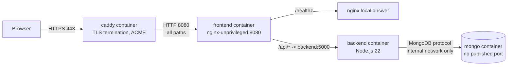
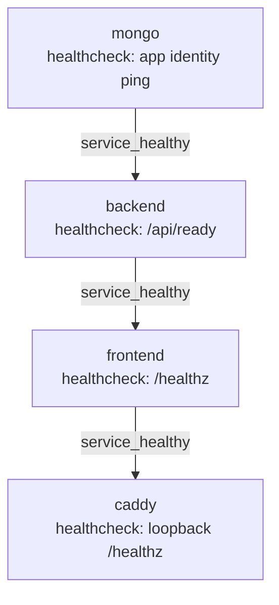

# Deployment reality — SIGAP ULP Labuhan

This document describes the topology and the endpoints that this repository
actually implements. It is the reference for the release gates; where it
differs from a target design, the target design is not claimed to exist.

## 1. Request path

Facts that follow from the files in this repository:

| Fact | Source |
|---|---|
| Caddy terminates TLS and forwards every path to the frontend container | `deploy/Caddyfile` |
| The frontend container serves the static assets and proxies `/api/` to `backend:5000` | `frontend/nginx.conf` |
| The public API prefix is `/api/v1`; the browser client uses the relative prefix `/api/v1` | `backend/src/app.js`, `frontend/src/services/api.ts` |
| MongoDB has no published port and is reachable only on the internal `data` network | `deploy/docker-compose.prod.yml` |
| Only Caddy publishes ports (80 and 443) | `deploy/docker-compose.prod.yml` |

### 1.1 Endpoint inventory

| Endpoint | Implemented by | Purpose | Used by |
|---|---|---|---|
| `GET /healthz` | frontend Nginx | Static layer liveness; answers `ok` without touching the API | Caddy active health check, container health check, static smoke check |
| `GET /api/health` | backend Express | Backend liveness; does not check MongoDB | operator diagnostics |
| `GET /api/ready` | backend Express | Backend readiness; returns `503` while MongoDB is not connected | backend container health check, **deployment smoke check** |
| `GET /api/v1/*` | backend Express | The documented REST contract | browser client |

**The deployment smoke check must use `/api/ready`, not `/healthz` alone.**
`/healthz` only proves that the Nginx container answers; it does not prove that
the backend process is running or that MongoDB is reachable. The deployment
workflow therefore checks both, and treats `/api/ready` as the release signal.

The Caddy container has its own health check against a loopback-only listener
(`http://127.0.0.1:8081/healthz`) that never proxies application traffic.

## 2. Container start order

All `depends_on` conditions in `deploy/docker-compose.prod.yml` use
`service_healthy`. The Caddy container waits for a healthy frontend, and the
frontend waits for a healthy backend.

## 3. Images and configuration

| Item | How it is pinned |
|---|---|
| Backend image | `ghcr.io/<owner>/<repository>/backend@sha256:<64 hex>` |
| Frontend image | `ghcr.io/<owner>/<repository>/frontend@sha256:<64 hex>` |
| MongoDB image | `docker.io/library/mongo@sha256:<64 hex>` |
| Caddy image | `docker.io/library/caddy@sha256:<64 hex>` |
| Backend base image | `node:22.13.0-bookworm-slim@sha256:<64 hex>` in `backend/Dockerfile` |
| Frontend base images | `node:22.13.0-alpine@sha256:<64 hex>` and `nginxinc/nginx-unprivileged:1.27-alpine@sha256:<64 hex>` in `frontend/Dockerfile` |

The compose file refuses to start when an image variable is missing, and the
release validator refuses to continue when a reference is not an exact digest
in the expected repository. A mutable tag such as `:latest` is rejected.

## 4. What is not covered here

- The database schema, the API contract, and the requirement documents are not
  deployment artefacts; they are described in `docs/api`, `docs/database`, and
  `docs/requirements`.
- `.temp/sigap/` is never mounted, copied, or modified by any deployment
  artefact in this repository.
- The remote GitHub environment, rulesets, branch protection, and the host
  firewall are external; see [Operator setup checklist](operator-setup-checklist.md).
