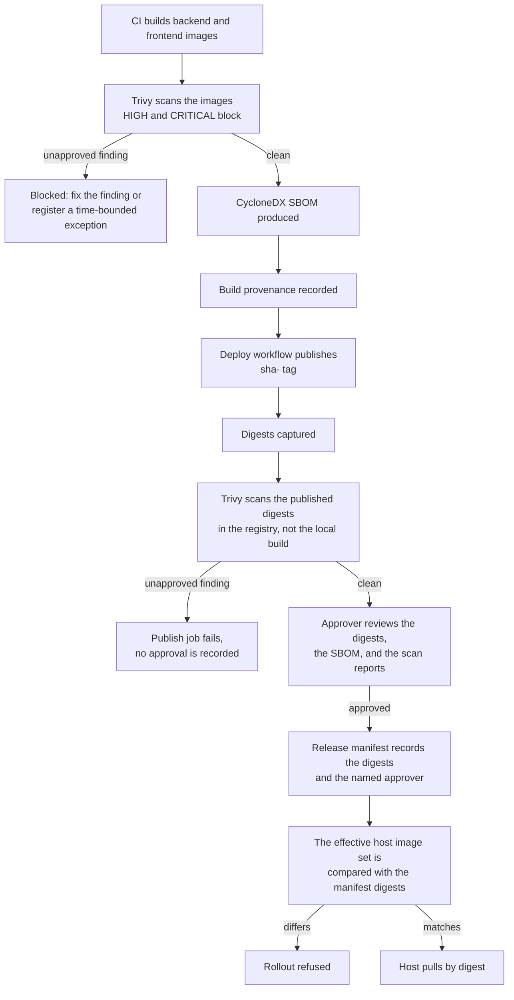

# Image approval and evidence — SIGAP ULP Labuhan

This document describes how an image becomes eligible for a production
rollout, and which evidence must be retained for it.

## 1. Rule: images are approved by digest, never by tag

A production rollout uses an exact digest reference:

```
ghcr.io/<owner>/<repository>/backend@sha256:<64 lowercase hex characters>
ghcr.io/<owner>/<repository>/frontend@sha256:<64 lowercase hex characters>
docker.io/library/mongo@sha256:<64 lowercase hex characters>
docker.io/library/caddy@sha256:<64 lowercase hex characters>
```

The validator rejects anything else, including:

| Reference | Verdict |
|---|---|
| `ghcr.io/acme/sigap/backend@sha256:not-a-digest` | Rejected — the digest is not 64 hex characters |
| `ghcr.io/acme/sigap/backend:latest` | Rejected — a mutable tag |
| `ghcr.io/acme/sigap/backend:v1.4.2` | Rejected — a mutable tag |
| `ghcr.io/other-owner/sigap/backend@sha256:<64 hex>` | Rejected — the repository is not the expected one |
| `docker.io/library/mongo@sha256:<64 hex>` | Accepted when it is the approved MongoDB digest |

## 2. Where the digests come from

| Image | Digest source |
|---|---|
| Backend and frontend | The `digest` output of `docker/build-push-action` in the deploy workflow, recorded in the release manifest |
| MongoDB and Caddy | The pinned digests in the repository variables `MONGO_IMAGE` and `CADDY_IMAGE` |
| Backend base image | `node:22.13.0-bookworm-slim@sha256:f5a0871ab03b035c58bdb3007c3d177b001c2145c18e81817b71624dcf7d8bff` in `backend/Dockerfile` |
| Frontend base images | `node:22.13.0-alpine@sha256:f2dc6eea95f787e25f173ba9904c9d0647ab2506178c7b5b7c5a3d02bc4af145` and `nginxinc/nginx-unprivileged:1.27-alpine@sha256:65e3e85dbaed8ba248841d9d58a899b6197106c23cb0ff1a132b7bfe0547e4c0` in `frontend/Dockerfile` |

The base-image digests in the Dockerfiles were resolved from the official
registry manifests. When a Node.js or Nginx version changes, the digest must be
resolved again and reviewed in the same change.

## 3. Approval flow



The approver is the `creator` of the GitHub deployment record whose
`environment` is `production` and whose `ref` is the release revision. The
release manifest stores that identity and the timestamp, and
`scripts/validate-release-manifest.js` rejects a manifest without an approval
for the required role (`release-manager` by default).

**The approval covers the published bytes.** The publish job scans
`ghcr.io/<owner>/<repository>/backend@<digest>` and the matching frontend
digest — the exact images that the host pulls — after they were pushed and
before the approval is recorded. A scan report for the local build is not
accepted as a substitute.

**The approval is checked against the host.** After the release files are
installed and before the stack is started,
`scripts/verify-host-image-set.sh` compares the image set that Compose
actually resolves on the host with the four digests that the approved
release manifest records. A host environment file that still names an older
MongoDB or Caddy image stops the rollout instead of deploying an image that
was never approved.

The effective image set is resolved from the declared host environment files
only. Docker Compose gives the process environment a higher precedence than
an `--env-file` value, so the check removes the four image variables from its
own environment before it asks Compose, and the rollout removes them before
it starts the stack. An image variable that is exported in the host shell
profile can therefore neither pass the check nor change what is deployed.

**Current state (2026-11-27):** the remote repository
`zuuisworking/20261109_053845` has **no environments**
(`environments` `total_count: 0`) and **no published workflows**, so no
production deployment record exists and the workflow cannot read an approver
from one. The `publish` job therefore fails with "No production deployment
record with an approver was found", which is the intended fail-closed
behaviour: the pipeline cannot manufacture an approval. See
[Operator setup checklist](operator-setup-checklist.md#0-verified-state-of-the-remote-repository).


## 4. Vulnerability exception format

Approved exceptions live in `security/vulnerability-exceptions.json`. Every
entry must carry:

| Field | Meaning |
|---|---|
| `id` | Stable identifier |
| `advisory` | A CVE or GHSA identifier; the gate rejects anything else |
| `package` | The affected package and version |
| `severity` | The severity of the advisory |
| `owner` | The accountable person or team; mandatory |
| `expiresAt` | An ISO date; an expired entry fails the build |
| `riskTreatment` | How the risk is handled while the exception is valid |
| `rationale` | Why the exception is justified |
| `compensatingControls` | At least one concrete control |

`scripts/check-security-exceptions.js` validates both this registry and the
licence registry, and `scripts/build-trivy-ignorefile.js` turns the approved
entries into the Trivy ignore file that the CI scans use. An exception that
is not in the registry therefore **fails** the scan — the gate never silently
ignores a finding.

## 5. Licence exception format

`security/license-exceptions.json` uses the same owner/expiry discipline. The
single current entry is documented in
[Production release](production-release.md#22-the-licence-gate-is-a-bounded-truthful-equivalent).

## 6. Retained evidence

The following artefacts are produced by CI and must be retained for the audit
period:

| Artefact | Producer | Retention |
|---|---|---|
| `trivy-backend-image.json`, `trivy-frontend-image.json` | The `images` job | CI artefact, 30 days by default; copy to long-term storage |
| `sbom-backend.cdx.json`, `sbom-frontend.cdx.json` | The `images` job (CycloneDX) | Same |
| `build-provenance.json` | The `images` job | Same |
| SBOM and provenance attestations | `docker/build-push-action` (`sbom: true`, `provenance: mode=max`) attached to the published image in GHCR | In the registry, alongside the image |
| `trivy-fs.json` (backend), `trivy-frontend.json` | The `backend` and `frontend` jobs | CI artefact |
| `trivy-backend-published.json`, `trivy-frontend-published.json` | The `publish` job — the scan of the published digests | CI artefact `published-image-scan-<source_sha>` |
| `contract-gate.json`, `license-report.json` | The `contracts` job | CI artefact |
| `action-pins.json` | The `action-pins` job | CI artefact `action-pin-evidence` |
| Release bundle and `SHA256SUMS` | The `publish` job | CI artefact `release-bundle-<source_sha>` |
| `release-manifest.json` | The `publish` job | CI artefact and the deployment host |
| Gitleaks output | The `secrets` job | Job log |

The 30-day default CI artefact retention is a platform default, **not** a
compliance retention decision. A longer retention policy must be configured in
the repository settings; that is an external obligation and is listed in the
[Operator setup checklist](operator-setup-checklist.md).

## 7. Digest verification on the host

Before the rollout the host resolves the digests it is about to use:

```bash
docker pull ghcr.io/<owner>/<repository>/backend@sha256:<64 hex>
docker image inspect ghcr.io/<owner>/<repository>/backend@sha256:<64 hex> \
  --format '{{json .RepoDigests}}'
```

The `RepoDigests` output must contain exactly the reference from the release
manifest. The deploy workflow uses `docker compose pull` with digest
references, which resolves to the same check.

In addition, the **effective** image set of the Compose project on the host
is compared with the approved digests before the stack is started:

```bash
scripts/verify-host-image-set.sh \
  --compose-file <deploy-path>/docker-compose.prod.yml \
  --env-file <deploy-path>/.env \
  --env-file <deploy-path>/.release.env \
  --expected ghcr.io/<owner>/<repository>/backend@sha256:<64 hex> \
  --expected ghcr.io/<owner>/<repository>/frontend@sha256:<64 hex> \
  --expected docker.io/library/mongo@sha256:<64 hex> \
  --expected docker.io/library/caddy@sha256:<64 hex>
```

The script asks Compose for the image set that the host would actually
deploy (`docker compose config --images`) and compares it as a set with the
expected references. A difference fails the check, so a stale
`MONGO_IMAGE` or `CADDY_IMAGE` in the host environment file cannot deploy an
image that was never validated or approved. The host environment file must
therefore define all four image variables with approved digests.

## 8. External blockers

- A named, out-of-band approver for the digests must exist. The workflow can
  read the GitHub deployment record, but it cannot decide that a digest is
  acceptable.
- The long-term retention of the SBOM, provenance, and scan reports must be
  arranged outside the workflow.
- The GHCR package visibility, the retention policy for the published tags,
  and the tag cleanup policy must be configured in the repository settings.
- The vulnerability and licence exception registries must be reviewed on a
  schedule; the build fails when an entry expires, but a human must decide
  whether to renew, replace, or remove it.
