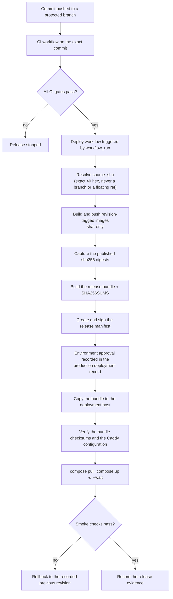

# Production release runbook — SIGAP ULP Labuhan

This runbook describes how a release is produced, gated, approved, and rolled
out. It states exactly which checks run in CI and which checks run on the
deployment host.

## 1. Release model



## 2. CI gates (`.github/workflows/ci.yml`)

| Job | What it proves | How it fails |
|---|---|---|
| `lint` | The root and the frontend sources lint, the frontend type-checks, and every shell script parses (`bash -n`) and passes ShellCheck | A non-zero exit from `npm run lint`, `npm run typecheck`, `bash -n`, or `shellcheck` |
| `action-pins` | Every GitHub Action that a workflow uses is pinned to an exact 40 character commit SHA, and that SHA is the one recorded in the reviewed registry `security/action-pins.json`; the upstream repositories are queried to confirm that the commit exists | A floating tag or branch; a commit that is not in the registry; a registry SHA that differs from the workflow; an upstream commit that the GitHub API does not resolve (HTTP 404/422) |
| `contracts` | The documented API contract, the Express routes, and the frontend client agree; the exception registries are valid; the dependency licence metadata is acceptable | The contract gate reports a difference that is not registered in `security/contract-gate-exceptions.json`; an exception is expired or lacks an owner; a licence is missing or forbidden |
| `backend` | The backend test suite and the coverage run pass, and the dependency tree has no unapproved HIGH/CRITICAL advisory | A failing test; Trivy reports an unapproved HIGH/CRITICAL vulnerability |
| `frontend` | The frontend test suite and production build pass, and the frontend dependency tree is clean | A failing test, a failing build, or an unapproved advisory |
| `e2e` | The end-to-end and visual tests pass against a digest-pinned MongoDB service | A failing test |
| `secrets` | No credential is present in the commit history or in the working tree | Gitleaks reports a finding |
| `images` | The final backend and frontend images build, the images are scanned, and the SBOM plus the build provenance are produced and retained | A build failure, an unapproved advisory, or a missing evidence file |
| `release-controls` | The remote GitHub release controls are actually present | `scripts/check-github-release-controls.sh` reports a missing or unverifiable control |

The image job runs **after** every other gate. A release is therefore only
possible when lint, type check, action pin, contract, licence, secret, test,
and scan gates all passed for the same commit.

### 2.0 The action pin gate

Every `uses:` reference in `.github/workflows/*.yml` must be pinned to an
exact 40 character commit SHA. `scripts/check-action-pins.js` compares the
workflows with the reviewed registry `security/action-pins.json`, which
records, for every action, the upstream version and the commit that the
version refers to:

| Action | Version | Commit |
|---|---|---|
| `actions/checkout` | `v4.2.2` | `11bd71901bbe5b1630ceea73d27597364c9af683` |
| `actions/setup-node` | `v4.4.0` | `49933ea5288caeca8642d1e84afbd3f7d6820020` |
| `actions/upload-artifact` | `v4.4.3` | `b4b15b8c7c6ac21ea08fcf65892d2ee8f75cf882` |
| `actions/download-artifact` | `v4.3.0` | `d3f86a106a0bac45b974a628896c90dbdf5c8093` |
| `docker/setup-buildx-action` | `v3.12.0` | `8d2750c68a42422c14e847fe6c8ac0403b4cbd6f` |
| `docker/login-action` | `v3.6.0` | `5e57cd118135c172c3672efd75eb46360885c0ef` |
| `docker/build-push-action` | `v6.19.2` | `10e90e3645eae34f1e60eeb005ba3a3d33f178e8` |

Each commit was resolved with `git ls-remote` against the upstream tag
(peeling an annotated tag to the commit it points at) and confirmed with the
GitHub commits API on 2026-11-27. The registry is the only place where a pin
may be changed, so a mistyped or non-existent commit is caught by the gate
instead of by a failed workflow run.

`node scripts/check-action-pins.js --verify-remote` additionally queries the
upstream repositories. A commit that the upstream API does not resolve is
always an error. An unreachable or rate-limited upstream API is an error by
default and a warning with `--allow-unavailable`; the CI job uses
`--allow-unavailable` for the remote step only, so the registry comparison
always runs and a wrong pin always fails the build.

**Superseded pin.** The earlier `actions/setup-node` pin
`11d5960a326750d5838078e36cf38b85af677262` does not exist; the GitHub API
answers `422 No commit found for SHA`. It was replaced with
`49933ea5288caeca8642d1e84afbd3f7d6820020`, the commit that the `v4.4.0`
tag points at.

The `release-controls` job uses `RELEASE_CONTROLS_TOKEN` when it is
configured and the built-in `GITHUB_TOKEN` otherwise. Reading an environment,
a ruleset, a branch protection rule, and the variable inventory requires
repository administration access, so without that token the job reports those
controls as unreadable and fails. The secret inventory is always skipped in
CI, because listing repository secrets is a separate privilege; it is covered
by the operator run of the same script. See
[Operator setup checklist](operator-setup-checklist.md#01-the-token-used-by-the-release-controls-ci-job).

### 2.1 The contract gate is truthful

`scripts/check-api-contract.js` compares three sources:

1. the endpoint table in `docs/api/overview.md`;
2. the routes that the Express application registers, with their mount paths;
3. the paths and methods that `frontend/src/services/api.ts` calls.

A difference is a **failure** unless it is registered in
`security/contract-gate-exceptions.json` with an `owner`, a `rationale`, and an
`expiresAt` date. An expired exception fails the build. The gate never
rewrites the contract and never downgrades a difference to a warning.

The current registered differences are two:

| Method | Path | Type | Reason |
|---|---|---|---|
| `GET` | `/api/health` | operational-endpoint | Operational liveness probe outside the versioned contract |
| `GET` | `/api/ready` | operational-endpoint | Operational readiness probe outside the versioned contract |

The export filter is documented and implemented as `view`; the client sends the
same `view` parameter. The earlier documentation-only `category`/`view`
divergence was corrected in `docs/api/overview.md` and is not an outstanding
contract difference.

### 2.1.1 Resolved contract differences

The registry also records how the two former differences were closed, so that a
reverted documentation change is noticed instead of silently re-opened:

| Former difference | Resolution |
|---|---|
| `POST /api/v1/auth/profile/avatar` was undocumented | `docs/api/overview.md` now documents the multipart avatar upload, so the `undocumented-implementation` exception was removed. |
| `GET /api/v1/auth/avatar/:userId` was undocumented | `docs/api/overview.md` now documents the avatar download, so the `undocumented-implementation` exception was removed. |

An entry that no longer corresponds to a difference is removed from the
registry: a stale entry would silently re-open a hole that the documentation
has already closed. If the documentation is reverted, the exceptions must be
re-registered with a fresh review.

### 2.2 The licence gate is a bounded, truthful equivalent

`scripts/check-license-policy.js` reads the installed dependency metadata and
evaluates the declared licence expression of every package. It accepts the
permissive licences listed in the policy, honours `OR`/`AND`/`WITH` operators,
and rejects packages that declare no licence or a forbidden licence.

This is deliberately **not** claimed to be a complete legal licence audit: it
does not resolve transitive licence obligations of optional peer dependencies
that are not installed, and it does not read the licence text. One exception is
registered in `security/license-exceptions.json` for `buffers@0.1.1`, which
ships no licence field:

| Package | Reason | Owner | Expires |
|---|---|---|---|
| `buffers@0.1.1` | The package declares no licence field; it is a transitive dependency of the image processing chain and is not reachable from an untrusted input | dependency-review-owner | 2026-12-31 |

## 3. Deployment workflow (`.github/workflows/deploy.yml`)

### 3.1 Revision resolution

- The workflow is triggered by `workflow_run` after the `CI` workflow
  completes, or manually with a `source_sha` or a `release_tag` input.
- The resolved revision must match `^[0-9a-f]{40}$`. A branch name, a pull
  request ref, a tag name, or `HEAD` is never accepted.
- A tag is resolved through `git ls-remote` to the exact commit it points at.
  Both lightweight and annotated tags are supported: an annotated tag is
  peeled (`refs/tags/<tag>^{}`) to the commit it points at, and a lightweight
  tag is used as it is.
- The checkout uses `ref: <source_sha>` and the workflow then re-reads
  `git rev-parse HEAD` and refuses to continue when it differs from the
  resolved revision.

**Only an allowed ref may authorise a deployment.** A successful CI run
proves that a change is testable, not that the change is releasable, so a
`pull_request` CI run never authorises a rollout:

| Trigger | Requirement |
|---|---|
| `workflow_run` after CI | The CI run concluded with `success`, its event is `push` or `workflow_dispatch`, and its ref is the protected branch (`vars.RELEASE_PROTECTED_BRANCH`, default `main`) or a release tag matching `vars.RELEASE_TAG_PATTERN` (default `v*`) |
| `workflow_dispatch` with `source_sha` | The SHA must have a **successful CI run from an allowed ref** — the workflow searches the successful CI runs for that SHA and accepts only a `push` or `workflow_dispatch` run on the protected branch or on a release tag |
| `workflow_dispatch` with `release_tag` | The tag must match the release tag pattern and must resolve to an exact commit SHA; that SHA must then pass the same allowed-ref CI gate |

A manual `source_sha` that points at a pull request head, a feature branch,
or a commit whose only successful CI run is a `pull_request` run is refused.
The protected branch and the release tag pattern are repository variables, so
an operator can change them without editing the workflow; the defaults are
`main` and `v*`.

The CI workflow itself triggers on `push` to `main`, on `push` of a `v*` tag,
on `pull_request`, and on `workflow_dispatch`, so the CI run that authorises
a tag deployment actually exists for a tag.

### 3.2 Publication

- The only published tag is `sha-<source_sha>`. There is no `latest` tag and
  no tag derived from a branch.
- The published `sha256` digests are read back from the build output and are
  validated with `^sha256:[0-9a-f]{64}$` before they are used.
- **The published digests are scanned before the approval is recorded.** The
  Trivy scan runs against
  `ghcr.io/<owner>/<repository>/backend@<digest>` and the matching frontend
  digest — the exact bytes that the host will pull — not against the local
  build. A HIGH or CRITICAL finding that is not covered by the approved
  exception registry fails the publish job, and the scan reports are retained
  as the `published-image-scan-<source_sha>` artifact.
- The scanner reference is the reviewed exact digest
  (`aquasec/trivy:0.58.1@sha256:ab70a02200597efa04748f210f793936eb647cbcdb0ea69cc30b226d6f5a22c7`).
  It is **not** taken from a repository variable: an operator-controlled or
  mutable scanner reference in the production publish path would replace the
  reviewed scanner with an unreviewed one. The publish job asserts that the
  scanner reference is still the approved digest before it scans anything.
- The deployment pulls `ghcr.io/<owner>/<repository>/backend@sha256:<digest>`
  and the matching frontend image. A tag is never used at deploy time.
- SBOM and provenance attestations are requested (`sbom: true`,
  `provenance: mode=max`).
- **The release manifest is always signed.** The publish job requires the
  `RELEASE_MANIFEST_SIGNING_KEY_B64` secret; when it is missing or decodes to
  an empty key, the job fails. There is no unsigned path, and the signature
  file must exist before the job succeeds. The manifest is signed with
  Ed25519 and the detached signature travels with the bundle.

### 3.3 Rollout on the host

1. The release bundle is copied to `<deploy-path>/releases/<source_sha>/bundle`.
2. `scripts/verify-release-bundle.sh` verifies the `SHA256SUMS` manifest on the
   host.
3. `caddy validate` runs against the pinned Caddy image with the bundle's
   `Caddyfile`.
4. The registry credential is written to the host's Docker config with
   `docker login --password-stdin` and is removed with `docker logout` in an
   `always()` step.
5. The release files are installed (Compose file, Caddyfile, MongoDB init
   script, and the runtime scripts).
6. **The release environment and the rollback reference are recorded.**
   `scripts/prepare-release-env.sh` writes `<deploy-path>/.release.env` with
   the complete approved four-image set and the rollback reference
   `<deploy-path>/rollback/<source_sha>.env` with the complete four-image set
   of the revision that was live before the rollout. The reference is
   verified with `--verify` before the rollout continues. A host that never
   ran a release is recorded explicitly as the initial installation; a host
   that did run a release but whose previous image set cannot be resolved
   stops the rollout.
7. **The effective host image set is compared with the approved digests.**
   `scripts/verify-host-image-set.sh` asks Compose on the host for the
   effective image set (`docker compose config --images`, resolved with the
   host's `.env` and `.release.env`) and compares it as a set with the four
   digests that the approved release manifest records
   (`images.backend`, `images.frontend`, `images.mongo`, `images.caddy`). The
   rollout is refused when the sets differ, so a stale `MONGO_IMAGE` or
   `CADDY_IMAGE` in the host environment file cannot deploy an image that was
   never validated or approved. The comparison is exact: every expected
   reference must be an `<repository>@sha256:<64 hex>` digest.
   The effective set is resolved **from the declared environment files only**.
   Docker Compose gives the process environment a higher precedence than an
   `--env-file` value, so the check removes `BACKEND_IMAGE`, `FRONTEND_IMAGE`,
   `MONGO_IMAGE`, and `CADDY_IMAGE` from its own environment before it asks
   Compose. An image variable in the host shell profile therefore cannot
   override the approved references.
8. `docker compose pull` and `docker compose up -d --wait --remove-orphans`
   run with the pinned image references. The rollout removes the same four
   image variables from the ambient environment first, so it resolves exactly
   the image set that the check verified a moment earlier.
9. The smoke checks run:
   - `GET <PUBLIC_APP_URL>/api/ready` must return `"status":"ok"` — this is
     the release signal, because it proves that the backend is up **and** that
     MongoDB is reachable;
   - `GET <PUBLIC_APP_URL>/healthz` must succeed — this proves that the
     static layer answers;
   - `GET https://<PUBLIC_HOST>/healthz` must succeed — this proves that the
     TLS endpoint serves the new revision.

### 3.4 SSH hardening

Every SSH and SCP invocation uses:

```
-o StrictHostKeyChecking=yes
-o UserKnownHostsFile=~/.ssh/known_hosts
-o BatchMode=yes
```

The host key is supplied from the `VPS_SSH_HOST_KEY` secret and written to
`known_hosts` before the first connection. A host key change therefore fails
the rollout instead of silently accepting a new host.

### 3.5 Permissions

| Job | Permissions |
|---|---|
| `resolve` | `contents: read`, `actions: read` |
| `publish` | `contents: read`, `packages: write` |
| `deploy` | `contents: read` (plus the `production` environment gate) |

No job receives `contents: write` or `administration: write`.

## 4. The release preflight (`scripts/validate-production-release.sh`)

The validator runs on the runner before anything is copied to the host, and
can be re-run on the host. It has two modes.

### 4.1 The production gate (the default)

`scripts/validate-production-release.sh` without arguments is the **production
gate**. It approves a release, so it fails closed on:

| Check | Failure condition |
|---|---|
| Required values | Any of the 18 required variables is empty |
| Image digests | A reference is not `<expected repository>@sha256:<64 lowercase hex>`; a mutable tag; `sha256:not-a-digest` |
| Secrets | A secret is shorter than 32 characters or still contains a placeholder such as `replace_with`, `example`, or `change_me` |
| Public URL | `PUBLIC_APP_URL` is not HTTPS, or its host differs from `PUBLIC_HOST`, or `PUBLIC_HOST` contains a scheme, port, or path |
| Origin allowlist | `CLIENT_URLS` does not contain `https://<PUBLIC_HOST>` |
| Database separation | `MONGO_RESTORE_DATABASE` equals `MONGO_DATABASE` |
| Identity separation | Two MongoDB identities share a user name |
| Application identity | `COMPOSE_MONGODB_URI` authenticates as another user, uses the root password, targets another database, or omits `authSource=<application database>` |
| Bundle files | A required runtime file is missing from the release bundle |
| Bundle checksum | `SHA256SUMS` is **missing** from the release bundle, or a file does not match it |
| Release manifest | `RELEASE_MANIFEST` is **not set** or the file does not exist |
| Manifest content | The manifest is expired, signed incorrectly, names another image, or its exception summary disagrees with the repository registries |
| Bundle archive | `BUNDLE_ARCHIVE` is not set, does not exist, or its bytes do not match `manifest.bundle.sha256` |
| Compose expansion | `docker compose config` fails |

A missing `SHA256SUMS` and a missing approved manifest are **failures**, not
skipped checks. The bundle checksum manifest is what makes the runtime files
verifiable, and the approved manifest is what makes the release approved.

The bundle checksum is verified against the **actual archive bytes**: the
deploy workflow sets `BUNDLE_ARCHIVE` to the exact downloaded release archive,
and the manifest validator compares its SHA-256 with `manifest.bundle.sha256`.
The recorded checksum is therefore not only checked for the correct format.

### 4.2 The host runtime check (`--bundle-only`)

`scripts/validate-production-release.sh --bundle-only` is the **host runtime
check**. It verifies that the runtime files are present and that they match
the bundle checksum manifest, without Node.js and without the approved release
manifest. It is the only mode used on the VPS.

It is explicitly **not** a release approval: it cannot verify the approved
manifest, the manifest signature, or the recorded bundle archive checksum.
The cryptographic approval is verified in CI and in the production gate.

`SKIP_COMPOSE_CONFIG=true` exists **only** for the automated tests. The
deployment workflow never sets it, and the validator prints a warning when it
is set.

## 5. Release evidence

The following must be attached to the release record. The fields marked
"recorded by the workflow" are produced automatically; the others are operator
duties.

| Field | Source |
|---|---|
| `sourceSha` | Recorded by the workflow |
| `backendImage`, `frontendImage` (with the digest) | Recorded by the workflow |
| `mongoImage`, `caddyImage` (with the digest) | Recorded in the release manifest; the same four digests are compared with the effective host image set before the rollout |
| `bundle.sha256` | Recorded in the release manifest |
| `releaseId`, `generatedAt`, `expiresAt` | Recorded in the release manifest |
| `approvals[].approver`, `approvals[].approvedAt` | Recorded in the release manifest from the production deployment record |
| `exceptionSummary` | Recorded in the release manifest |
| Trivy image and dependency scan reports | CI artefact `image-scan-and-sbom`, `backend-dependency-scan` |
| Trivy scan of the published digests | Publish job artefact `published-image-scan-<source_sha>` |
| CycloneDX SBOM (backend, frontend) | CI artefact `image-scan-and-sbom` |
| Build provenance (`sourceSha`, `ref`, `runId`, image ids) | CI artefact `image-scan-and-sbom` |
| Gitleaks report | CI job `secrets` log |
| Action pin gate report | CI artefact `action-pin-evidence` |
| Contract gate report | CI artefact `policy-gate-evidence` |
| Licence report | CI artefact `policy-gate-evidence` |
| `caddy validate` output | Deployment job log |
| Effective host image set versus the approved digests | Deployment job log (step `Verify the effective host image set against the approved digests`) |
| Smoke check output (`/api/ready`, `/healthz`) | Deployment job log |
| Rollback reference (`rollback/<sha>.env`) | Deployment host |
| Backup taken before the rollout, with its checksum | Operator, see [Backup and restore](backup-restore.md) |
| MongoDB role reconciliation evidence | Operator, see `deploy/mongo/README.md` |

## 6. External blockers

The following are **not** implemented by this repository and must be arranged
outside it before a production rollout:

- a GitHub `production` environment with a required reviewer, an active
  ruleset or branch protection on the protected branch, and the repository
  secrets and variables — see
  [Operator setup checklist](operator-setup-checklist.md);
- a deployment host with a pinned SSH host key, a firewall that exposes only
  80/443, and a Docker installation with the Compose plugin;
- a TLS certificate authority and the ACME contact address;
- a signed release manifest key pair (`RELEASE_MANIFEST_SIGNING_KEY_B64` for the
  signing key and `RELEASE_MANIFEST_PUBLIC_KEY_B64` for the verification key).
  **Both are required for a production rollout:** the publish job refuses to
  create an unsigned manifest, and the deploy job refuses to roll out without
  the public key. The deploy job always sets
  `REQUIRE_RELEASE_MANIFEST_SIGNATURE=true`, so an unsigned, missing, or
  tampered manifest fails the rollout;
- an encrypted, off-host backup target — see
  [Backup and restore](backup-restore.md);
- an out-of-band approver for the image digests — see
  [Image approval](image-approval.md).

### 6.1 Current state of the remote release controls

These blockers are **not theoretical**. A read-only inspection of the remote
repository `zuuisworking/20261109_053845` on 2026-11-27 found:

- **no published workflows** — so no CI run exists for any revision, and the
  deploy workflow's "successful CI for this exact SHA" gate refuses every
  deployment;
- **no rulesets** (`rulesets` list length `0`);
- **no environments** (`environments` `total_count: 0`) — so there is no
  `production` environment, no required reviewer, and no deployment approval;
- **no branch protection** for `main` (the protection endpoint returns 404);
- **unverifiable variable and secret inventories** — the list endpoints return
  403 for the active token, so their contents are unknown rather than empty.

`scripts/check-github-release-controls.sh --repository
zuuisworking/20261109_053845` fails closed and reports the remote controls as
incomplete. The remote repository was not modified.

Until an operator creates the environment, the ruleset or branch protection,
and the required variables and secrets on the remote, the pipeline in this
repository is **not** able to establish a controlled production release. The
files in this repository can only detect the missing controls and refuse to
proceed. See
[Operator setup checklist](operator-setup-checklist.md#0-verified-state-of-the-remote-repository).

