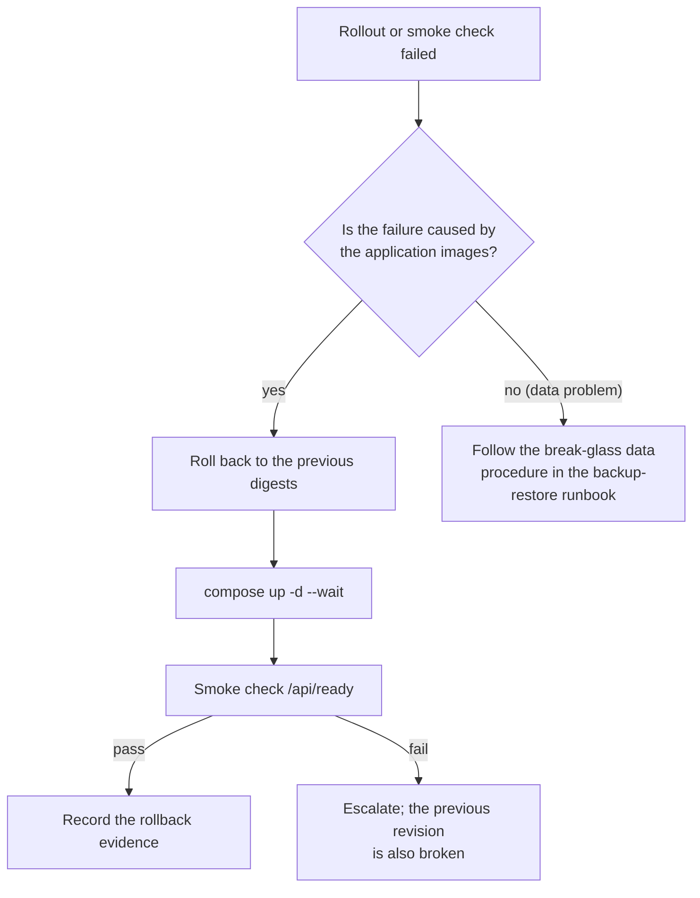

# Rollback runbook — SIGAP ULP Labuhan

This runbook describes how to roll back a release that failed after the
rollout started.

## 1. What rollback means here

A rollback in this deployment means **re-running the Compose stack with the
image digests of the previous release**. It does not mean reverting a commit,
because the deployment host never checks out a Git revision: it runs images by
digest.



**A code rollback does not undo a data change.** If the failed release
migrated or corrupted the data, rolling back the images is not sufficient; use
the break-glass database procedure in
[Backup and restore](backup-restore.md).

## 2. Triggers

Roll back when any of the following is true:

- the `/api/ready` smoke check fails after the retry window;
- the TLS or static smoke check fails;
- the Caddy container never becomes healthy;
- the backend container restarts repeatedly after the rollout;
- the error rate or the latency of the public endpoint degrades immediately
  after the rollout and the degradation is attributable to the new revision.

Do **not** roll back for a problem that already existed before the rollout
unless the new revision makes it materially worse. Rolling back a healthy
release only removes the fix.

## 3. The rollback reference

The deploy workflow records the rollback reference **before** the new revision
starts:

```
<deploy-path>/rollback/<source_sha-of-the-rollout>.env
```

That file contains the complete approved four-image set of the revision that
was live **before** the rollout:

```
BACKEND_IMAGE=ghcr.io/<owner>/<repository>/backend@sha256:<64 hex>
FRONTEND_IMAGE=ghcr.io/<owner>/<repository>/frontend@sha256:<64 hex>
MONGO_IMAGE=docker.io/library/mongo@sha256:<64 hex>
CADDY_IMAGE=docker.io/library/caddy@sha256:<64 hex>
SOURCE_SHA=<40 hex source sha>
```

The MongoDB and Caddy references are part of the rollback reference **on
purpose**. A rollback that only restored the application images would leave a
newly approved MongoDB or Caddy image in place, so the rolled-back stack
would not be the stack that was approved and tested before.

The live references are kept in:

```
<deploy-path>/.release.env
```

`scripts/prepare-release-env.sh` writes both files on the host. It resolves the
previous image set from the live `.release.env`; when that file is incomplete
(it may predate this rule), it recovers the set from the release manifest of
the revision that the live file names, and then from the most recent other
release manifest under `<deploy-path>/releases/`. When the host did run a
release but the previous image set cannot be resolved, the rollout is refused:
an incomplete rollback reference is worse than no rollout.

The only exception is the **initial installation**: a host that never ran a
release has nothing to roll back to. The script records that explicitly in
`<deploy-path>/rollback/<source_sha>.no-previous-release`, and the deploy
workflow accepts it with an explicit warning.

Therefore the rollback procedure is: read the recorded rollback reference (it
holds the previous `.release.env`), and run the Compose stack with those
references.

### 3.1 Automatic rollback

The deploy workflow does **not** roll back automatically. An automatic
rollback would replay the same failure mode without a human decision. The
workflow fails, the evidence is preserved, and the operator follows this
runbook.

### 3.2 Manual rollback on the host

```bash
cd <deploy-path>

# 1. Inspect the recorded references.
cat .release.env
ls -l rollback/

# 2. Restore the previous references.
cp rollback/<previous-sha>.env .release.env

# 3. Confirm that the references are the complete approved four-image set
#    and that they are exact digests, not tags.
scripts/prepare-release-env.sh --verify .release.env
grep -E '^(BACKEND|FRONTEND|MONGO|CADDY)_IMAGE=' .release.env

# 4. Roll the stack back.
#    The four image variables are removed from the ambient environment first:
#    Docker Compose gives the process environment a higher precedence than an
#    --env-file value, so an exported variable would otherwise override the
#    recorded references.
unset BACKEND_IMAGE FRONTEND_IMAGE MONGO_IMAGE CADDY_IMAGE
docker compose --env-file .env --env-file .release.env \
  -f docker-compose.prod.yml pull
docker compose --env-file .env --env-file .release.env \
  -f docker-compose.prod.yml up -d --wait --remove-orphans
docker compose --env-file .env --env-file .release.env \
  -f docker-compose.prod.yml ps

# 5. Confirm that the stack really runs the rolled-back image set.
scripts/verify-host-image-set.sh \
  --compose-file docker-compose.prod.yml \
  --env-file .env \
  --env-file .release.env \
  --expected "$(sed -n 's/^BACKEND_IMAGE=//p' .release.env)" \
  --expected "$(sed -n 's/^FRONTEND_IMAGE=//p' .release.env)" \
  --expected "$(sed -n 's/^MONGO_IMAGE=//p' .release.env)" \
  --expected "$(sed -n 's/^CADDY_IMAGE=//p' .release.env)"

# 6. Smoke check the rolled-back revision.
curl --fail --silent --show-error https://<PUBLIC_HOST>/api/ready
curl --fail --silent --show-error https://<PUBLIC_HOST>/healthz
```

`scripts/prepare-release-env.sh --verify` refuses a reference that does not
declare the complete four-image set, so an incomplete rollback file cannot be
used by accident.

If `rollback/<previous-sha>.env` is missing, the previous references can be
recovered from the GHCR revision tags (`sha-<source_sha>`), but the digest
must then be resolved again with `docker pull` and `docker image inspect`
before it is used. A tag must never be written into `.release.env` by hand,
and the recovered set must contain all four images.

## 4. Rolling back to a specific earlier revision

```bash
cd <deploy-path>

cat > .release.env <<'EOF'
BACKEND_IMAGE=ghcr.io/<owner>/<repository>/backend@sha256:<backend digest>
FRONTEND_IMAGE=ghcr.io/<owner>/<repository>/frontend@sha256:<frontend digest>
MONGO_IMAGE=docker.io/library/mongo@sha256:<mongo digest>
CADDY_IMAGE=docker.io/library/caddy@sha256:<caddy digest>
SOURCE_SHA=<40 hex source sha>
EOF

# The set must be complete before the stack is rolled back.
scripts/prepare-release-env.sh --verify .release.env

# The ambient image variables are removed for the same reason as in the
# automatic rollback procedure above.
unset BACKEND_IMAGE FRONTEND_IMAGE MONGO_IMAGE CADDY_IMAGE
docker compose --env-file .env --env-file .release.env \
  -f docker-compose.prod.yml pull
docker compose --env-file .env --env-file .release.env \
  -f docker-compose.prod.yml up -d --wait --remove-orphans
```

The MongoDB and Caddy references are **not** left at the current values: the
rolled-back stack runs the same four images that the earlier revision was
approved with.

## 5. What is **not** rolled back automatically

| Artefact | Behaviour on rollback |
|---|---|
| The MongoDB volume | Never touched by an image rollback. A data rollback is a separate, break-glass operation. |
| The Caddy TLS certificate and ACME account | Preserved in the `caddy_data` volume. |
| The `caddy_config` volume | Preserved. |
| The bootstrap root credential | Not revoked by a rollback; see `deploy/mongo/README.md`. |
| The release bundle on the host | Preserved under `releases/<source_sha>/`; it is the evidence of what was deployed. |
| The published GHCR images | Preserved; the tags are revision-scoped, so an old revision stays pullable. |

## 6. After a rollback

1. Record the incident: the revision that failed, the revision that was
   restored, the timestamps, and the smoke-check output.
2. Keep the failed revision's bundle and manifest as evidence; do not delete
   them.
3. Open an issue that describes the failure and links the CI artefacts.
4. Do not re-attempt the same revision until the cause is understood.
5. If the rollback was caused by a data problem, follow the break-glass
   procedure in [Backup and restore](backup-restore.md) and keep the
   production restore audit trail.

## 7. External blockers

- A rollback that depends on an older GHCR tag assumes that the tag was not
  deleted. The tag retention and cleanup policy is an external repository
  setting.
- Restoring the database during an incident assumes that an off-host backup
  exists and is readable. That backup target is an external obligation; see
  [Backup and restore](backup-restore.md#3-external-obligations-that-are-not-implemented).
- The incident record, the on-call schedule, and the communication channel are
  organisational obligations and are not configured by this repository.
