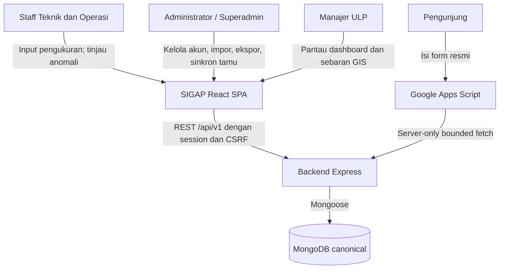

# Requirements Overview — SIGAP ULP Labuhan

Sistem Informasi Geografis & Analisis Pembebanan Trafo (SIGAP) ULP Labuhan is a web application for PLN distribution operations: transformer asset management, electrical load analysis, GIS visualization, customer master data, guest records, controlled imports/exports, and backend-only Google guest synchronization.

## 1. Business problem

1. **Distribution reliability:** Transformers with overload above 80% or phase-current unbalance above 10% require operator attention because sustained abnormal loading can increase temperature, degrade insulation, and cause trips or outages.
2. **Disconnected static data:** The original monolithic HTML application used client-side simulated data and a static map and could not safely serve 1,238 transformer masters and 68,742 customers.
3. **Fragmented field data:** Transformer master data, WBP/LWBP measurements, DIL customer records, and the official guest book need one canonical backend with explicit provenance.
4. **Production trust:** Session revocation, CSRF/origin enforcement, complete import diffs, bounded exports, and fail-closed external integrations are required before production use.

## 2. Users and responsibilities

Roles are enforced by the backend. The SPA is not a security boundary, and the browser never receives the Google endpoint, MongoDB URI, raw session token, or server secrets.

## 3. Source authority

| Source | Canonical meaning |
|---|---|
| Transformer CSV | 1,238 canonical transformer master records |
| Customer CSV | 68,742 canonical customer records; CP1252-compatible |
| Customer XLSX | Equivalent representation of the same customer population; row-for-row cross-check |
| Static HTML | UI reference plus 53 transformer names containing 106 period objects |
| Runtime API | Canonical state after approved migration/import/operator writes |

The HTML measurement source reconciles 46 names, producing 92 eligible period records. Seven names remain unresolved, producing 14 unresolved period records, until explicit operator aliases are approved.

## 4. Contract set

- [Functional requirements](functional-requirements.md)
- [Non-functional requirements](non-functional-requirements.md)
- [Canonical data dictionary](data-dictionary.md)
- [REST API contract](../api/overview.md)
- [Implemented database schema](../database/schema.md)
- [Migration strategy](../database/migration.md)
- [Testing strategy](../testing/strategy.md)

## 5. Current release boundary

The repository implements the application contract and has repository-level test/gate evidence. Release status remains **NO-GO** until a production-target migration is rehearsed and approved, the seven unresolved names are resolved or explicitly excluded, the real Google Apps Script contract is approved, and the deployment/backup/security gates are closed.
