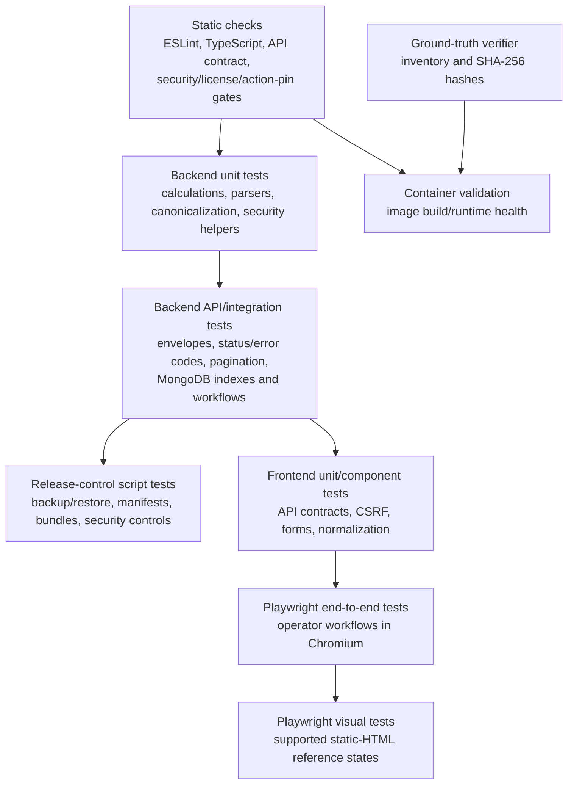

# Testing Strategy and Quality Gates — SIGAP ULP Labuhan

**Status:** The repository test/gate matrix exists. The current evidence record was reconciled on 27 November 2026.  
**Release status:** **NO-GO**. Repository evidence does not close production migration, alias, external-integration, backup/restore, or production image/publication/deployment gates.  
**Contracts:** [API contract](../api/overview.md), [implemented schema](../database/schema.md), [migration guide](../database/migration.md), [implementation plan](../implementation-plan.md).

## 1. Test layers



A lower layer must be green before its dependent higher layer is accepted. A skipped test requires an approved exception with owner and risk treatment; it is not a pass.

## 2. Ground-truth-derived fixtures

Tests and migration rehearsals must not modify `.temp/sigap/`. Fixtures are created as explicitly approved test data in a temporary/test directory.

| Fixture profile | Required assertions |
|---|---|
| Transformer CSV | 1,238 source rows; UTF-8 BOM; semicolon/CRLF; empty feeder/capacity; compound capacity; WKT longitude-first; audited coordinate envelope |
| Customer CSV | 68,742 source rows; CP1252 bytes; semicolon/CRLF; quoted internal semicolon; exactly 12-digit IDs; Indonesian thousands power |
| Customer XLSX | 68,742 equivalent rows; numeric power agrees after declared normalization |
| HTML measurement extract | 53 transformer names / 106 period objects; 46 reconciled names / 92 eligible period records; 7 unresolved names / 14 unresolved period records; all source dates/times null |
| Unauthorized/negative cases | Invalid encoding, wrong headers, duplicate keys, malformed power, missing fields, invalid coordinate, expired/tampered import job |

Full production-sized fixtures may be optional in pull-request unit tests, but a release candidate must run the full population reconciliation in an isolated integration job.

## 3. Backend unit coverage

### 3.1 Electrical analysis

- Average current `(R + S + T) / 3`.
- Unbalance percentage from maximum phase deviation.
- Nominal current from numeric kVA and the static 400 V formula.
- Loading percentage.
- Visual status boundaries: above 10% warning, above 20% critical.
- Recommendation boundaries: above 10% warning, above 15% critical, neutral current above 40 A critical.
- Overload above 80% takes priority.
- Missing inputs or a non-positive average produce the documented nullable result, not an invented substitute.

### 3.2 Parsing and canonicalization

- UTF-8 BOM transformer CSV.
- CP1252 customer CSV and rejection of invalid decoding.
- RFC 4180 quoting, including an address containing an internal semicolon.
- Semicolon delimiter enforcement.
- Customer power `900` and `1.300`; missing and ambiguous values.
- Exactly 12-digit customer ID and leading-zero preservation.
- WKT longitude-first parsing and raw-coordinate retention.
- HTML latitude-first adapter conversion.
- Transformer display-name/`nameKey` normalization and alias normalization.
- Versioned guest fingerprint stability and field-boundary collision resistance.

### 3.3 Request and security rules

- JSON and multipart syntax errors.
- Required/unknown fields and enum/range validation.
- Page/pageSize bounds and endpoint-specific fixed ordering.
- Session-token entropy, HMAC-SHA-256 hash storage, expiry, and revocation.
- Independent per-session CSRF token generation and SHA-256 hash storage.
- CSRF cookie/header/session-hash mismatch, including a missing cookie, missing header, cookie/header mismatch, and token issued for another session.
- Exact allowed-origin and disallowed-origin behavior.
- CORS allowlist and credential rejection for wildcard/unlisted origins.
- Spreadsheet formula neutralization.
- Error envelope redaction.

## 4. Backend integration coverage

The suite uses isolated MongoDB test databases and a test-only application configuration.

| Area | Assertions |
|---|---|
| Mongoose models | Required/null/default behavior and strict unknown-field rejection |
| Unique indexes | Transformer name key, customer ID, guest fingerprint, import token/job ID, alias key |
| Transformer identity | Canonical backfill, exact startup error codes, duplicate-key abort without merge/delete, unique-index plan/apply |
| Measurement uniqueness | At most one current document per transformer/period; update preserves key |
| Sessions | Session lookup by token hash; expiry/revocation rejection; TTL cleanup eventually removes expired row |
| Import job | Persisted preview survives service boundaries; owner/hash/expiry/state checks; TTL and cleanup |
| Import commit | Valid insert/update, unchanged skip, rejected-row exclusion, repeat-commit idempotency, target conflict |
| Full customer import | CP1252/RFC 4180 parsing, every-row CSV/XLSX equivalence, 68,742 business keys |
| Measurement migration | 53 names/106 period objects, 46 names/92 eligible records, 7 names/14 unresolved records unless aliases are approved |
| Export | Complete customer population, UTF-8 BOM, semicolon delimiter, safe quoting, explicit 100,000-row maximum error, output-byte ceiling error, concurrent-export rejection |
| Google sync fixture | Valid insert, duplicate skip, malformed-row rejection, no fallback insert |
| Health/readiness | Dependency/configuration behavior with no secret disclosure |

## 5. API-contract gate

`npm run lint:contracts` compares the documented and implemented route inventories and the frontend client calls. The current result is:

```text
Contract gate: 37 documented, 37 implemented, 30 client-called, 2 operational endpoint(s).
Static API contract gate passed.
```

The gate supplements, rather than replaces, endpoint behavior tests. It is a static inventory check, not proof of production deployment or external operation.

## 6. Frontend tests

The frontend suite covers:

1. typed API calls, response envelopes, and defensive normalizers;
2. `X-CSRF-Token` attachment for unsafe methods and no unsafe retry after CSRF failure;
3. session-expiry behavior;
4. transformer pagination, anomaly endpoint use, and full-replacement form payloads;
5. manual measurement payload semantics;
6. dashboard envelope/period behavior;
7. customer/guest representation and server-only guest-sync payload;
8. import preview/commit contract;
9. export error/download behavior, including the output-byte ceiling and the concurrent-export rejection; and
10. Leaflet popup construction without unsafe HTML interpolation.

## 7. Playwright end-to-end and visual workflows

Required release-candidate workflows:

1. Login, `/auth/me`, protected navigation, logout, and expired-session return to login.
2. Dashboard counts, anomaly lists, and map popup/detail action.
3. Transformer list/search/filter/detail/create/edit/delete.
4. WBP/LWBP measurement entry and current-period update behavior.
5. Customer list/search/detail/create/edit/delete with string ID preserved.
6. Guest list and server-only sync summary/error behavior.
7. Transformer/customer import preview, issue review, commit, and expired/replayed commit behavior.
8. Transformer/customer/guest export download and explicit limit error.

E2E fixtures must be synthetic or approved test data and must not use production PII.

The current rerun records **4/4 Playwright end-to-end/visual tests passed** on desktop and mobile Chromium using an isolated MongoMemoryServer database `sigap_ulp_labuhan_e2e`. The Playwright configuration/global setup assumes that isolated Mongo listener is already available on `127.0.0.1:27018`; the successful rerun supplied it explicitly before invoking Playwright and stopped it afterward. A direct invocation without that listener fails during web-server startup before a test runs. This is browser/repository evidence, not production evidence.

Visual evidence covers the supported login, dashboard, transformer, and customer/guest states. The acceptance statement is preservation of supported states with documented evidence, not an unconditional claim that every rendered pixel is identical.

## 8. Performance and capacity evidence

The target population is 1,238 transformers and 68,742 customers.

| Scenario | Evidence target |
|---|---|
| Transformer list/filter | Database-side pagination and representative query plan/latency |
| Customer search | Indexed bounded predicate and representative query plan/latency |
| Map | Render behavior with the canonical transformer population |
| Customer export | Complete export without browser memory load or silent truncation |
| Import preview | Full-population comparison within an approved operational window |
| Concurrent measurement write | Unique-key conflict handled as expected; no duplicate current document |

The non-functional latency target is a requirement, not evidence that a production profile meets it.

## 9. Security and release-control checks

- Dependency, action-pin, license, exception-registry, container, and secret scans.
- No usable default administrator credential or production secret fallback.
- No wildcard credentialed CORS.
- No raw session/CSRF token, password, MongoDB URI, Google endpoint, or unnecessary PII in logs/responses/snapshots.
- Upload size/content/type and request-size limits.
- Login rate limiting and the dedicated guest-sync rate ceiling, single-flight coalescing, and retry after a failed synchronization.
- Spreadsheet formula-injection protection.
- `.temp/sigap/` unchanged after the complete test run.

The current repository gates passed for the API contract, security exception registries, licenses (637 installed packages), action pins (35 uses across two workflows), and protected ground-truth hashes. The disposable local Docker image build, Compose runtime health check, Trivy filesystem scan, Trivy image scans of both application images, Gitleaks history/working-tree scans, actionlint, `bash -n`, Mermaid parsing, and Markdown link checks also passed. Production image publication, production deployment, and the remote GitHub release controls remain open.

## 10. Commands

```bash
# Backend and release-control suites
npm test
npm run test:unit
npm run test:integration
npm run test:scripts

# Frontend
npm --prefix frontend test
npm run typecheck
npm run build

# Static contracts and release controls
npm run lint
npm run lint:contracts
npm run lint:security
npm run lint:licenses
npm run lint:action-pins
npm run verify:ground-truth

# Browser evidence
npm run test:e2e
npm run test:visual
```

A command's presence in `package.json` is not proof that its tests exist or pass. The evidence table below records actual runs.

## 11. Evidence record — 27 November 2026

### 11.1 Current rerun

| Check | Current result | Environment/scope |
|---|---|---|
| Backend unit | **54/54 passed**, 9 files | Current working tree |
| Backend integration | **119/119 passed**, 12 files | Isolated MongoDB test databases |
| Aggregate root suite | **272/272 passed**, 31 files | Final stable sequential rerun; 54 unit + 119 integration + 99 script tests |
| Release-control script tests | **99/99 passed**, 10 files | Current isolated rerun on the final script-test surface |
| Frontend unit/component | **39/39 passed**, 14 files | jsdom/Vitest |
| Frontend typecheck | **Passed** | `tsc --noEmit` |
| Frontend production build | **Passed** | Vite build; chunk-size warning only |
| Playwright E2E/visual | **4/4 passed**, 2 files | Desktop/mobile Chromium; isolated MongoMemoryServer DB `sigap_ulp_labuhan_e2e` |
| API-contract gate | **Passed** | 37 documented / 37 implemented / 30 client-called / 2 operational |
| Security exception gate | **Passed** | No expired exception |
| License gate | **Passed** | 637 installed packages scanned |
| Action-pin gate | **Passed** | 35 uses across two workflows, all pinned to registered SHAs |
| Ground-truth verifier | **Passed** | Protected inventory and SHA-256 hashes |
| Root ESLint | **Passed** | `eslint backend/src tests scripts` on the final tree |
| Shell syntax (`bash -n`) | **Passed** | All 9 shell scripts under `scripts/` |
| Actionlint | **Passed** | `actionlint 1.7.7` on both workflows; exit 0 |
| Gitleaks 8.24.2 | **Passed** | Commit history and working tree; no leaks |
| Trivy filesystem scan | **Passed** | Pinned scanner `aquasec/trivy:0.58.1@sha256:ab70a022…`; 0 HIGH / 0 CRITICAL |
| Mermaid parse | **Passed** | 68 Mermaid blocks in 38 Markdown files parsed with the Mermaid parser |
| Markdown link/fence check | **Passed** | 38 files; 203 relative links resolved; all fences balanced |
| Docker image build | **Passed** | Disposable Compose project `sigap-validation`; backend and frontend images rebuilt from the final tree |
| Docker runtime | **Passed** | MongoDB, backend, and frontend containers healthy; frontend `/healthz` and backend `/api/ready` returned `200`; see 11.4 |
| Trivy image scans | **Passed** | Both rebuilt application images: 0 HIGH / 0 CRITICAL with the pinned scanner |

The test surface changed concurrently during this session. The first aggregate `npm test` invocation overlapped a separate `npm run test:scripts` invocation, so the same restore-reconciliation file executed twice at once and produced one transient failure while 197/198 tests passed. A later stable surface passed **198/198 across 24 files**. Further script-test files were then added or changed; an intermediate aggregate reported **213/213** while writes were still occurring, so that count was not accepted as final evidence. After most writes settled, the isolated layers passed **32/32 unit**, **96/96 integration**, and **96/96 script** tests, and the aggregate passed **224/224 across 27 files**. `release-env.test.js` then received one final added test; the isolated script rerun passed **97/97**, and the final sequential aggregate passed **225/225 across 27 files**. A frontend invocation run concurrently with typecheck/build produced six 5-second timeout failures under CPU contention; the immediate isolated frontend rerun passed **39/39 across 14 files**.

Three delegated hardening workstreams (export resources, alias registry, release controls) then added their own regressions and changed the surface again. After those workstreams were integrated, the final sequential rerun on the settled tree passed **54/54 unit**, **119/119 integration**, **99/99 script**, and **272/272 across 31 files** for the aggregate root suite; the frontend suite independently passed **39/39 across 14 files**, and the Playwright E2E/visual suite passed **4/4**. The earlier intermediate counts above are kept visible so that no intermediate count is mistaken for the final evidence.

### 11.2 Supplied update-time checkpoint and concurrent test surface

Before the later script-test additions changed the lint/test surface, the supplied 27 November 2026 checkpoint recorded:

- root lint passed;
- frontend typecheck and build passed;
- API-contract, security, and license gates passed;
- script tests **54/54 passed**; and
- ground-truth hash verification passed.

Those checkpoint results remain historical evidence. The current rerun supersedes their test counts because the script-test surface expanded: root lint passes, the isolated script suite passes **99/99**, and the aggregate suite passes **272/272 across 31 files**. The concurrent-write history above remains visible so an intermediate count is not mistaken for final evidence.

### 11.3 Migration and identity rehearsal

| Evidence item | Result |
|---|---|
| Aggregate dry run | Passed in isolated DB `sigap_ulp_labuhan_migration_dry_run`; 70,033 source records read; 0 invalid; 69,980 planned transformer/customer upserts; 106 period objects; 92 eligible/14 unresolved; 0 CSV/XLSX mismatches; 0 writes |
| Identity dry run | Passed against isolated empty DB: 0 pending updates/duplicates; plan for `transformer_name_key_unique` |
| Identity apply | Passed on isolated legacy DB; `Trafo Legacy` → `trafo legacy`, `Café Trafo` → `café trafo`; unique index created |
| Duplicate identity scenario | Exited 1; both records retained unchanged and without `nameKey`; no canonical index; no merge/deletion |

These results prove isolated command behavior. They do not prove a production migration or approved production index state.

### 11.4 Disposable container validation

| Check | Current result | Environment/scope |
|---|---|---|
| Docker daemon availability | **Available** | Docker Desktop 4.96.2 / Engine 29.9.2 on the local workstation |
| Earlier runtime attempt | **Failed, then superseded** | The initial tree rejected `restore` as a MongoDB privilege action during MongoDB initialization; the initialization script was subsequently corrected in the working tree |
| Backend/frontend image build | **Passed** | Disposable Compose project `sigap-validation`; both application images rebuilt from the final tree after the export/alias/release hardening |
| Compose runtime | **Passed** | MongoDB, backend, and frontend containers reported healthy; MongoDB created the app/backup/restore identities; frontend `/healthz` returned `200 ok`; backend `/api/ready` returned `200` with `status: "ok"` and `database: "connected"` |
| Scoped backup/restore identity rehearsal | **Passed** | Disposable project `sigap-validation`; the backup identity created a gzip archive for a smoke collection, the restore identity restored it with `--drop` into a separate database and reconciled the expected value, backup write was denied, and restore cross-database write was denied |
| Trivy image scans | **Passed** | Both rebuilt application images scanned with the pinned `aquasec/trivy:0.58.1@sha256:ab70a022…` image: 0 HIGH and 0 CRITICAL findings |
| Cleanup | **Passed** | The earlier disposable project (`sigap-doc-validation-current`) and its volumes, networks, and images were removed after that check; the final `sigap-validation` stack was torn down after this rerun |

This is local build/runtime/scan evidence only. It is not production image publication, production deployment, a production-approved rollback rehearsal, or approval to deploy. The production release gates in the implementation plan remain open.

## 12. Evidence and sign-off

Each production release record must include:

- source revision and runtime/toolchain versions;
- exact command and environment;
- test count/result and relevant reports;
- fixture/profile and isolated MongoDB identifier;
- visual screenshot/diff references;
- security/dependency scan disposition;
- failed/skipped tests and approved exceptions;
- migration rehearsal, backup/restore, and approval references; and
- proof that no supplied data or `.temp/sigap/` file changed.

The [implementation plan](../implementation-plan.md#9-release-decision) defines the remaining production gates and the **NO-GO** decision.
